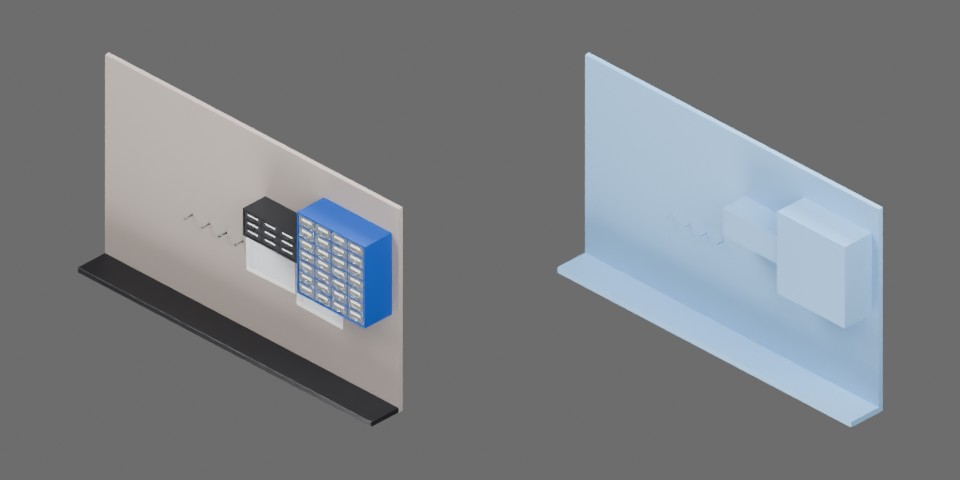

# 工作台背板



立在桌面后沿的暖灰色墙板（1300 × 18 × 750 mm），底部向前伸出 140 mm 深的黑色重型脚轨使其自立；墙上左上为 3 × 3 深灰小零件抽屉柜，右上为 4 列 × 7 行蓝框透明零件抽屉柜（空白标签），中左钉一排四根钢挂钉（Ø6 mm、伸出墙面 34 mm、端头带 Ø9 mm 挡头，高 330 mm，间距约 75 mm），钳子可从两柄之间穿挂在钉上；中部钉两张横线白纸和一条白胶带。总体约 1300 × 141 × 750 mm，质量 12 kg（质心设在脚轨上方偏前偏低）。一个完整刚体，无关节。

```text
bench_backboard
  body [rigid]
    foot_rail
    panel
    papers
    parts_cabinet
    pegs
    small_cabinet
    tape
```
