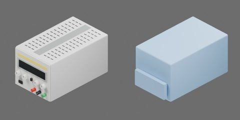

# 直流稳压电源



浅灰色线性直流稳压电源，纵深大于宽度（长边沿 Y），顶面平整、两侧带通风孔、中间为把手凹槽，可放小型模块；前面板有黄色标签条、深色数显窗、4 个旋钮、模式开关、电源开关和红、黑、绿 3 个接线柱（无文字）。外形约 170 × 280 × 150 mm（含旋钮深 293 mm），质量 4.0 kg，尺寸为工程估计。一个完整刚体，无关节。

```text
bench_power_supply
  body [rigid]
    binding_posts
    case
    controls
    front_panel
    vented_top
```
