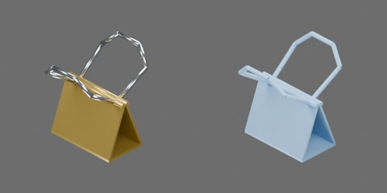

# 金色长尾夹

金色漆面夹体与银色金属环柄，约 22 × 26 × 27 mm（估计，非实测）。夹体底部中心为原点，+X 沿夹口宽度，+Y 朝后夹柄，+Z 朝夹口及伸出的夹柄。

1 个完整刚体，包含折弯夹体、闭合夹口与两只固定环柄；保留侧向空腔和夹柄孔洞，无活动关节。此资产用于闭合状态收纳，不支持张合、折叠夹柄或夹纸；不表示夹紧力、弹性或机器人操作已经验证。

整体移动时选择 `clip` 刚体根；视觉已合为一件，子几何变换锁定，碰撞代理不可单独选择。
