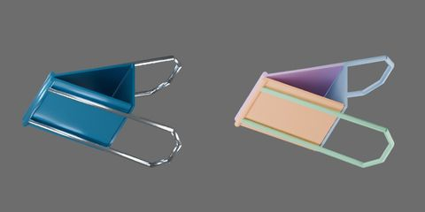

# 大档蓝色长尾夹



夹口宽 41 mm，蓝色漆面与金属线环。保存零位夹口闭合，完整环柄中心线共面、长臂为直段。零位视觉包围盒 X × Y × Z 为 41.000 × 32.327 × 51.279 mm；板厚 0.85 mm、线径 1.80 mm、卷边半径 1.00 mm、背板深度 16.80 mm，背板/夹片间隙 0.40 mm。尺寸均为工程估计。

原点为背板底面中心，+X 沿夹口宽，+Y 指向后夹片，+Z 从背板指向夹口；环柄向 −Z 伸出，整件最低点在原点以下。整体移动选组织根 `binder_clip`，它携带全部刚体、部件、网格和关节锚点；部件/网格变换锁定，碰撞代理不可单独选择。

实际模型有 5 个自由 ACTIVE 刚体、4 个 HINGE；连接为背板 → 两侧夹片 → 各自完整环柄，无闭环、无固定世界刚体。下方是从本款最终 object.blend 导出的父子树，省略网格层；关节连接与组织父子关系分别表示。

```text
binder_clip
  back [rigid]
    plate
  front_handle [rigid]
    wire_loop
  front_jaw [rigid]
    rolled_contact
    sheet
  rear_handle [rigid]
    wire_loop
  rear_jaw [rigid]
    rolled_contact
    sheet
```

所有关节绕约束局部 Z 转动，角度参数单位 rad，保存姿态为 0。正夹片坐标同时张开两侧。锚点为零位资产坐标，单位 mm：

| 关节 | 连接 | 锚点 X / Y / Z | 零位轴向 | 限位 |
|---|---|---|---|---|
| `binder_clip.front_jaw_open` | `binder_clip.back` → `binder_clip.front_jaw` | 0.000 / -8.400 / 1.250 | +X | 0–15° |
| `binder_clip.front_handle_turn` | `binder_clip.front_jaw` → `binder_clip.front_handle` | 0.000 / -2.000 / 30.000 | +X | −30–0° |
| `binder_clip.rear_jaw_open` | `binder_clip.back` → `binder_clip.rear_jaw` | 0.000 / 8.400 / 1.250 | −X | 0–15° |
| `binder_clip.rear_handle_turn` | `binder_clip.rear_jaw` → `binder_clip.rear_handle` | 0.000 / 2.000 / 30.000 | −X | −30–0° |

工作开合仅改变两夹片关节，环柄相对夹片始终为 0°，随夹片一起运动。闭合时整环平面各外倾 15°，两夹片各开 15°时两柄平面与夹体纵向平行；柄端中心间距从 30.527 降到 19.318 mm，夹口净间距从 0 增至 15.455 mm。此间距是网格几何行程，不是实物容量。

`handles.mp4` 闭口依次演示各柄 0 → −30°外摆 → 0；`jaws.mp4` 为夹口侧视往返，`operation.mp4` 为同一开合的立体视角。后两种工作动作都保持柄关节零位；关键帧驱动几何姿态，不模拟按压传力。预览提供六视图、四分之三图及关节端点。

禁碰仅有 front_jaw/front_handle 与 rear_jaw/rear_handle 两个连接刚体对。每个禁碰作用于整对，原因是柄端座合在简化实心卷边内；另外逐侧审查 −30–0°每度及实际预览角度，交集只在线材首尾段与卷边。交点距柄端 X 最多 0.898350 mm、距卷边轴最多 1.000000 mm，未见夹片/长臂交叠；其他刚体对保持碰撞检查。夹体空腔、完整环孔及夹口接触面保留。

刚性夹片铰链近似弹簧钢片弯曲。第一章未验证弹性、按压传力、夹紧力、自动复位、Isaac Play/Stop 或机器人任务；几何采样不保证全部连续姿态。
