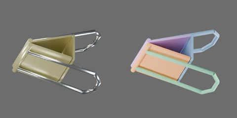

# 迷你档浅黄长尾夹



夹口宽 15 mm，浅黄漆面与金属线环。保存零位夹口闭合，完整环柄中心线共面、长臂为直段。零位视觉包围盒 X × Y × Z 为 15.000 × 12.478 × 18.440 mm；板厚 0.50 mm、线径 0.90 mm、卷边半径 0.55 mm、背板深度 6.10 mm，背板/夹片间隙 0.22 mm。尺寸均为工程估计。

原点为背板底面中心，+X 沿夹口宽，+Y 指向后夹片，+Z 从背板指向夹口；环柄向 −Z 伸出，整件最低点在原点以下。整体移动选组织根 `binder_clip`，它携带全部刚体、部件、网格和关节锚点；部件/网格变换锁定，碰撞代理不可单独选择。

实际模型有 5 个自由 ACTIVE 刚体、4 个 HINGE；连接为背板 → 两侧夹片 → 各自完整环柄，无闭环、无固定世界刚体。下方是从本款最终 object.blend 导出的父子树，省略网格层；关节连接与组织父子关系分别表示。

```text
binder_clip
  back [rigid]
    plate
  front_handle [rigid]
    wire_loop
  front_jaw [rigid]
    rolled_contact
    sheet
  rear_handle [rigid]
    wire_loop
  rear_jaw [rigid]
    rolled_contact
    sheet
```

所有关节绕约束局部 Z 转动，角度参数单位 rad，保存姿态为 0。正夹片坐标同时张开两侧。锚点为零位资产坐标，单位 mm：

| 关节 | 连接 | 锚点 X / Y / Z | 零位轴向 | 限位 |
|---|---|---|---|---|
| `binder_clip.front_jaw_open` | `binder_clip.back` → `binder_clip.front_jaw` | 0.000 / -3.050 / 0.720 | +X | 0–15° |
| `binder_clip.front_handle_turn` | `binder_clip.front_jaw` → `binder_clip.front_handle` | 0.000 / -1.100 / 10.500 | +X | −30–0° |
| `binder_clip.rear_jaw_open` | `binder_clip.back` → `binder_clip.rear_jaw` | 0.000 / 3.050 / 0.720 | −X | 0–15° |
| `binder_clip.rear_handle_turn` | `binder_clip.rear_jaw` → `binder_clip.rear_handle` | 0.000 / 1.100 / 10.500 | −X | −30–0° |

第一章几何预览的工作开合仅改变两夹片关节，环柄相对夹片始终为 0°，随夹片一起运动。闭合时整环平面各外倾 15°，两夹片各开 15°时两柄平面与夹体纵向平行；柄端中心间距从 11.578 降到 7.395 mm，夹口净间距从 0 增至 5.270 mm。此间距是网格几何行程，不是实物容量。

`handles.mp4` 闭口依次演示各柄 0 → −30°外摆 → 0；`jaws.mp4` 为夹口侧视往返，`operation.mp4` 为同一开合的立体视角。后两种工作动作都保持柄关节零位；关键帧驱动几何姿态，不模拟按压传力。预览提供六视图、四分之三图及关节端点。

第一章几何层禁碰仅有 front_jaw/front_handle 与 rear_jaw/rear_handle 两个连接刚体对。每个禁碰作用于整对，原因是柄端座合在简化实心卷边内；另外逐侧审查 −30–0°每度及实际预览角度，交集只在线材首尾段与卷边。交点距柄端 X 最多 0.448725 mm、距卷边轴最多 0.550000 mm，未见夹片/长臂交叠；其他刚体对保持碰撞检查。夹体空腔、完整环孔及夹口接触面保留。

刚性夹片铰链近似弹簧钢片弯曲。第一章未验证弹性、按压传力、夹紧力、自动复位、Isaac Play/Stop 或机器人任务；几何采样不保证全部连续姿态。

## 第二章原生机构与验证范围

`physics.py` 配置自由根 articulation、两夹片被动预载扭簧和完整环柄原有 −30–0° 铰链。柄尾向内加载由 0° 止挡传力，夹片依靠原生接触摩擦保持量规，不需要行为脚本。显式禁碰为两对柄/夹片及两对有间隙的背板/夹片；其他刚体对保留自碰撞。几何、四关节锚点和行程保持第一章版本。

每侧等效扭簧 k=0.025 N·m/rad、c=0.0002 N·m·s/rad，自由角 −5°，实际夹片下限仍 0°。USD 角驱动刚度/阻尼按度换算。总质量估计 2.10862 g：背板 0.35685 g，每夹片 0.65471 g，每柄 0.22117 g。质量由钢密度 7800 kg/m³ 与碰撞实体体积估计，线材/卷边截面修正为圆截面，忽略漆重，保留夹片/卷边局部重叠。惯量/质心由碰撞代理估计，受截面与重叠误差影响。质量、摩擦和弹性参数均未经实物标定。

漆面静/动摩擦 0.35/0.25，环柄 0.30/0.20，恢复系数 0；接触偏移 100 µm、rest offset=0。求解条件为 CPU PhysX/TGS、16/4 迭代、CCD 开。资产加载入口为 `object.usdz`，宿主场景需要自行设置步长。

**本款当前模型已完成下表 13 项实验及完整帧序列、曲线审查。** 4 ms 仅通过自由基础冲量；其余按柄、夹持、释放、单侧加载、整体运动与多实例功能在 1 ms 下通过。本款 4 ms 完整功能未经验收。各尺寸/颜色依据各自证据，基础和功能两类 RTF 分别测量，不合并为同一性能条件。

| 实验 | 状态、外力及观测 | 步长 |
|---|---|---|
| `free_impulse` | 自由整体、零重力 X 向冲量；总动量与关节锚点误差 | 4 ms |
| `press_release` / `handles_outward` | 柄尾各 0→1.5 N、保持、撤力；柄初始 0° / −30°，口隙及四关节响应 | 1 ms |
| `asymmetric_press` / `asymmetric_rear` | 分别只按前柄/后柄；检查两侧独立响应与回闭 | 1 ms |
| `stop_removed_control` | 实验对照中移除柄限位并关闭柄碰撞，隔离止挡作用；只修改测试场景 | 1 ms |
| `gauge_thin` / `gauge_thick` | 0.5/2 mm 理想量规，0.05 N 弱拉保持；持续同一弱拉时按柄释放 | 1 ms |
| `gauge_strong_thin` / `gauge_strong_thick` | 同量规先弱拉，再增至 0.5 N 拔出；柄不加载 | 1 ms |
| `free_eccentric` | 自由夹体，只给前柄尾施加偏心力；动量、旋转和关节整体性 | 1 ms |
| `low_drop` | 重力中侧放低落，无夹具；接触恢复、沉降与锚点误差 | 1 ms |
| `two_instances` | 同款两实例交替按柄；检查分别张口、回闭及无串扰 | 1 ms |

量规为 8.182×厚度×6.818 mm、0.31696 g 的理想刚体，静/动摩擦 0.50/0.40，与夹片平均组合为 0.425/0.325。原生 Z 向导向仅约束横向与转动，不提供轴向驱动/摩擦；−13.636/+8.182 mm 末端在量规离开夹口后接住它。夹持实验固定背板并采用零重力，不代表有重力自由夹纸、多页纸弯曲或机器人抓取已通过。力列记录施加外力，不冒称接触力或夹具反力。

正常双侧按柄各 1.5 N 时开口约 5.075 mm。0.5/2 mm 理想量规在 0.05 N 弱拉下保持，持续同一弱拉时按柄可释放，增大拉力至 0.5 N 可拔脱；夹持接触口隙误差约 57/62 µm。前柄单侧加载时前/后夹片峰值约 14.73/0.00°，后柄单侧加载时约 15.03/14.49°；自由侧可受原生接触带动，单侧响应有方向差异，此模型不提供精确对称的力学标定。

该模型近似钢片弹性，不模拟应力、疲劳、塑性或卷边柔性。本款完成无渲染及含视频两类 RTF、同款多实例、原生停止/显式快照复位/卸载重载检查。最终 USDZ 独立重开与引用加载均为 1 m、Z 向上，几何和原生物理属性已核对。原生 USD 无行为脚本；应用负责停止后的场景复位，未验证 GUI 自动回卷。

构建和实验入口见[第二章教程](../../../../docs/tutorials/02-physics-assets.md)。执行时显式选择本款；例如 `python scripts/assets/physics_test.py assets/objects/binder_clip/000008 --script asset_sources/objects/binder_clip/000008/physics_test.py --gpu 0`，解释器应使用现有 Isaac Sim 5.1 环境。
