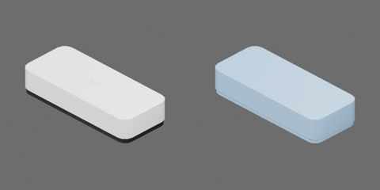

# 白壳黑板擦



白色圆角长方上壳、深色底沿及黑色毡垫外观近似，约 130 × 55 × 25 mm（工程估计）。

上壳、底沿与擦垫合为一个搬运刚体，无关节；不提供擦除或毡垫受压变形功能。原点为擦垫底面中心，+X 为长度、+Y 为宽度、+Z 向上。

从实际模型导出的资产树（省略视觉/碰撞网格）：

```text
board_eraser
  body [rigid]
    felt_pad
    pad_mount
    shell
    shell_print
```

黑色擦垫近似、深色固定底沿、白色上壳和简化印字按材质与功能组织，均随整件运动；擦垫与上壳保留各自接触碰撞面。

## 物理能力与参数

`physics.py` 配置一个 50 g 自由刚体、两个凸碰撞和两种接触材料，无关节或行为脚本。构建后的加载入口为 `object.usdz`；源代码和产物快照依赖同版本 `table_1000` 包。质量按约 25 g 薄 ABS 壳、20 g 底座/支撑、5 g 毡估计，未经实物称量。引擎按现有实心碰撞代理估算质心与惯量，未表示空心壳和低密度毡的真实质量分布。

| 接触部件 | 静摩擦 | 动摩擦 | 恢复系数 |
| --- | ---: | ---: | ---: |
| felt_pad（黑毡面） | 0.70 | 0.55 | 0 |
| shell（壳面及底沿的共用碰撞代理） | 0.35 | 0.25 | 0 |

这些是用于对照实验的工程候选值，接触采用平均组合，不能作为材料实测值。固定印字和底沿没有独立碰撞；壳碰撞覆盖底沿的 1 mm 边界。碰撞接触裕量 0.1 mm、rest offset 为零；线性/角阻尼为零，使用 CPU PhysX/TGS、16/4 迭代与 CCD。

`physics_test.py` 的四项实验使用同款多实例和理想地面（静/动摩擦 0.40/0.30，恢复 0，接触裕量 0.1 mm）：

- `face_friction`：毡面朝下、壳面朝下与不受力对照；相同质心水平力渐增到 0.30 N，1.84 s 完全撤力，比较起滑载荷、速度和停止距离。
- `eccentric_tip`：侧立实例受到高处 0.30 N 偏心推力，1.12 s 撤力，观察推倒与未加载实例的稳定性。
- `drop_faces`：毡面、壳面、侧面最低碰撞点离地 50 mm 自由落放，检查几何穿地和沉降。
- `free_eccentric`：无重力、无地面，两个实例承受相同 +X 冲量（质心/偏心），比较线动量和旋转，并保留未加载实例。

所有力列均为施加的外力，不是接触反力。姿态仅在初始化设置；撤力后继续原生物理运动。实验脚本中的自动断言通过仍需审查视频、曲线和实际性能报告，才能计为验收。

复现命令在仓库根目录运行，解释器和 Blender 环境按[第二章教程](../../../../docs/tutorials/02-physics-assets.md)配置：

```bash
"$ISAAC_PYTHON" scripts/assets/build_physics.py --assets board_eraser/000000 --gpu 0
"$ISAAC_PYTHON" scripts/assets/physics_test.py assets/objects/board_eraser/000000 --gpu 0
```

当前能力用于刚体搬运、朝向接触和推移/落放；不模拟擦除、毡垫压缩、粉尘、磨损或实测冲击恢复。跨资产装填和机器人抓取另行验收。
