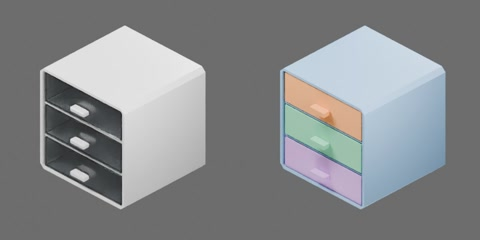

# 三抽屉塑料盒（橡胶脚垫）

## 2026-10-23 总控四环境补证及最终验收

accepted_with_conditions：总控已补齐原三项GPU四环境逐步证据并完成独立验收；四环境原判据通过，env0与旧完整轨迹逐值差0，已有CPU/媒体/三轮性能按原版本保留。当前无返修阻塞，原组可收口。

自由拉柜四环境位移约14.46–15.97cm，均落稳，真实副本差异保留。固定外壳拉动上抽屉时其他抽屉可有约0.507mm短暂开口，不声称严格零漂移。验收仅覆盖原三项实验与所记录输入，未扩展为机器人/装载/组合场景或专门生命周期验收。下方待补证结论为历史。

## 2026-10-23 总控独立审核

总控独立审核已完成：现有三项双后端的env0数值、正式性能及全部媒体通过；GPU其余三环境缺完整轨迹/逐环境判定，不能全量签收。状态needs_supplemental_evidence，后续定向补证由总控协调；原资产对话无需再次审核或全套重跑。



乳白色柜壳带三个半透明抽屉和四个黑色橡胶脚垫，约 286 × 285 × 290 mm。包括四个刚体：外壳及三个抽屉。三个 SLIDER 关节限位均为 [0, 0.173] m，正值沿 −Y 拉出，零位闭合；原点为脚垫落地面中心。

```text
cabinet
  drawer1..3 [rigid]
    bottom
    front
    handle
    rear
    side1..2
  housing [rigid]
    back
    rubber_pad1..4
    shelf1..2
    shell
```

## 物理实测

### 上游参考数据

以下为原 README 随源码保存的上游参考记录，不是本机本轮测量。2026-10-22 追溯未找到可核验其完整输入哈希、三项双后端 result/trace/视频/曲线及正式性能的原始结果；其他组保存的拉抽屉 smoke 仅作链路历史参考，不能替代当前三项验收。原记录声明 Isaac Sim 5.1.0 / Isaac Lab 2.3.2、4 ms、CPU 1 / GPU 4 环境，数值未经实物标定。

| 物理量 | CPU | GPU | 测试与测量方式 |
| --- | --- | --- | --- |
| 抽屉起滑角（drawer1 / 2 / 3） | 18.94° / 18.94° / 18.92° | 16.64° / 16.10° / 15.82° | `gravity_tilt`：夹持外壳，在 15 s 内从水平连续下倾到 45°，取各抽屉相对位移达到 0.5 mm 时的倾角 |

关节轴静摩擦 0.50 N 对应的解析起滑角约 18.6°。GPU 比 CPU 早约 2.5°，原因未定。

性能（3 项测试的范围；RTF 按单个环境计）：

| 后端 | 无渲染 RTF | 含视频 RTF | 本进程 CPU 占用 | GPU 利用率（无渲染 / 含视频） |
| --- | --- | --- | --- | --- |
| CPU，1 个环境 | 0.63–1.13 | 0.37–0.49 | 2.4–3.8 核 | 5–7% / 8–14% |
| GPU，4 个环境 | 0.27–0.45（合计 1.08–1.79） | 0.20–0.28（合计 0.81–1.11） | 1.5–2.1 核 | 26–36% / 24–30% |

测量机器为 AMD EPYC 7542（128 线程）加 RTX 4090，与其他任务共享：1 分钟负载 11–20，每张显卡上共有 4–5 个计算进程（含本进程）。GPU 利用率是整卡数据，包含这些进程。“合计”为所有环境的仿真秒数之和除以墙钟时间。最慢的一项是 `gravity_tilt`。

### 本机本轮实测（2026-10-22）

当前 `TESTS` 仅为 `drawer_slide`、`pull_cabinet`、`gravity_tilt`。本轮使用原几何、质量、材料、关节摩擦、阻尼、载荷和原断言；实际 CPU 1 环境、GPU 4 环境，4 ms 步长。Isaac Sim 5.1.0 rc.19，现有 Isaac Lab 源码 VERSION 2.3.2 / 扩展发行元数据 0.54.3；未证明等同锁定官方 wheel，未安装升级环境。

| 测试 / 物理量 | CPU | GPU | 原始测量来源 |
| --- | --- | --- | --- |
| `drawer_slide` 执行 / 本组功能媒体审核 | completed / 通过 | completed / 通过 | 8 s 完整实验，201 帧、2001 行采样 |
| 初始开度 | 45.0000 mm | 44.9999 mm | `trace.csv` 首行 |
| 撤力后停下开度 | 101.6 mm | 102.0 mm | `summary.json` 的 `rest_opening`；2.104 s 时速度已低于原断言的 0.1 mm/s |
| 全程最小 / 最大开度 | 0.0000554 / 173.000089 mm | −0.0000479 / 173.000540 mm | `result.json` 的 `min_opening` / `max_opening`；数值限位误差小于 0.001 mm |
| `pull_cabinet` 执行 / 本组功能媒体审核 | completed / 通过 | completed / 通过 | 7 s 完整实验，176 帧、1751 行采样 |
| 第三抽屉最大开度 | 173.0 mm | 173.0 mm | `summary.json` 的 `drawer_opening` |
| 柜体位移 | 15.34 cm | 15.88 cm | `summary.json` 的 `housing_travel` |
| 最大地面几何重叠 | 0.000473 mm | 0.000482 mm | `result.json` 的 `ground_contact`；四脚垫全程净空另由碰撞顶点与记录位姿复核，不是接触反力测量 |
| `gravity_tilt` 执行 / 本组功能媒体审核 | completed / 通过 | completed / 通过 | 18 s 完整实验，451 帧、4501 行采样；原 ≥15° 断言通过 |
| 起滑角 drawer1 / 2 / 3 | 18.94° / 18.94° / 18.92° | 16.64° / 16.10° / 15.82° | `summary.json`；相对位移首次达到 0.5 mm 时记录的外壳倾角 |

原始功能结果位于生成目录 `assets/objects/cabinet/000000/physics_test/`：`summary.json`，每后端 `<test>/result.json`、`trace.csv`、`plots.jpg`、`frames/` 与 `<test>.mp4`。本轮输入/依赖哈希、旧证据归档、完整功能副本、逐帧联系表和审核集中在仓库相对路径 `outputs/asset-physics/cabinet-000000/evidence-2026-10-22/`；该路径是本地证据，不随公共源码分发。

本轮独立重开发现原 USDZ 根 stage 的单位/上轴缺失，解析为 0.01 m/Y；旧包先归档，随后仅重打包补为 1 m/Z。所有 authored prim、几何、属性、Schema、关系、解析物理材料及打包 MDL 内容等价，详见 `package-audit.json`；未修改 `object.py`、`physics.py` 或 `physics_test.py`。

实际 CPU 为 TGS、刚体 16/4、CCD 开启；GPU 为 TGS、场景最小 64/16、CCD 关闭。视频实际为 RealTimePathTracing、960 × 480、25 FPS、每次正常采集两次渲染、12 次反弹上限；读回直接光/穹顶光为 2 spp，Kit/TBB 32 线程、PhysX 4 线程、BLAS 1 线程，与规范 1 spp、Kit/TBB 目标 4 有偏差，已报告且未擅改公共框架。

GPU 记录及视频按现有规范取环境 0；`pull_cabinet` 的最终环境间最大位置差为 14.70 mm。它不影响环境 0 的上述位移原始记录，但不能据此宣称四环境轨迹一致；其他环境未保留完整逐步轨迹。起滑角的 CPU/GPU 差异仍未作实物标定或解释为材料真实差异。

本轮正式性能已完成，队列17ae55a366392d01，2026-10-23总控核验三轮及全部新媒体通过。各测试无渲染RTF为三轮中位数，含视频RTF来自同一冻结基准运行；实际共享主机和渲染/线程偏差沿用上文。

| 测试 | CPU1无渲染 | CPU含视频 | GPU4无渲染 | GPU含视频 |
| --- | ---: | ---: | ---: | ---: |
| drawer_slide | 0.983205 | 0.270829 | 0.392764 | 0.186966 |
| pull_cabinet | 1.032795 | 0.269581 | 0.431219 | 0.196667 |
| gravity_tilt | 0.587815 | 0.228246 | 0.253702 | 0.148125 |

GPU其余三环境逐项证据仍未齐全，当前不声明整件完整验收通过。原冻结输入与当前公共渲染/运行器已有差异，旧性能不冒充当前依赖新测量。
