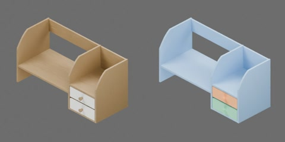

# 双抽屉木制桌面架



棕色木架带后挡板、开缝层架和两个白色面板抽屉，约 874 × 379 × 435 mm，抽屉高 108 mm。包括三个刚体：木架、上抽屉、下抽屉。两个 SLIDER 关节限位均为 [0, 0.208] m，正值沿 −Y 拉出，零位闭合。

```text
cabinet
  drawer1..2 [rigid]
    bottom
    frame
    front
    handle
    rear
    side1..2
  housing [rigid]
    bottom
    cubby_floor
    divider
    drawer_back
    drawer_shelf
    guide1..4
    left_lower_back
    left_upper_rail
    raised_shelf
    right_upper_rail
    side1..2
```

## 场景加载的物理配置

`physics.py` 使用原生 USD/PhysX 为原有几何配置质量、接触材料和求解属性。外壳质量 4 kg、每个抽屉 0.35 kg；静/动摩擦 0.55/0.40，滑轨静/动阻力 0.50/0.35 N，黏性阻尼 3 N·s/m。外壳为可移动 articulation 根，两个抽屉保留原滑轨轴向、限位及禁碰关系，零位关闭，不固定到桌面。

以上质量、摩擦与阻力均为未实物标定的工程估计；质心和惯量由引擎根据碰撞几何估算。通过统一物理构建入口生成 `object.usdz`，不修改几何或 `metadata.json`。本次只核对构建、刚体、关节和材料属性，**未运行第二章 CPU/GPU 单资产物理测试**；场景静置检查不能替代抓取、滑动或完整物理验收。
