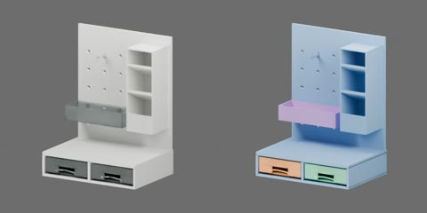

# 洞洞板双抽屉收纳架



白色洞洞板与右侧三层斜格柜、下方平台和抽屉外壳组成一个主体，配透明收纳盒、白色挂钩及两个烟灰透明抽屉。主体约 **320 × 220 × 420 mm**；闭合装配含把手、安装销约 **320 × 233 × 420 mm**。尺寸为工程估计，非实测。

共五个完整刚体组件：`pegboard_cabinet.housing`、`tray`、`hook`、`drawer_left`、`drawer_right`（后四者使用相同前缀）。左右抽屉各通过一个 `SLIDER` 连接主体，行程 **0–170 mm**，正值沿 **−Y** 拉出。收纳盒和钩子以独立直插销组件装配到洞洞板，沿 −Y 拔出；背面安装结构为推定结构。安装销为3×9.6 mm截面、20 mm长，贴合10 mm孔高以限制自重俯仰；孔位和孔口不变，仍沿前后方向插拔，无焊接或永久连接。每个抽屉的盒底、四壁、前板和把手属于同一刚体。

原点为主体底面中心，+X 为宽度，+Y 向后，+Z 向上。

实际模型资产树（省略视觉/碰撞网格；部件均随所属刚体运动）：

```text
pegboard_cabinet
  drawer_left [rigid]
    bin
    handle
  drawer_right [rigid]
    bin
    handle
  hook [rigid]
    crook
    mounting
  housing [rigid]
    back_wall
    bottom
    cubby_base_trim
    cubby_left_wall
    cubby_right_wall
    cubby_shelf1..3
    cubby_top
    divider
    left_wall
    pegboard
    platform
    right_wall
  tray [rigid]
    bin
    mounting
```

洞洞板保留左侧 4 × 5 个原八边形通孔，孔口对边距 10 mm、板厚 8 mm。碰撞以孔间连续实体分块，不封闭闲置孔；三层斜格、两个抽屉及收纳盒保持空腔，把手和安装销随各自刚体移动。

右侧斜柜下方开口净高 **69 mm**：平台顶面 Z=73 mm，前封板和侧板下缘 Z=142 mm。洞洞板顶面由380加高至420 mm，三层斜柜整体上移40 mm；最低/中间/最高斜板前缘分别为189/261/341 mm，柜顶上缘395.5 mm。原三层内腔尺寸与72/80 mm前缘间距保留；斜板由两侧板和延长后的背板承托，原20个孔及托盒、挂钩安装高度不变。视觉与碰撞使用相同尺寸参数。

以下放书专项、动力学实验及性能数据来自加高前的380 mm版本。当前420 mm版本仅更新尺寸、主体质量估计、构建产物和预览，按本次要求不重复专项或动力学测试；历史结果不作为新版本验收。

加高前已使用独立的深蓝小本 `notebook/000001` 原始8个碰撞网格（含束带103×143×21.4 mm）做几何配合检查。书朝向不变，最终原点(104,18,73) mm，向斜柜下方进入88.5 mm，整本位于平台内。前方以1 mm抬高量插入，落座后平台接触，随后抬起退出；229个离散姿态、最大2 mm步长、1 μm穿透容差通过。插入上方净空最小6.6 mm，落座后7.6 mm，距背板7.5 mm。该检查不保证夹爪通过，不是连续碰撞证明或动力学组合通过；书不属于本柜交付内容。

第二章提供原生物理配置及 `TESTS/TestContext` 测试：五刚体、两滑动关节，不含行为脚本。当前主体/左右抽屉/托盒/钩质量为2.76/0.25/0.25/0.16/0.003 kg；主体新增40 mm高、320 mm宽、8 mm厚板材约102.4 mL，以ABS约1050 kg/m³估算增加约0.108 kg，原2.65 kg估计更新为2.76 kg，其余由几何碰撞体积和ABS/PET密度估计，非实物标定；重叠凸体使体积略偏大，惯量由PhysX根据当前几何重新计算。ABS静/动摩擦0.35/0.25，PET 0.32/0.23，恢复系数0；抽屉原生轴静/动阻力0.45/0.32 N，黏性阻尼2.5 N·s/m。接触裕量0.1 mm、CCD开启、TGS 16/4。

物理加载入口为构建后的 `object.usdz`。加高前版本已在4 ms、CPU PhysX/TGS 16/4、CCD开启条件下完成左右抽屉渐拉/撤力、双限位持续受力、自由主体拉动、重力起滑、静置/60 mm落放双实例及附件就位/未就位/偏载/两轮拔出重装的8项验收，均保存视频、CSV、曲线和结果。左右抽屉以0.5 mm位移判据约在0.474 N或10.85°起滑；这些历史结果对应原主体质量2.65 kg及原380 mm几何，不是实物标定。固定主体仅用于抽屉隔离与装配夹具实验，自由拉动实验中主体能随抽屉限位反作用滑移并转向。

直销依靠孔壁接触限制俯仰，适用于正常直立收纳；60 mm落放及大角度倾斜会使附件脱出，不提供抗摔或任意方向保持保证。4 ms落放有约5.54 mm瞬时地面穿透，随后恢复落稳；最后1 s最大地面重叠低于1 μm。两轮附件重装在25 Hz离散几何复查中最大重叠约0.057 mm。

AMD EPYC7542、RTX4090、4个工作线程下，单实例实验的无渲染RTF中位数约0.80–1.07，双实例约0.46–0.47；无渲染各测3轮，每轮至少10 s有效实验。960×480/25FPS含视频RTF约0.29–0.51。当前视频入口实际为2 spp，区别于规范目标1 spp；结果记录了准备、预热、复位成本及共享开发机负载，不能据此作隔离硬件排名。

停止/复位、两个实例及原生USD卸载重载已检查。当前公共混合关节树工具的单体初态/初速/任意保存状态恢复会遗漏独立附件；未就位实验在初始化前通过官方USD API设位，完整状态恢复需同时对托盒和钩使用官方单体 `RigidPrim` API。运行中不写动态资产位姿，无行为脚本或永久附件固定约束。

目标书尚无有效物理资产，真实书组合动力学仍待书组依赖，不计入柜体单资产通过；几何放书检查为加高前版本的历史记录。源码快照依赖同版本 `table_1000` 包。
