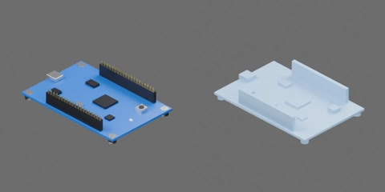

# 蓝色开发板



蓝色单片机开发板，四个 3 mm 黑色支脚，板上有若干芯片、晶振、复位键、两排排针和 USB 接口。PCB 85 × 56 × 1.6 mm，总高约 16 mm。尺寸为工程估计。一个完整刚体，无关节。

```text
circuit_board
  body [rigid]
    chips
    headers
    pcb
    standoffs
    usb
```
