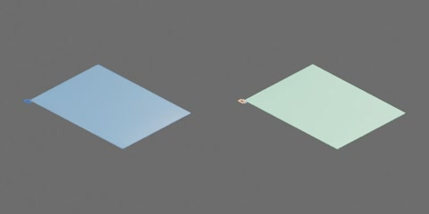

蓝色透明白网格拉链文件袋，采用 A 连续薄袋几何。网格纹路为程序材质，三边连续包边；保留真正张开的袋口、装载内腔和完整拉环孔。照片无标尺，下列尺寸是工程候选，A 方向及示意效果已确认，数值与正式成品外观尚未逐项确认。

袋面外形 340 × 250 mm，每面厚 0.6 mm；空袋膜面包络厚 3 mm，鼓起上限 42 mm，拉头/拉环突出部分另计。袋平放 XY，底面中心为原点，+Z 向上，袋口在 −Y 长边。拉头从 X=−162 mm 沿 +X 移到 +162 mm，行程 324 mm。

实际模型有 **2 个刚体、1 个连续几何归属、1 个原生 HINGE**。以下树从最终 object.blend 的 parent 层级导出并核对，省略网格：

```text
document_bag
  film [deformable]
    lower_film
    lower_zipper_tape
    seam_binding
    upper_film
    upper_zipper_tape
  puller [rigid]
    loop
  slider [rigid]
    housing
```

在 Blender 对象模式中，打开文件后默认选中共同根 `document_bag`；也可在 Outliner 选择该根，再用 G／R 整件平移或旋转。膜面、五金子网格及语义部件的普通位置／旋转／缩放操作已锁定，碰撞代理不可默认单独选取，避免将视觉拖离碰撞。开口与鼓起使用下述合法 controls，拉环使用原生 HINGE；编辑保护保留这些运动，不是物理约束，也不阻止程序强写属性或编辑网格。

`document_bag.unzip` 是 0–0.324 m 的几何控制量；`document_bag.bulge` 是 0–1 的无量纲鼓起量，归属均为 `document_bag.film`。零位是闭合空袋。口部净间距为 `0.040 * min(1, q/0.120) * sin²(πt/q)` m，仅作用于距 −X 起点的已解开区间 `0<t<q`；其余口缘闭合。固定拓扑的采样列跟随 q/2 峰值与 q 封口界，不代表材料点。视觉与 216 个闭合凸代理使用同一曲面；`unzip=0, bulge=1` 保留装载内腔。

`document_bag.puller_swing` 连接 slider 和 puller，绕资产 +X 摆动 −π/3 至 +π/3 rad（±60°）；零位环框平行 XY。环框外形 18 × 12 mm（连接片另计），通孔 12 × 6 mm。原生关节只施加拉环角度，几何回调负责拉头/拉环基准位置及铰轴随动；没有袋面到拉头的虚构 SLIDER。

复杂度为 856 个视觉三角、231 个碰撞块（15 BOX + 216 CONVEX_HULL）。第一章已完成当次公共验收、完整预览及专项封口/装载检查：七类代表件在指定朝向和路线下，闭合与 30 mm 少开阻挡，162/324 mm 开口可通过；九件代表装载可闭口。此结论仅覆盖离散几何采样，不证明任意方向、帧间连续安全或袋面自碰撞。

连续袋面属于第一章几何表示；模型旁 object.py 的回调及同版本 table_1000 包是预览依赖。没有验证柔性质量/受力、拉链保持力、Isaac 选取/拖动/Play/Stop/复位或机器人任务，当前第二章物理导出明确不支持该表示。程序材质无外部纹理依赖。
