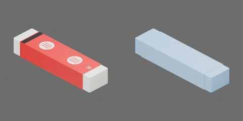

# 红纸套橡皮



白色细长橡皮、红色纸套及简化印花/条码，约 60 × 15 × 10 mm（工程估计）。

橡皮、纸套与印花合为一个搬运刚体，无关节。原点为底面中心，+X 为长度、+Y 为宽度、+Z 向上；纸套不可单独滑脱。

从实际模型导出的资产树（省略视觉/碰撞网格）：

```text
eraser
  body [rigid]
    paper_sleeve
    rubber
    sleeve_print
```

三个部件分别表示固定纸套、橡皮本体及纸套印花；均随整件运动，无独立刚体或关节。

## 物理资产与实验

`physics.py` 提供 `author(geometry_path, output_path)`，通过统一物理构建入口生成
`object.usdz`，可直接加载；没有行为脚本。一个刚体的质量为 0.014 kg：约
8.41 cm³ 橡胶按 1.60 g/cm³，加约 0.484 cm³ 纸套按 0.9 g/cm³，取整至
14 g。质心与惯量由引擎按碰撞形状估算，未按纸/胶密度分别标定。

橡胶静/动摩擦为 0.85/0.70，纸套及印花为 0.45/0.35，恢复系数为 0，
摩擦使用 average 组合。碰撞 contact offset 为 0.05 mm，rest offset 为 0；
刚体无额外线性/角阻尼，16/4 求解迭代，开启 CCD 与 speculative CCD 处理转动接触。以上均为未实测的工程估计。
印花只有视觉网格，不产生独立接触；四个纸套碰撞和一个橡胶碰撞分别继承对应材料。
纸套仅厚 0.2 mm，接触裕量与数值误差可能导致混合纸/胶接触，不能把整件的
起滑载荷当作单一材料摩擦实测。

`physics_test.py` 使用统一 `TESTS/TestContext`，登记四项实验：

| 名称 | 内容 |
| --- | --- |
| `contact_slide` | 平放纸套与端立露胶的渐增质心推力、撤力和停止距离；露胶实例使用实验专用的原生转动导向，三向平移自由，另有未加载端立对照 |
| `free_tip` | 端立露胶、无导向，两实例比较高点推力/撤力与静置，观察自由翻倒 |
| `drop_orientations` | 纸套底/顶、露胶端三朝向，从最低碰撞点高 50 mm 自由落放 |
| `free_impulse` | 零重力下质心/偏心等冲量及闲置实例对照，核对线动量与转动 |

导向夹具只用于实验，不随资产分发，也不代表资产可以自由端立滑动。实验不在积分中
写资产位姿；记录的是施加外力，不是接触或夹具反力。当前 USD 重开、四项受力诊断、完整诊断视频/曲线查看、2 ms 步长对照及
停止/复位/实例隔离已完成；正式实验及两类 RTF 尚待独占测量窗口。
端立冷启动存在约 2.2 mm 水平沉降，静置 0.5 s 后再核对控制实例的加载期漂移；
当前不支持初始端立位置保持在 0.5 mm 内。4 ms 下 50 mm 落放的峰值几何穿地约
1.01 mm，2 ms 约 0.67 mm，不能宣称亚毫米接触精度。参数不适用于预测真实冲击、橡胶压缩或擦除效果；
机器人抓取及与其他资产的组合整理另行验收。
