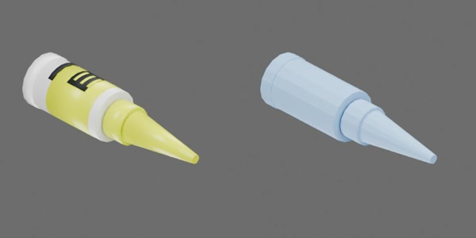

# 尖嘴胶水

## 2026-10-22 总控独立验收（柜体与尖嘴胶水）

accepted_with_conditions：CPU1/GPU4各五项、全部环境轨迹、原生reset/两次真实重载、四项三轮性能与媒体独立核对完成。接受推倒2ms、落放1ms、其余4ms的限定工况；保留旧失败、小穿透裕量、CPU余转、工程估计和共享主机条件。无需重复入队。

本次独立审查既有原始证据，未重新仿真或测性能。原队列状态只代表历史执行状态；本段覆盖下文历史自审/待审结论。



白色小瓶、黄色标签和尖嘴瓶盖，约 25 × 25 × 95 mm。

整体为一个刚体。

```text
glue
  bottle [rigid]
    base_rim
    container
    label_band
    label_block
    label_print1..3
    label_stripe
    neck
    nozzle_cap
    screw_collar
```

## 场景加载的物理配置

`physics.py` 使用原生 USD/PhysX 为原有几何配置质量、接触材料和求解属性。整件刚体质量 20 g，静/动摩擦 0.45/0.35、恢复系数 0。保留整体刚体结构，不新增开盖、挤胶或涂抹能力。

以上质量、摩擦与阻力均为未实物标定的工程估计；质心和惯量由引擎根据碰撞几何估算。通过统一物理构建入口生成 `object.usdz`，不修改几何或 `metadata.json`。

## 物理实测

测试程序为 `physics_test.py`。瓶盖与瓶身属于同一刚体；测试不包含旋盖、拔帽、挤胶、流体、粘接或涂抹。CPU为1环境，GPU为4环境并逐环境判定。除注明的步长对照外，积分步长4 ms、TGS；CPU CCD开启，GPU按PhysX限制关闭。读回质量约20 g、COM z=30.397 mm、横向惯量8.7006e-6 kg·m²、轴向惯量1.2091e-6 kg·m²；原生角阻尼0.05 s⁻¹、线阻尼0。推力试验以底沿面法线施力，避开多边形顶点偏航；落放每款实例空间分隔，全部轨迹额外验证碰撞体包围盒间距。

数值取自 `physics_test/summary.json`，未标定仿真值：

| 测试量 | CPU | GPU | 步长与条件 |
| --- | ---: | ---: | --- |
| 低位推力起滑力 | 0.07274 N | 0.07994–0.08246 N（4环境） | 2 ms，8 mm作用高；名义 μs·mg=0.08829 N |
| 低位推后滑移 | 209.4 mm | 176.9–188.1 mm（4环境） | 2 ms，力逐渐增至0.11 N并撤除 |
| 高位推力峰值倾角 | 101.2° | 101.1–101.4°（4环境） | 2 ms，75 mm作用高、峰力0.06 N；明确倾倒 |
| 直立组最大几何穿透 | 1.418 mm | 1.427 mm | 2 ms，门槛1.5 mm |
| 侧卧双向施力后最大穿透 | 0.174 mm | 0.235 mm | 4 ms；接触部件形状引发滚动/摇摆，撤力后滚动衰减，未加滚阻 |
| 侧卧组撤力后最大末态角速 | 1.392 rad/s | 0.0531 rad/s | 4 ms，观察至2 s；CPU余转仍可测，不能按迅速停止解读 |
| 四方向落放最大几何穿透 | 0.779 mm | 0.492 mm | 1 ms，10 mm最低碰撞点高度 |
| 尖嘴朝下尖嘴最低间隙 | -0.153 mm | -0.212 mm（最差环境） | 1 ms；负值为尖嘴碰撞几何最大穿透，尖嘴确实接触，整体倾倒允许 |
| 偏心脉冲最大线动量误差 | 4.02e-12 kg·m/s | 1.27e-9 kg·m/s（4环境） | 4 ms，零重力、0.004 N × 0.04 s |
| 偏心脉冲末态角速 | 0.1811 rad/s | 0.1812 rad/s | 4 ms；偏心10 mm，按每步世界惯量及阻尼积分 |
| 原生重置及真实卸载/重载 | 两轮 | 两轮（4环境） | 4 ms；最大状态误差<1.6e-8，兄弟实例卸载期间持续匀速 |

推力对照的闲置实例峰值附加位移约0.0003 mm（CPU）及0.0002 mm（GPU），处于数值噪声量级；受载与闲置互相隔离。GPU推力起滑阈值在4环境间相差约2.5 mN，已逐环境记录。失败的4 ms推倒/落放及侧卧顶点方向诊断保留在专属 `outputs/asset-physics/glue-000000/history/`，本表只列通过合同的最终方向与步长；4 ms尖锐倾倒的实测瞬时穿透超过1.5 mm，所以推倒和落放采用经对照的2 ms与1 ms，未更改物性、载荷或门槛。较细步长结果不可冒充4 ms标准条件。

**正式性能**（队列 `d768455f4ef3ea96`，RTF中位数；4环境吞吐为4×GPU RTF）：

| 测试/步长 | CPU1 无渲染 RTF | CPU含视频 RTF | GPU4 无渲染 RTF | GPU含视频 RTF | GPU4吞吐 env·s/s |
| --- | ---: | ---: | ---: | ---: | ---: |
| upright_push_tip / 2 ms | 0.3272 | 0.1613 | 0.1614 | 0.1062 | 0.6456 |
| side_roll_release / 4 ms | 0.5042 | 0.2026 | 0.2593 | 0.1426 | 1.0374 |
| drop_orientations / 1 ms | 0.1368 | 0.0934 | 0.0633 | 0.0503 | 0.2533 |
| free_eccentric / 4 ms | 0.6899 | 0.2129 | 0.3181 | 0.1400 | 1.2724 |

每个后端每项测量三轮，每轮实际积分10或12秒；短实验用独立完整重放达到10秒，没有追加静置。逐轮RTF、预热、复位和端到端时间见性能队列冻结结果。运行CPU资源槽为32–38/96–102（PhysX目标4，BLAS/OMP目标1）；225个约10秒间隔样本中主机1分钟load average为20.1–46.6、均值30.4。GPU2平均利用率约7%（峰28%）、显存平均7970 MiB（峰12222 MiB）；另有GPU1平均2.8%、峰43%，两卡负载均包含其他进程。视频实测本进程CPU均值约1.3–1.6核，整机CPU均值约26.9–44.6%。故这是明确竞争负载的共享主机结果，不能称独占性能。GPU4代表同一资产4环境并行，不同步为单环境结果。

这四项性能使用各自功能合同的步长；1/2 ms项不属于4 ms标准步长性能对照。GPU与CPU基准均为同一软件/主机上的共享条件测量。所有结果为 Isaac Sim 5.1.0、AMD EPYC 7542、RTX 4090上的未标定仿真值，不外推为独占主机性能或实物参数。冻结运行后本README才增加上述实测值；队列输入清单中README哈希与运行前版本相符，测试源码哈希及USD哈希与功能证据一致。
