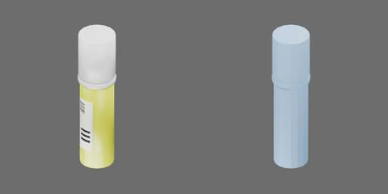

# 黄色固体胶



黄色圆筒胶棒、白色盖和纸质标签，约 28 × 28 × 107 mm。

整体为一个刚体。

```text
glue
  stick [rigid]
    barcode_line1..6
    cap
    cap_rim
    container
    label
    label_print1..3
    shoulder
```

## 场景加载的物理配置

`physics.py` 使用原生 USD/PhysX 为原有几何配置质量、接触材料和求解属性。整件刚体质量 25 g，静/动摩擦 0.45/0.35、恢复系数 0。保留整体刚体结构，不新增开盖、挤胶或涂抹能力。

以上质量、摩擦与阻力均为未实物标定的工程估计；质心和惯量由引擎根据碰撞几何估算。通过统一物理构建入口生成 `object.usdz`。本轮只增加独立实验，不改变几何、质量、材料、UUID、整体刚体结构或资产求解属性。拔盖、旋出胶芯、涂胶和粘接均未建模。

## 第二章实验

`physics_test.py` 导出五项 `TESTS`，导入不启动仿真。运行方法见[物理资产教程](../../../../docs/tutorials/02-physics-assets.md)，资产参数为 `--assets glue/000001`。CPU 使用 1 环境，GPU 使用 4 环境；每环境各自读取原生状态并判定，视频仅展示 env0。全部实验自由运动，无夹具；积分中不写位姿。力列是施加的外力，不是支持反力。

| 实验 | 状态对照和输入 | 每环境实例数 | CPU 步长/求解器 | GPU 步长/求解器 |
| --- | --- | --- | --- | --- |
| upright_push_tip | 底面落座；8 mm 低位推移、90 mm 高位推倒、闲置；有限加载并撤除 | 3 | 1 ms / TGS | 2 ms / PGS |
| side_roll_release | 侧卧横向、轴向、斜向有限加载及闲置，1 s 后撤力 | 4 | 4 ms / TGS | 4 ms / TGS |
| drop_orientations | 底面、盖端、侧面、斜向，碰撞最低点离地 50 mm，自由落放 | 4 | 2 ms / TGS | 2 ms / PGS |
| free_eccentric | 零重力中心力、偏心 6 mm 力脉冲及闲置，检查线/角动量 | 3 | 4 ms / TGS | 4 ms / TGS |
| lifecycle_reset_reload | 同 Stage 原生 stop/reset、真正移除全部目标副本再引用，闲置兄弟始终保留，三段重复受力 | 2 | 4 ms / TGS | 4 ms / TGS |

接触地面静/动摩擦 0.45/0.35、恢复 0、接触裕量 0.1 mm。CPU 刚体 16/4 迭代、CCD 开；GPU 场景迭代下限 64/16、CCD 关，TGS 每迭代施加外力开，PGS 关。实际值逐项写入 `result.json/conditions`。

默认 4 ms 已真实验证：高位倾倒撞地几何穿透 CPU 3.691 mm、GPU 至少 3.940 mm，超过原 1.5 mm 门槛；CPU 2 ms 倾倒仍有 1.893 mm 穿透。GPU TGS 的直立落放在 4/2/1 ms 均出现持续角摆动，单纯缩步长未消除。表中细步长及 PGS 是保留原高度、姿态、材料和判据后的有限条件结果，**不代表 4 ms/TGS 已通过，也不是 CPU/GPU 同条件比较**。这些分项设置需由组合场景统一选择并复验。

低位制动按实际 COM 与底面支撑区设计：质量 25 g、底面半径 12.5 mm，COM 高 56.4495 mm，横向惯量约 2.41427×10⁻⁵、轴向惯量约 2.04729×10⁻⁶ kg·m²。0.115 N 加载后保留 0.075 N 平缓制动段，2.4 s 完全撤力；瞬间撤力会把滑动制动与静态倾倒阈值混在一起。默认角阻尼 0.05 s⁻¹、线阻尼 0，未临时添加滚阻。

盖半径 13.6 mm、盖沿 14 mm、筒身 12.5 mm；侧卧最终由盖沿和筒身共同支撑，白盖端相对离地约 0.45 mm。滚动包含转向及轴线摆动，不按理想圆柱要求直线或规定迅速停止。几何最低顶点的接触点速度仅用于估算滚滑关系，不是接触传感器。

## 物理实测

2026-10-22，Isaac Sim 5.1.0 rc.19 / PhysX；Isaac Lab 2.3.2 源码可编辑环境、扩展发行元数据 0.54.3，未证明等同锁定的 2.3.2.post1 wheel。以下为未标定仿真值，取自 `physics_test/summary.json` 及各项 `result.json/experiment`，GPU 汇总所有环境的保守值。

| 量 | CPU | GPU | 来源与方式 |
| --- | --- | --- | --- |
| 低位起动推力 | 0.1008 N | 0.1099 N | upright，横向速度 >5 mm/s 且位移 >0.2 mm |
| 低位滑移 | 54.41 mm | 最大 31.58 mm | upright，刚体原点 X 范围，撤力后落稳 |
| 高位峰值倾角 | 93.36° | 各环境最小 90.11° | upright，局部 Z 轴与世界竖直夹角 |
| upright 最大几何穿透 | 0.4313 mm | 0.8316 mm | 全实例/环境碰撞顶点最低值 |
| 横向加载峰值滚转角速 | 36.28 rad/s | 各环境最小 37.19 rad/s | side_roll，角速投影到筒轴 |
| 撤力后轴线摆动范围 | 0.6866° | 最大 0.9705° | side_roll，筒轴仰角范围 |
| side_roll 最大几何穿透 | 0.3660 mm | 0.4428 mm | 全实例/环境碰撞顶点最低值 |
| 四朝向落放最大穿透 | 0.2237 mm | 0.5961 mm | drop，原 50 mm 高度 |
| 落放最大几何离地反弹 | 0.09796 mm | 0.008401 mm | drop，首撞后最低点高度 |
| 最大线动量相对误差 | 0.00002229% | 0.001976% | free，逐步积分实际外力 |
| 最大角动量相对误差 | 0.01936% | 0.0006537% | free，实际 COM 世界力矩积分，保留原角阻尼 |
| 复位/重载初态及重复响应最大标量差 | 0 | 0 | lifecycle，全部环境原生变换/速度张量比较 |

五项双后端功能与完整媒体已核对。部件、盖和筒身保持同一刚体，相对结构不变；生命周期每物理步仅一次回调，三段完整视频保留。尚未验证 GUI、机器人抓取、组合场景或实物标定；整章签收由独立验收另行判定。

## 性能

CPU1使用2026-10-22原正式批次四项有效结果，GPU4于2026-10-23独立补测四项完成。两批均采用统一 `--benchmark`：三轮各至少10 s，无渲染与含视频分开，生命周期不计入。CPU/GPU分别归属真实冻结依赖和负载，不作为同次、同条件对比。旧GPU OOM失败和诊断部分轮次原样保留。

| 测试 | CPU 无渲染三轮RTF（中位数） | CPU含视频RTF | GPU4 无渲染三轮RTF（中位数） | GPU含视频RTF | GPU总吞吐 env·s/s |
| --- | --- | --- | --- | --- | --- |
| upright_push_tip | 0.09868–0.10433（0.09929） | 0.07562 | 0.18035–0.18838（0.18431） | 0.11744 | 0.73725 |
| side_roll_release | 0.34950–0.64426（0.42303） | 0.22365 | 0.24691–0.25828（0.25583） | 0.13554 | 1.02331 |
| drop_orientations | 0.35692–0.39688（0.37839） | 0.17375 | 0.15626–0.15973（0.15945） | 0.09512 | 0.63781 |
| free_eccentric | 0.43504–0.48815（0.46508） | 0.17557 | 0.32033–0.37218（0.33226） | 0.16995 | 1.32906 |

两后端各三轮物理时长依次10.2/12/12/10.4 s，每轮完整独立重复3/5/4/13次；偏心短实验预热2次/1.6 s，其他实验预热1次完整过程，未追加静置尾部。八项新旧完整轨迹逐值差0，各轮无渲染与录像末态差0；GPU四环境分别读回并复核原判据。CPU/GPU正式媒体各244帧完整解码、全部编号联系表及曲线已审，upright原取景限制由下述独立补拍补证。

CPU每轮准备/复位成本（upright/side/drop/free）3.09–4.48/6.79–9.02/2.92–3.14/12.80–14.34 s；GPU为3.38–3.47/5.76–5.81/4.68–5.03/15.82–16.51 s，均不计入RTF推进成本。进程启动CPU46.91 s/GPU32.20 s，视频场景构建及初始化另列于各result的preparation。

机器为EPYC 7542与RTX 4090共享主机。两批均绑14个逻辑CPU，PhysX目标4、BLAS1，Kit tasking/TBB线程池32，进程实查最多268/269线程，不能称全进程仅4线程。CPU旧批主机CPU各实验平均35.7–97.1%、峰值99.9%，设备显存峰值24080 MiB。GPU新批启动设备空闲24071 MiB、无已知外部资产进程，测量设备显存最高8504 MiB；主机CPU负载仍变化，不称严格独占或跨后端同条件基准。

| 测试 | CPU进程平均核数 无渲染/视频 | CPU批设备GPU平均利用率 无渲染/视频 | GPU批进程平均核数 无渲染/视频 | GPU批设备平均利用率 无渲染/视频 |
| --- | --- | --- | --- | --- |
| upright_push_tip | 1.44/1.30 | 4.54/19.89% | 1.32/1.32 | 11.17/9.80% |
| side_roll_release | 1.64/1.27 | 11.93/6.43% | 1.25/1.33 | 11.12/8.42% |
| drop_orientations | 2.25/1.46 | 10.01/18.36% | 1.28/1.29 | 10.46/8.42% |
| free_eccentric | 1.48/1.16 | 26.09/23.47% | 1.28/1.52 | 7.02/9.17% |

GPU新批无渲染主机CPU各项平均3.33/3.06/3.24/33.27%、峰值99.9%；视频平均3.35/3.52/7.28/33.11%。GPU利用率/显存为设备级读数，包含潜在外部负载；RTF必须按实际物理及各批竞争条件解释。

更新：2026-10-23；组内ready_for_controller_review，待总控独立验收及步长/PGS例外评估。

upright原录像闲置对照的白盖顶部与字幕栏重叠，保留原始媒体与性能后只将相机焦距32改28，定向在线补拍CPU1/GPU4。新172帧完整审查通过，原数值全轨迹差0，物理与判据未变；补拍含视频RTF CPU0.14063/GPU0.11283，属于另次功能媒体运行，不是新三轮无渲染基准，也不冒充原批性能录像。
