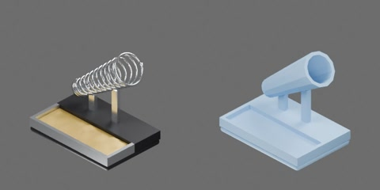

# 烙铁架



烙铁架：黑色配重底座，前部黄铜丝清洁槽，后部斜向上 37° 的镀铬弹簧筒，`soldering_iron/000000` 可尖端朝下插入。约 110 × 75 × 99 mm。1 个刚体，无关节。

```text
iron_holder
  body [rigid]
    base
    bracket
    brass_wool
    coil
    end_cup
    pocket
```
