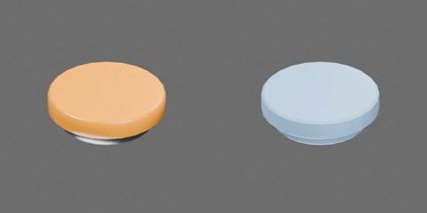

# 橙色磁扣



橙色圆形塑料罩和深灰磁性底座组成 **1 个完整刚体**，无独立活动组件、关节或限位。
外径 25 mm，底座直径 20 mm；保留已有几何的实际总厚度约 7.45 mm（原标称估计为 9 mm，未经实测）。
原点为底面中心，+Z 朝塑料罩，X/Y 为径向。磁吸采用下述工程近似；各实验的执行和媒体验收状态分别记录。

资产树（由模型实际层级导出，省略网格）：

```text
magnet
  body [rigid]
    magnetic_base
    plastic_cap
```

## 物理属性与加载

使用 `object.usda` 加载整个资产目录，保留旁置 `behavior.py` 与同版本 `table_1000` 包；
官方 Python Scripting 组件需启用。`object.usdz` 仅含几何和原生接触属性，不包含可执行磁力。
一个刚体总质量8g（继承工程估计，未称重），质心/惯量由两碰撞代理自动估算；
底座静/动摩擦0.40/0.30，塑料罩0.35/0.25，平均组合，恢复0，接触裕量0.1mm。
CPU PhysX/TGS、16/4迭代、CCD开启；普通接触、自由冲量及无接触磁力对照使用4ms。20mm低落采用2ms，
原4ms诊断瞬时穿地约1.347mm、超过1mm接受上限；2ms正式实验约0.719mm。结果不代表实物冲击精度。

默认磁矩为本体+Z方向0.035A·m²，作用点在底面上方2mm。三色同极性：
同轴罩—底相吸，同极底—底或罩—罩相斥；自由磁扣也可受力转向。
采用2mm软化磁偶极势能，25–35mm中心距平滑截断；成对施加力及双方力矩。
近场是有效工程近似，不能用来鉴定极性、磁牌号或预测真实拉脱力。

仅明确标记 `table1000:magnet:steelHalfExtents`（本地XY半宽，m）的有限钢板面受吸附；
其本地XY平面为表面、+Z为外法向。磁扣与钢板按米制、单位缩放加载；动态钢板的标记放在
表示该表面的单一刚体根节点，标记坐标系与刚体坐标系一致。非单位缩放和复合多面目标未验证。
底座九点分布法向吸力，上限1N、2mm衰减尺度、
6–8mm间隙截断；磁面与板外法向夹角达到60°时为零，罩背向无吸力，边缘1mm平滑减弱。
普通地面或金属视觉材质不自动受磁。动态板受反作用力；竖直保持依赖正常接触摩擦，
没有磁吸固定关节、位姿吸附或速度清零。每件每步只选择一个有效的最近钢板面，
不支持双面夹持或多个钢板合成磁场。该板模型与磁扣对模型是两种独立近似，均未实测标定。

钢板释放、同轴互吸、拔离、再吸附、剪切和多件接触实验使用2ms；偏转互吸使用1ms。
偏转互吸的2ms对照曾在单个积分采样出现约1.477mm重叠，1ms正式实验约0.317mm；
原2ms结果保留为步长敏感性证据，不用25FPS画面推断积分步内的接触精度。
最终表示的4ms对照中，竖直剪切和拔离的完整碰撞体分别穿入约1.277/1.135mm，
超过0.5mm判据；2ms正式实验分别约0.196/0.319mm。不能把本资产全部功能称为4ms通过。
磁矩中心距小于3mm会报模型域错误，不能用软化力掩盖严重几何重叠。

磁性接触实验把场景的原生摩擦锚点合并距离设为0.1mm；自由反作用检查需要此设置：

```python
from pxr import PhysxSchema
PhysxSchema.PhysxSceneAPI.Apply(scene_prim).CreateFrictionCorrelationDistanceAttr(0.0001)
```

`scene_prim` 是使用方已有的物理场景。默认25mm合并距离大于本接触斑，偏心自由钢板试验的
角动量漂移约2.52e-5kg·m²/s；最终表示0.1mm时约2.73e-8，满足原5e-7判据。
资产行为不擅自修改全场景设置；两者都保留原摩擦系数和2ms步长。
默认锚点下同轴互吸也曾超过角动量判据；本组磁性接触统一使用0.1mm。
使用方应把该设置用于相应小尺寸接触场景。

碰撞Mesh在物理层使用局部点坐标×100和逆局部缩放0.01，凸包顶点上限128，
以改善PhysX对毫米级倒角的烘焙精度；世界顶点与原几何差小于1nm，外形和拓扑不变。
实际烘焙凸包仍是近似，不把输入96点等同于引擎保留96点。原默认烘焙中存在静置倾斜及
外缘误差；最终检查使用所有输入碰撞顶点和每个物理采样，不以刚体原点代替完整几何。

## 验证与生命周期

本款15项正式数值实验已完成，完整视频帧和关注曲线已逐项实际审查通过；
每项分别保留三轮无渲染RTF及独立视频端到端RTF、实际环境与准备成本。
当前仍缺最终版本的可见GUI验收，整体交付状态尚未就绪。

`physics_test.py` 登记15项实验：普通接触与撤力、自由质心/偏心冲量、三朝向低落、
钢板距离/方向/识别对照、释放吸附、竖直剪切、法向/边缘拔离并回送再吸附、
磁扣互吸/排斥/超范围/转向/拔离再吸附、自由钢板反作用、三活跃加一闲置实例、
以及两磁扣吸附同一钢板。回送使用明确的原生弹性夹具，只移动关节目标；
自由释放保留当时位姿与速度。外力记录不代表接触或夹具反力。
强剪切爬升目标为0.50N，滑移3mm或到期即撤力，实际峰值写入结果。

钢板实验另记录九点间隙、力和方向/边缘/截断因子；只读诊断指向最近的显式标记面，
实际总磁力还可能包含磁扣之间的作用。不同ID的三色配对单列组合验证，不计入单款验收。

已检查官方组件的无界面独立目录加载、同名叶节点多实例、暂停/继续、停止/复位和卸载重载。
增删刚体或钢板采用“停止 → 装卸 → 复位 → 继续”；运行中直接改刚体拓扑会使PhysX张量视图失效，
不支持热装卸。钢板列表在开始/继续播放时重新发现。可见GUI窗口加载仍待具备可呈现窗口的环境复核。

在仓库根目录使用已有Isaac Sim环境运行（解释器路径由使用方提供）：

```bash
python scripts/assets/physics_test.py assets/objects/magnet/ID --gpu 0
```

把`ID`替换为本目录编号。统一入口生成完整MP4、CSV、关注曲线及两类RTF；
`execution_status=completed`只表示运行完成，实际媒体审查另写`review_status`。
质量、磁力与接触均为工程估计，数值通过不代表实物标定或机器人组合任务通过。
