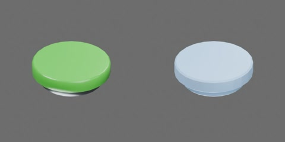

# 绿色磁扣



绿色圆形塑料罩和深灰磁性底座组成 **1 个完整刚体**，无独立活动组件、关节或限位。
外径 25 mm，底座直径 20 mm；保留已有几何的实际总厚度约 7.45 mm（原标称估计为 9 mm，未经实测）。
原点为底面中心，+Z 朝塑料罩，X/Y 为径向。磁扣名称描述物品类型，未实现磁吸行为。

资产树（由模型实际层级导出，省略网格）：

```text
magnet
  body [rigid]
    magnetic_base
    plastic_cap
```
