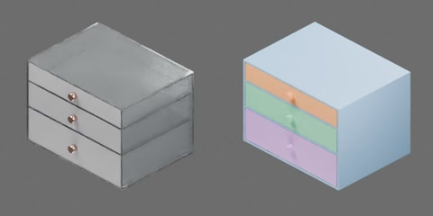

# 透明亚克力三抽屉化妆收纳柜



透明亚克力柜体，三个深度递增的抽屉（开口高 50、68、90 mm），磨砂前板和玫瑰金圆拉钮，四个透明硅胶脚垫；320 × 240 × 230 mm。包括四个刚体：柜体及三个抽屉。三个 SLIDER 关节 `makeup_organizer.drawer1..3.slide` 限位均为 [0, 170 mm]，正值沿 −Y 拉出，零位闭合；原点为脚垫落地面中心，+X 宽度、+Y 进深、+Z 向上。

```text
makeup_organizer
  drawer1..3 [rigid]
    bottom
    front
    handle
    rear
    side1..2
  housing [rigid]
    back
    bottom
    foot1..4
    shelf1..2
    side1..2
    top
```

## 物理实测

Isaac Sim 5.1.0，CPU PhysX，4 ms 步长，单环境；未标定的仿真值。测试见 `physics_test.py`（通用实现 `table_1000/physics/drawer_tests.py`）。

| 测试 | 结果（CPU） |
| --- | --- |
| `drawer_slide`：固定柜体，0.8 N 拉第一个抽屉后松手，再以 2 N 推拉 | 松手后停在 101.8 mm；2 N 拉到 170 mm 限位、推回 0 mm |
| `pull_unit`：柜体放在地面上，拉力逐渐加到 8 N 拉底层抽屉 | 抽屉拉到底后柜体被拉动 3.7 cm |
| `gravity_tilt`：夹住柜体从水平前倾到 45° | 三个抽屉起滑角约 20.3° |
