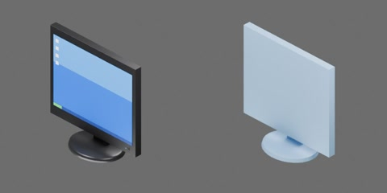

# 19 英寸液晶显示器



4:3 黑色窄边框液晶显示器：屏幕显示亮蓝色桌面（上部浅蓝带、左上几个白色图标、底部深蓝任务栏和绿色开始按钮），后壳收窄，黑色立柱和扁平椭圆底座，右下角有电源键和蓝色指示灯。外形约 420 × 180 × 420 mm（底座 220 × 180 mm），质量 3.5 kg，质心设在底座上方以免前倾，尺寸为工程估计。一个完整刚体，无关节。

```text
monitor
  body [rigid]
    housing
    screen
    stand
```
