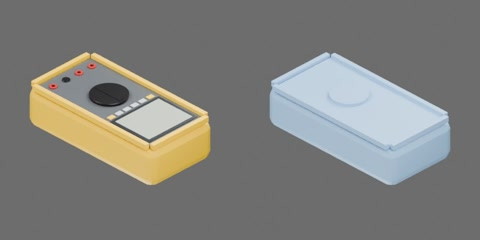

# 黄色护套台式数字万用表



平放、面板朝上的台式数字万用表：黄色橡胶护套和凸起围边，深灰面板上有灰色液晶屏、一排按键、黑色旋钮和四个红黑表笔插孔。外形 185 × 92 × 52 mm。尺寸为工程估计。一个完整刚体，无关节。

```text
multimeter
  body [rigid]
    buttons
    dial
    display
    face
    holster
    jacks
```
