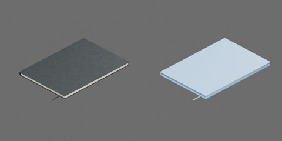

# 深灰黑大幅闭合笔记本



斑纹封面、浅色内收页块和固定书签。闭合本体约 210 × 297 × 12 mm，整体最大长度约 332 mm。尺寸为工程估计。
封面、页块、书脊和书签组成 1 个完整刚体，0 关节；保持闭合，不支持翻页、开合或附件变形。
原点在本体底面中心，+X 指向书口、+Y 沿书脊、+Z 朝上封面，书脊在 −X。

实际模型层级（省略网格层，部件均随整本固定）：

```text
notebook
  closed [rigid]
    bookmark
    cover_bottom
    cover_top
    page_edge_detail
    pages
    spine
```

## 物理能力与实验

`physics.py` 为单刚体配置640 g工程估计质量：页块表观密度800 kg/m³、封面1100 kg/m³；页块458.2 g+两封面164.7 g≈622.8 g，计入固定附件/胶层余量取640 g。未实测克重/页数，质心与惯量由碰撞几何均匀分布推算。

静/动摩擦候选为封面与书脊0.55/0.40、页块0.45/0.30、固定织物0.65/0.50，恢复系数0，平均组合；碰撞contact offset 0.05 mm、rest offset 0，CCD与speculative CCD开启，16/4求解迭代，线/角阻尼0。均未经实物标定。

生成后的无行为加载入口为`object.usdz`，保留同目录构建快照。`physics_test.py`覆盖正反/短边朝下推移撤力、50 mm落放、自由侧立倾倒、同款偏置堆叠及无重力质心/偏心冲量。推移侧立对照使用仅锁转动的原生D6夹具；堆叠下层固定仅用于隔离层间滑动。其他实验无夹具，不在运动中写入资产位姿。

推移、落放和自由冲量采用4 ms步长；倾倒4 ms几何穿地超2 mm，采用2 ms；三层堆叠在4/2 ms末速波动超10 mm/s，采用1 ms。两项为明确单列的步长例外，不能作为4 ms标准基准结果。侧立时封面边缘可能先于内收页块接触，朝向对照不是纯封面/页边摩擦系数测量。封面、页块和附件始终固定，不支持翻页、开合、束带变形、跨ID堆叠或整叠搬运验收。诊断运行完成不等于正式验收，视频/曲线及两类RTF需分别审查。
