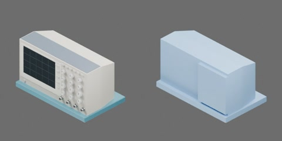

# 台式数字示波器



米白色机壳的台式数字示波器，顶部深灰色盖板，前面板左侧为深色屏幕（淡网格线）和一列菜单键，右侧为一排小按键、12 个灰色旋钮和底部 4 个 BNC 接口；整机立在一块青蓝色平底座板上（同一刚体）。外形约 340 × 200 × 190 mm（机壳 330 × 150 × 170 mm，座板厚 20 mm），质量 3.0 kg，尺寸为工程估计。一个完整刚体，无关节。

```text
oscilloscope
  body [rigid]
    base_plate
    bnc
    case
    controls
    display
```
