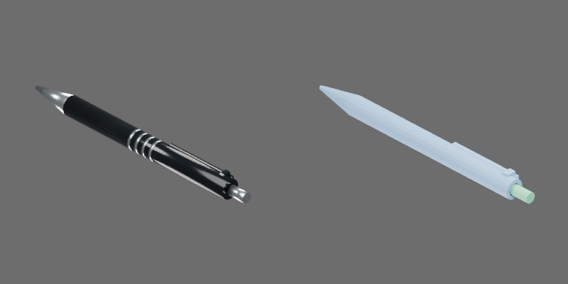

# 黑色按动圆珠笔



黑色漆面笔杆、银色鼻锥与握环，约 149 × 13 × 14 mm。

笔壳、按钮、笔芯为三个独立刚体；button_press与refill_slide沿局部X，限位均为[−0.003, 0]m，负值朝笔尖方向。只缩短隐藏芯尾留净空，外形与笔尖行程保留。

```text
pen
  button [rigid]
    button
  refill [rigid]
    shaft
    tip
  shell [rigid]
    barrel
    clip
    clip_bridge
    grip_band1..4
    nose
```


`button_press`连接壳与按钮，`refill_slide`连接壳与芯。原生自由基座Articulation保留自碰撞，两对直接相连刚体禁碰；第一章另检查独立滑块九姿态的所有刚体对，不以禁碰代替净空核查。

## 按动近似与加载

官方行为组件读取真实按钮关节位移：压至−2.7mm后置为待切换，回到−0.3mm以内时只切换一次芯Drive的0/−3mm目标。持续长按不重复切换，浅按不触发；行为不写动态位姿或速度。暂停续播保留状态，停止复位回到根属性`table1000:click:initialExtended`指定的初态（默认收芯）。该属性是布尔值；需要默认出芯时在播放前设置为true，芯由有限力Drive移动到出芯端。

这是位置触发的双状态工程近似，不模拟真实棘轮；不承诺任意冲击防误触。按钮和芯均通过有限力原生Drive向笔壳传递反作用。按钮刚度300N/m、阻尼0.08N·s/m、最大力2N；芯800N/m、0.15N·s/m、最大力3N。质量为壳10g、按钮1g、芯2g，总质量与原两体模型相同；质心和惯量按碰撞体积估算。参数均未经实物标定。

塑料静/动摩擦0.35/0.30，金属鼻锥、按钮与笔尖0.20/0.15（银色握环仅视觉）；本款无橡胶握部；平均组合，恢复系数0，接触裕量0.1mm、rest offset为0，无附加刚体线性/角阻尼。按动实验使用CPU PhysX/TGS、16/4迭代、CCD开、1ms；加载方需设置世界步长，USD不会替调用方改变世界时钟。

按[第二章教程](../../../../docs/tutorials/02-physics-assets.md)显式选择本ID构建。带行为资产须加载整个产物目录中的`object.usda`，保留旁置`object.usdz`和`behavior.py`，并启用官方Python Scripting组件。单独加载USDZ只包含原生几何/质量/Drive，不能完成状态切换。需要同版本`table_1000`包；三个笔组共享模块分别负责几何、属性和实验，不另建加载器。

## 实验范围

`physics_test.py`包含收芯和出芯初态的完整按放/长按/浅按/第二次按放、自由0.02N按钮加载撤力及闲置第二实例、最低点20mm和20°俯仰的低落。按压循环使用理想笔壳固定夹具和1.2N完整按压、0.3N浅按；自由受力低于触发力，用于整体反作用与动量核对，不代表自由手持按动。低落记录实际最终状态，不外推真实冲击或误触阈值。

三体模型已逐项完成正式实验、完整视频/曲线审查、两类RTF及独立官方GUI/无界面便携加载与生命周期检查。停止后编辑/卸载刚体，再reset恢复；不支持仿真中直接改变刚体拓扑。

|实验|无渲染RTF（三轮中位）|含视频RTF|
|---|---:|---:|
|click_cycles|0.230991|0.175248|
|initial_extended|0.224256|0.156225|
|free_press|0.137760|0.114807|
|low_drop|0.242257|0.180686|

短实验独立复位重复累计每轮至少10s，含行为、动作、状态读取和采样成本；视频960×480/25FPS。实际RTX RT2采样为direct2/dome2/TAA8，非严格1spp；各独立无渲染和视频终态差异见报告。质量、驱动及冲击均非实物标定，不把单款验收称为机器人场景完成。
