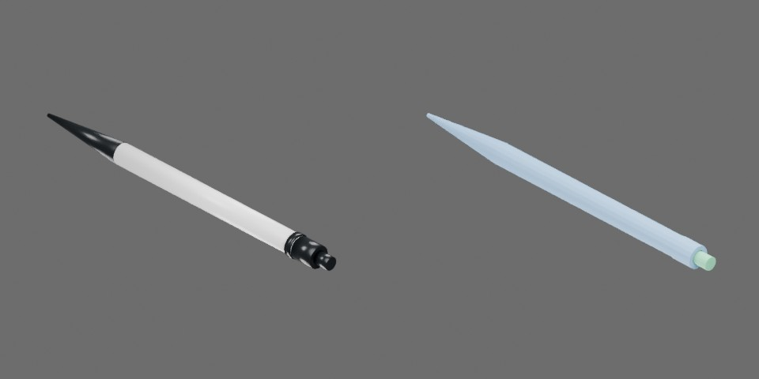

# 白黑色按动圆珠笔



白色笔杆、黑色后壳与长鼻锥，约 162 × 11 × 11 mm。

笔壳、按钮、笔芯为三个独立刚体；button_press与refill_slide沿局部X，限位均为[−0.003, 0]m，负值朝笔尖方向。只缩短隐藏芯尾留净空，外形与笔尖行程保留。

```text
pen
  button [rigid]
    button
  refill [rigid]
    shaft
    tip
  shell [rigid]
    barrel
    nose
    rear_housing
    shoulder
```


`button_press`连接壳与按钮，`refill_slide`连接壳与芯。原生自由基座Articulation保留自碰撞，两对直接相连刚体禁碰；第一章另检查独立滑块九姿态的所有刚体对，不以禁碰代替净空核查。

## 按动近似与加载

官方行为组件读取真实按钮关节位移：压至−2.7mm后置为待切换，回到−0.3mm以内时只切换一次芯Drive的0/−3mm目标。持续长按不重复切换，浅按不触发；行为不写动态位姿或速度。暂停续播保留状态，停止复位回到根属性`table1000:click:initialExtended`指定的初态（默认收芯）。该属性是布尔值；需要默认出芯时在播放前设置为true，芯由有限力Drive移动到出芯端。

这是位置触发的双状态工程近似，不模拟真实棘轮；不承诺任意冲击防误触。按钮和芯均通过有限力原生Drive向笔壳传递反作用。按钮刚度300N/m、阻尼0.08N·s/m、最大力2N；芯800N/m、0.15N·s/m、最大力3N。质量为壳6g、按钮0.4g、芯1.6g，总质量与原两体模型相同；质心和惯量按碰撞体积估算。参数均未经实物标定。

塑料静/动摩擦0.35/0.30，金属笔尖0.20/0.15；本款无橡胶握部；平均组合，恢复系数0，接触裕量0.1mm、rest offset为0，无附加刚体线性/角阻尼。按动实验使用CPU PhysX/TGS、16/4迭代、CCD开、1ms；加载方需设置世界步长，USD不会替调用方改变世界时钟。

按[第二章教程](../../../../docs/tutorials/02-physics-assets.md)显式选择本ID构建。带行为资产须加载整个产物目录中的`object.usda`，保留旁置`object.usdz`和`behavior.py`，并启用官方Python Scripting组件。单独加载USDZ只包含原生几何/质量/Drive，不能完成状态切换。需要同版本`table_1000`包；三个笔组共享模块分别负责几何、属性和实验，不另建加载器。

## 实验范围

`physics_test.py`包含收芯和出芯初态的完整按放/长按/浅按/第二次按放、自由0.02N按钮加载撤力及闲置第二实例、最低点20mm和20°俯仰的低落。按压循环使用理想笔壳固定夹具和1.2N完整按压、0.3N浅按；自由受力低于触发力，用于整体反作用与动量核对，不代表自由手持按动。低落记录实际最终状态，不外推真实冲击或误触阈值。

三体模型已逐项完成正式实验、完整视频/曲线审查、两类RTF及独立官方GUI/无界面便携加载与生命周期检查。停止后编辑/卸载刚体，再reset恢复；不支持仿真中直接改变刚体拓扑。

历史CPU候选数据仅供追溯；当前性能见后文。

|实验|无渲染RTF（三轮中位）|含视频RTF|
|---|---:|---:|
|click_cycles|0.230716|0.176488|
|initial_extended|0.230845|0.169010|
|free_press|0.137450|0.115374|
|low_drop|0.233172|0.168523|

短实验独立复位重复累计每轮至少10s，含行为、动作、状态读取和采样成本；视频960×480/25FPS。实际RTX RT2采样为direct2/dome2/TAA8，非严格1spp；各独立无渲染和视频终态差异见报告。质量、驱动及冲击均非实物标定，不把单款验收称为机器人场景完成。

### 2026-10-22 框架/GPU复验

新版四项正式合同的CPU1/GPU4均completed并由笔组审查完整媒体。点击循环两种初态均观察到完整压放、长按不重复、浅按不触发、第二次压放恢复初态；每个GPU环境计数均为2。自由0.02N受力相对动量误差CPU 1.90e-6、GPU各环境最大1.11e-6，闲置实例速度为0，未触发状态切换。低落穿地CPU 0.405mm、GPU最大0.990mm（2mm限值内），落地后稳定且保持收芯。全部648帧（CPU/GPU各324）按序查看，八条完整曲线已审；全景下按钮位移不显著，3mm行程及状态切换依曲线确认。组审查记录：`outputs/asset-physics/pen/framework-gpu-2026-10-22/media-review/000001-click-contract-review.json`。

独立异载荷状态隔离和官方行为生命周期另行completed：CPU1/GPU4均验证，GPU环境0/2对1.2N各切换一次，环境1/3受0.3N保持不切换；闲置peer为0次。生命周期暂停续播、stop/reset、卸载重载和同名实例通过，状态误差0；其媒体记录见同目录`000001-lifecycle-review.json`。这些诊断不计入四项合同的RTF。

带盖框架复验输入/历史证据快照、失败结果及运行器跟进详见`outputs/asset-physics/pen/framework-gpu-2026-10-22/RESULTS.md`。CPU复验依据是夹具初始化声明、运行期张量接口、采样与适配路径均已变化，历史CPU结果不能复用。四项正式benchmark已入统一队列`077bf853475a4ab4`，已实测完成且新媒体组审查通过；总控审核待完成。该工程近似不模拟真实棘轮，也不承诺任意冲击下防误触；行为位置阈值、Drive参数、质量和接触参数未经实物标定。
### 2026-10-23 正式性能与媒体复核

四项CPU1/GPU4稳态按动合同均完成正式三轮无渲染测量，每项独立预热≥1s、每轮≥10s；生命周期和隔离仍单列。8段新视频共648帧已完整审阅，全部曲线/CSV与已审功能结果逐字节一致，逐轮所有实例/环境末态与录像末态差0。本组审核通过，待总控独立验收。

| 测试 | CPU无渲染/含视频RTF | GPU无渲染/含视频RTF |
|---|---|---|
| 完整按放切换 | 0.213820 / 0.131934 | 0.092326 / 0.071913 |
| 初始出芯 | 0.219868 / 0.134115 | 0.093047 / 0.072651 |
| 自由反作用 | 0.135725 / 0.094345 | 0.067536 / 0.055140 |
| 低落 | 0.222307 / 0.134178 | 0.110379 / 0.082520 |

Isaac Sim 5.1，1ms；CPU TGS、场景最小迭代1/0、CCD开启；GPU前三项TGS、低落PGS，场景最小64/16、CCD关闭。刚体/关节树自身迭代与场景最小值不同，实际配置以result为准。共享主机RTX4090、GPU2、CPU绑核7个物理核及其SMT同胞，PhysX4线程、BLAS1线程；测量期本进程CPU均值约1.27–2.45核，GPU设备利用率均值约0.09–31.10%，不称独占空闲基准。

本批使用队列冻结版本，CPU含视频RTF对应后续Fabric同步补丁之前的渲染路径，不能冒充当前CPU Fabric路径的计时；无渲染CPU和GPU路径未受该补丁改变。完整新证据与条件：`outputs/asset-physics/pen/framework-gpu-2026-10-22/media-review/benchmark-2026-10-23/000001-review.json`。原始测量在统一队列`077bf853475a4ab4`的冻结资产目录，未重复入队。

### 当前物理实测指标

Isaac Sim 5.1，CPU1/GPU4，未经实物标定。数值来自当前summary中的metrics；“各环境最大”按指标原口径，动量误差为env0，全部环境另有补充审计。

| 物理量 | CPU1 | GPU4 | 来源测试 / 指标 |
|---|---:|---:|---|
| 各环境按放状态切换次数 (1) | 2 | 2 | click_cycles / toggle_count |
| 各环境按放状态切换次数 (1) | 2 | 2 | initial_extended / toggle_count |
| 各环境按放状态切换次数 (1) | 0 | 0 | free_press / toggle_count |
| 各环境最大瞬时几何穿地 (mm) | 0.4048482 | 0.9900036 | low_drop / penetration |

状态切换次数取完整两次按放；低落和小自由载荷都未发生切换。
