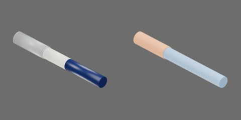

# 蓝色钢珠卡扣粗笔



蓝色连续笔杆带浅色标签和半透明笔帽，约 179 × 20 × 20 mm。笔身、帽壳和三颗内部钢球，共 **5 个物理刚体**。帽沿 −X 拔出；三球通过径向滑动关节连接帽壳，行程 0–0.8 mm。球仅在碰撞预览显示。

原生钢珠弹簧卡扣；参数为未标定工程代理。

```text
body [rigid]
  barrel
  detent_ridge
  label
  neck
  tip
cap [rigid]
  end
  lip
  shell
cap_ball1..3 [rigid]
  ball
```
