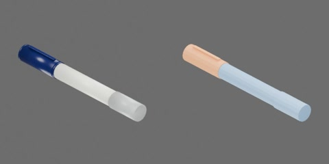

# 红色粗笔



红色粗笔带浅色标签和半透明笔帽，闭合约 179 × 20 × 20 mm。笔身、半透明空心笔帽和3个内部球形卡扣从动件，共5个刚体。从动件各以径向SLIDER连接笔帽，笔身与笔帽可完全分离。−X 朝笔尖和拔帽方向。

```text
body [rigid]
  detent_ridge
  barrel
  label
  neck
  tip
cap [rigid]
  end
  lip
  shell
cap_ball1..3 [rigid]
  ball
```

## 第二章物理能力

内部卡扣采用原生球形接触、颈部环形凸棱、有限径向行程和弹簧 Drive。保持、脱开与再次盖合均由接触求解，不需要行为脚本或测试夹具维持连接。保留外形与空腔，仅扩大隐藏帽口内部净空并添加内部机构。帽沿−X拔出；从动件沿各自关节局部+X向外，限位[0, 0.0006]m。

|参数|工程取值|
|---|---:|
|笔身 / 帽壳质量|12 / 3 g|
|从动件数量 / 半径|3 / 0.6 mm|
|每个从动件有效质量|0.421875 g|
|径向弹簧刚度 / 阻尼|600 N/m / 0.225 N·s/m|
|向内驱动目标（预压）|−0.1 mm|
|凸棱或斜坡高度|0.3375 mm|

从动件质量是约同尺寸实钢球60倍的有效惯量代理，按半径立方缩放；不是实钢密度。质量、弹簧和摩擦均未实物标定，质心/惯量由碰撞体积估算。塑料静/动摩擦0.35/0.30，球为金属接触0.20/0.15；平均组合、零恢复，contact offset 0.1mm/rest offset 0；无额外刚体线性/角阻尼。小接触采用1ms、TGS位置/速度迭代32/8、每体CCD开，稳定阈值0、最大去穿透速度1m/s；应单列于4ms、16/4标准条件之外。加载本新盖时应将仿真世界物理步长设为1ms；导入USDZ本身不会修改世界步长，不能把4ms视为已验收的等价条件。

凸体在USD中将局部顶点放大100倍并以原生形状缩放0.01补偿，世界尺寸不变，避免PhysX固定烘焙容差删除亚毫米凸棱。该设置随资产分发，不依赖全局烘焙参数；Blender仍为米单位原网格。

`physics_test.py` 提供六项独立实验：`pull_comparison`（紧/松渐拉、完全分离后接住放稳）、`close`（轻推停位、加力座合、撤去帽夹具）、`gravity_rotation`（只夹笔身翻转）、`cycles`（连续三次拔插，无状态复位）、`free_reaction`（自由帽受力、笔身反作用及闲置实例）、`low_drop`（最低点20mm落放与稳定）。正式候选已逐项完成三轮无渲染与独立视频测量及完整媒体审查；正式目录重建后的等价核对另行留证。

当前渐拉协议下紧/松帽完全分离末次外力约0.6393/0.049N；0.15N弱拉保持。轻推0.04N停在凸棱前，座合末次施力约0.5026N，撤去帽载荷和夹具后开口约0.03386mm。动态末次施力不是准静态实测拔力或接触反力。拉拔导向期间轴向刚度/阻尼为0，完全分离后才接住；盖合导向轴向阻尼10N·s/m，座合后释放。

能力限于正确朝向、低速引导装配、紧松保持差异和宏观低落。不能预测真实塑料变形、精确冲击载荷或真实脱帽高度；错向不自动吸正，跨ID换帽与机器人整理任务另行验收。正式RTF采用实际RTX RT2采样设置，非严格1spp；视频Actions栏只列计划动作，自定义加载回调以applied_force_x和曲线为准。

按[第二章教程](../../../../docs/tutorials/02-physics-assets.md)显式选择本ID构建，加载产物目录的 `object.usdz`。`object.py` / `physics.py` / `physics_test.py` 分别保留逐款几何、质量和实验协议参数，共享实现来自同版本 `table_1000.modeling.pen_detents`、`table_1000.physics.pen_assets`、`table_1000.physics.pen_tests`；源码快照重建依赖同版本包。身份字段不扩展。

### 历史CPU候选性能（旧框架，仅供追溯）

Isaac Sim 5.1 rc.19，CPU PhysX/TGS；EPYC7542，RTX4090用于渲染，Kit/PhysX线程目标4，实效OMP/BLAS线程池1（进程环境OPENBLAS_NUM_THREADS=4，测量区间threadpoolctl实效限制为1）。无渲染三轮各累计至少10s并取中位；视频960×480/25FPS、RTX RT2 direct2/dome2/TAA8，非严格1spp。启动/加载/预热/复位成本单列于原始结果。

|实验|无渲染RTF中位|含视频RTF|
|---|---:|---:|
|pull_comparison|0.131668|0.109394|
|close|0.227172|0.177424|
|gravity_rotation|0.124870|0.106912|
|cycles|0.228836|0.179367|
|free_reaction|0.129842|0.102622|
|low_drop|0.227267|0.176720|

各项独立无渲染与视频终态最大标量差0；仅适用于上述协议和数值条件。

### 2026-10-23 定向修复与当前结果

六项正式合同CPU1/GPU4均completed，完整媒体和曲线已由本组审查，待总控独立验收。旧TGS自由反作用首步异常及拉拔尾窗失败原证据保留，未覆盖为通过。free_reaction初态始终为座合帽，0.2s后才加0.02N外力。

自由反作用仅GPU采用用户批准的PGS、关闭每迭代重复外力，保留1ms、场景64/16、刚体32/8与全部原断言。其余GPU合同低落沿用原PGS，另外四项保持TGS；GPU场景CCD关闭，CPU TGS、scene1/0、CCD开。此前简写“32/8、CCD开”仅对应资产设置，不能代表GPU场景。参数均为未经实物标定的工程估计。

拉拔中，原生夹具只在既有1.2s下降段按帽碰撞凸包与COM旋转到最近稳定支撑面（约11.25°），再按原时刻释放。原2.4s稳定段、0.5s尾窗、0.01m/s及1mm门槛保留；没有运行期写资产位姿、改变几何/质量/材料/卡扣/载荷。此修正处理整个帽在棱上延迟滚动，不是给帽球添加阻尼。拉拔双后端重新测试，自由反作用仅GPU换求解器，CPU同合同已复测且调用路径无改变；close/翻转/循环/低落按输入与调用路径无影响复用本轮新版证据。

全套当前原始结果位于`assets/objects/pen/000003/physics_test/`；逐环境检查、媒体审核与历史输入索引见`outputs/asset-physics/pen/framework-gpu-2026-10-22/media-review/000003-complete-review.json`。正式性能已由统一队列冻结版本测量，见下表，功能录像RTF不充作正式无渲染性能。PGS是数值workaround，未定位PhysX内部故障。

本轮关键实测（Isaac Sim 5.1，未经实物标定）：

| 物理量 | CPU1 | GPU4（聚合口径见指标） | 来源 |
|---|---:|---:|---|
| 紧帽分离末施加载荷 (N) | 0.4446667 | 0.663 | pull_comparison / tight_pull |
| 松帽分离末施加载荷 (N) | 0.049 | 0.04933333 | pull_comparison / loose_pull |
| 撤力后开口 (mm) | 0.03438222 | 0.0372805 | close / released_opening |
| 紧帽全程最大开口 (mm) | 0.2056353 | 0.1729968 | gravity_rotation / held_opening |
| 完整拔插次数 (1) | 3 | 3 | cycles / cycles |
| 动量相对误差（env0） (1) | 1.063027e-05 | 5.686639e-07 | free_reaction / momentum_error |
| 最大几何穿地 (mm) | 0.4048368 | 0.4048182 | low_drop / penetration |

历史GPU失败及中断原始证据保留在本轮结果索引的`before/`与`runs/`，不计为当前通过。旧接触查询只覆盖env0；以初始化后四环境接触库存为准。逆环境位置诊断没有实际改变view初态，不能作为排除位置因素的依据。

正式性能任务`790b81cb2468ca90`已完成，本次12片新视频、曲线、四环境数据、三轮/预热/所有repeat末态已组审。前述旧候选CPU性能仅供追溯；功能、媒体及本次冻结性能均组审通过，总控独立验收尚未完成。

### 当前框架正式性能

Isaac Sim 5.1.0 rc.19，CPU1/GPU4，1ms，GPU求解器按上文逐项保留。RTX4090物理GPU2，EPYC7542；CPU亲和性32–38/96–102，PhysX目标4、BLAS实效1。共享主机，有其他卡任务，非严格整机空闲或独占基准。视频960×480/25FPS、RTX RT2 direct2/dome2/TAA8，非严格1spp；CPU使用当前Fabric同步路径。无渲染完整实验预热≥1s，三轮各累计≥10s，短实验用全新独立场景重复；准备/复位成本在原result单列。

|实验|CPU无渲染RTF中位|CPU含视频RTF|GPU无渲染RTF中位|GPU含视频RTF|
|---|---:|---:|---:|---:|
|pull_comparison|0.075237|0.065830|0.025872|0.023354|
|close|0.126916|0.101334|0.038161|0.033042|
|gravity_rotation|0.074024|0.066440|0.024063|0.022246|
|cycles|0.132039|0.103619|0.039382|0.035033|
|free_reaction|0.107747|0.085970|0.044668|0.038361|
|low_drop|0.185129|0.130198|0.066628|0.049295|

GPU RTF按单环境仿真时长计，合计吞吐为RTF×4。GPU pull含视频计时包含一次SIGUSR1线程栈诊断开销；三轮无渲染均在该信号前完成。所有测试每轮每repeat全部记录末态与新录像末态最大标量差0，CSV/曲线与已审功能逐字节相同。

|后端/区间|本进程CPU核数均值范围|整机CPU均值范围 (%)|整卡GPU利用率均值范围 (%)|整卡显存均值范围 (MiB)|
|---|---:|---:|---:|---:|
|isaac-cpu/无渲染|1.508–2.175|3.941–11.677|0.019–0.186|3192.000–6303.974|
|isaac-cpu/含视频|1.466–1.842|3.468–11.588|1.112–2.558|3190.041–6906.144|
|isaac-gpu/无渲染|1.151–1.255|3.198–22.053|19.053–43.057|5376.527–8973.621|
|isaac-gpu/含视频|1.163–1.245|4.217–32.723|17.647–39.533|6761.019–9754.024|

利用率/显存是整卡采样，计算进程数按原采样器原值保留；本机nvidia-smi曾把同一worker PID重复列两行，不能把原count=2直接等同两个独立竞争任务。各项极值、准备成本及连续负载采样见原result.performance和队列resources.jsonl。原始性能目录为`outputs/asset-physics/coordinator-benchmarks/790b81cb2468ca90/`，完整组审索引为本组`media-review/benchmark-followup-2026-10-23/000003/review-all.json`。

GPU低落三轮无渲染RTF分别0.066875、0.066628、0.058514，存在轮次波动，全部保留；本批是共享主机实测，不作为严格空闲条件下的性能排名依据。
