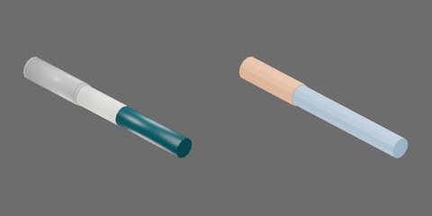

# 深青色直液式白板笔



深青色笔杆、浅色标签和半透明空心笔帽，闭合179×20×20mm。

笔身 `body`、空心笔帽 `cap` 和3个内部球形卡扣从动件，共5个刚体。笔身与笔帽可完全分离；每个从动件以原生径向 SLIDER 连到笔帽。−X朝笔尖及拔帽方向。

## 资产树

从当前 `object.blend` 实际父子关系导出，省略视觉/碰撞网格。部件随所属刚体运动。

```text
body [rigid]
  detent_ridge
  barrel
  label
  neck
  tip
cap [rigid]
  end
  lip
  shell
cap_ball1..3 [rigid]
  ball
```

## 第二章物理能力

内部卡扣采用原生球形接触、颈部环形凸棱、有限径向行程和弹簧 Drive。保持、脱开与再次盖合均由接触求解，不需要行为脚本或测试夹具维持连接。保留外形与空腔，仅扩大隐藏帽口内部净空并添加内部机构。帽沿−X拔出；从动件沿各自关节局部+X向外，限位[0, 0.0006]m。

|参数|工程取值|
|---|---:|
|笔身 / 帽壳质量|12 / 3 g|
|从动件数量 / 半径|3 / 0.6 mm|
|每个从动件有效质量|0.421875 g|
|径向弹簧刚度 / 阻尼|600 N/m / 0.225 N·s/m|
|向内驱动目标（预压）|−0.1 mm|
|凸棱或斜坡高度|0.3375 mm|

从动件质量是约同尺寸实钢球60倍的有效惯量代理，按半径立方缩放；不是实钢密度。质量、弹簧和摩擦均未实物标定，质心/惯量由碰撞体积估算。塑料静/动摩擦0.35/0.30，球为金属接触0.20/0.15；平均组合、零恢复，contact offset 0.1mm/rest offset 0；无额外刚体线性/角阻尼。小接触采用1ms、TGS位置/速度迭代32/8、每体CCD开，稳定阈值0、最大去穿透速度1m/s；应单列于4ms、16/4标准条件之外。加载本新盖时应将仿真世界物理步长设为1ms；导入USDZ本身不会修改世界步长，不能把4ms视为已验收的等价条件。

凸体在USD中将局部顶点放大100倍并以原生形状缩放0.01补偿，世界尺寸不变，避免PhysX固定烘焙容差删除亚毫米凸棱。该设置随资产分发，不依赖全局烘焙参数；Blender仍为米单位原网格。

`physics_test.py` 提供六项独立实验：`pull_comparison`（紧/松渐拉、完全分离后接住放稳）、`close`（轻推停位、加力座合、撤去帽夹具）、`gravity_rotation`（只夹笔身翻转）、`cycles`（连续三次拔插，无状态复位）、`free_reaction`（自由帽受力、笔身反作用及闲置实例）、`low_drop`（最低点20mm落放与稳定）。正式候选已逐项完成三轮无渲染与独立视频测量及完整媒体审查；正式目录重建后的等价核对另行留证。

当前渐拉协议下紧/松帽完全分离末次外力约0.6397/0.049N；0.15N弱拉保持。轻推0.04N停在凸棱前，座合末次施力约0.5045N，撤去帽载荷和夹具后开口约0.05063mm。动态末次施力不是准静态实测拔力或接触反力。拉拔导向期间轴向刚度/阻尼为0，完全分离后才接住；盖合导向轴向阻尼10N·s/m，座合后释放。

能力限于正确朝向、低速引导装配、紧松保持差异和宏观低落。不能预测真实塑料变形、精确冲击载荷或真实脱帽高度；错向不自动吸正，跨ID换帽与机器人整理任务另行验收。正式RTF采用实际RTX RT2采样设置，非严格1spp；视频Actions栏只列计划动作，自定义加载回调以applied_force_x和曲线为准。

按[第二章教程](../../../../docs/tutorials/02-physics-assets.md)显式选择本ID构建，加载产物目录的 `object.usdz`。`object.py` / `physics.py` / `physics_test.py` 分别保留逐款几何、质量和实验协议参数，共享实现来自同版本 `table_1000.modeling.pen_detents`、`table_1000.physics.pen_assets`、`table_1000.physics.pen_tests`；源码快照重建依赖同版本包。身份字段不扩展。

### 正式候选性能记录

Isaac Sim 5.1 rc.19，CPU PhysX/TGS；EPYC7542，RTX4090用于渲染，Kit/PhysX线程目标4、OMP/BLAS1。无渲染三轮各累计至少10s并取中位；视频为960×480/25FPS、RTX RT2 direct2/dome2/TAA8，非严格1spp。启动/加载/预热/复位成本单列于原始结果，不计入无渲染积分区间。

|实验|无渲染RTF中位|含视频RTF|
|---|---:|---:|
|pull_comparison|0.131512|0.113159|
|close|0.230015|0.176199|
|gravity_rotation|0.126884|0.108312|
|cycles|0.230062|0.176520|
|free_reaction|0.133092|0.111209|
|low_drop|0.229896|0.176037|

各项独立无渲染与视频终态最大标量差0；这些结果仅适用于上述协议和数值条件。
