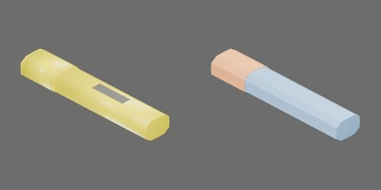

# 黄色短扁身荧光笔



黄色短扁身、凿形笔尖与同色空心笔帽，闭合110×22×15mm。

笔身 `body`、空心笔帽 `cap` 和4个内部球形卡扣从动件，共6个刚体。笔身与笔帽可完全分离；每个从动件以原生径向 SLIDER 连到笔帽。−X朝笔尖及拔帽方向。

## 资产树

从当前 `object.blend` 实际父子关系导出，省略视觉/碰撞网格。部件随所属刚体运动。

```text
body [rigid]
  detent_ramp1..4
  barrel
  label
  neck
  tip
cap [rigid]
  end
  lip
  shell
cap_ball1..4 [rigid]
  ball
```

## 第二章物理能力

内部卡扣采用原生球形接触、颈部4个局部斜坡、有限径向行程和弹簧 Drive。保持、脱开与再次盖合均由接触求解，不需要行为脚本或测试夹具维持连接。保留外形与空腔，仅扩大隐藏帽口内部净空并添加内部机构。帽沿−X拔出；从动件沿各自关节局部+X向外，限位[0, 0.00045]m。

|参数|工程取值|
|---|---:|
|笔身 / 帽壳质量|11 / 3 g|
|从动件数量 / 半径|4 / 0.45 mm|
|每个从动件有效质量|0.177979 g|
|径向弹簧刚度 / 阻尼|984.375 N/m / 0.16875 N·s/m|
|向内驱动目标（预压）|−0.16875 mm|
|凸棱或斜坡高度|0.253125 mm|

从动件质量是约同尺寸实钢球60倍的有效惯量代理，按半径立方缩放；不是实钢密度。质量、弹簧和摩擦均未实物标定，质心/惯量由碰撞体积估算。塑料静/动摩擦0.35/0.30，球为金属接触0.20/0.15；平均组合、零恢复，contact offset 0.1mm/rest offset 0；无额外刚体线性/角阻尼。小接触采用1ms、TGS位置/速度迭代32/8、每体CCD开，稳定阈值0、最大去穿透速度1m/s；应单列于4ms、16/4标准条件之外。加载本新盖时应将仿真世界物理步长设为1ms；导入USDZ本身不会修改世界步长，不能把4ms视为已验收的等价条件。

凸体在USD中将局部顶点放大100倍并以原生形状缩放0.01补偿，世界尺寸不变，避免PhysX固定烘焙容差删除亚毫米凸棱。该设置随资产分发，不依赖全局烘焙参数；Blender仍为米单位原网格。

`physics_test.py` 提供六项独立实验：`pull_comparison`（紧/松渐拉、完全分离后接住放稳）、`close`（轻推停位、加力座合、撤去帽夹具）、`gravity_rotation`（只夹笔身翻转）、`cycles`（连续三次拔插，无状态复位）、`free_reaction`（自由帽受力、笔身反作用及闲置实例）、`low_drop`（最低点20mm落放与稳定）。正式候选已逐项完成三轮无渲染与独立视频测量及完整媒体审查；正式目录重建后的等价核对另行留证。

当前渐拉协议下紧/松帽完全分离末次外力约1.706/0.047N；0.15N弱拉保持。轻推0.04N停在凸棱前，座合末次施力约1.069N，撤去帽载荷和夹具后开口约0.02847mm。动态末次施力不是准静态实测拔力或接触反力。拉拔导向期间轴向刚度/阻尼为0，完全分离后才接住；盖合导向轴向阻尼10N·s/m，座合后释放。

能力限于正确朝向、低速引导装配、紧松保持差异和宏观低落。不能预测真实塑料变形、精确冲击载荷或真实脱帽高度；错向不自动吸正，跨ID换帽与机器人整理任务另行验收。正式RTF采用实际RTX RT2采样设置，非严格1spp；视频Actions栏只列计划动作，自定义加载回调以applied_force_x和曲线为准。

按[第二章教程](../../../../docs/tutorials/02-physics-assets.md)显式选择本ID构建，加载产物目录的 `object.usdz`。`object.py` / `physics.py` / `physics_test.py` 分别保留逐款几何、质量和实验协议参数，共享实现来自同版本 `table_1000.modeling.pen_detents`、`table_1000.physics.pen_assets`、`table_1000.physics.pen_tests`；源码快照重建依赖同版本包。身份字段不扩展。

### 历史CPU候选性能（旧框架，仅供追溯）

Isaac Sim 5.1 rc.19，CPU PhysX/TGS；EPYC7542，RTX4090用于渲染，Kit/PhysX线程目标4、OMP/BLAS1。无渲染三轮各累计至少10s并取中位；视频为960×480/25FPS、RTX RT2 direct2/dome2/TAA8，非严格1spp。启动/加载/预热/复位成本单列于原始结果，不计入无渲染积分区间。

|实验|无渲染RTF中位|含视频RTF|
|---|---:|---:|
|pull_comparison|0.125735|0.107592|
|close|0.221694|0.173398|
|gravity_rotation|0.119206|0.102585|
|cycles|0.221518|0.169198|
|free_reaction|0.128515|0.107796|
|low_drop|0.220203|0.169279|

各项独立无渲染与视频终态最大标量差0；这些结果仅适用于上述协议和数值条件。

### 2026-10-22 框架迁移复验

新版CPU 1环境、GPU 4环境六项均执行完成，summary均无失败。CPU 969帧和GPU 1012帧均已全解码，顺序图板、六张曲线及关键原尺寸帧已实际审查，本组两后端媒体审查通过；记录见`outputs/asset-physics/pen/framework-gpu-2026-10-22/media-review/000007-{cpu,gpu}-review.json`。主要指标：紧帽最大开口0.1502/0.1501mm（CPU/GPU），三次完整循环通过，动量相对误差3.75e-6/1.647e-4，低落最大穿地0.6577/0.6986mm（均低于2mm限值）。GPU低落使用PGS，其余五项TGS；各后端1ms，GPU为4环境。旧框架RTF不复用；正式benchmark `aab22376dfe85c29` 已实测完成，新正式性能及媒体结论见下一节。

本组GPU自由反作用合同同样要求座合帽初态（opening=0），并在0.2s后才施加载荷。000007在既有四环境自由反作用轨迹的外力前窗口保持近静止（所有刚体峰速低于1.1e-7m/s），作为000003/000010/000011首步异常的对照；它不替代其他资产的复测，也不代表跨资产根因已确定。四款CPU1同窗轨迹的所有刚体峰速均低于3.6e-6m/s。对照轨迹和分析见`outputs/asset-physics/pen/framework-gpu-2026-10-22/runs/zero-load-diagnostic-v1/`。
### 2026-10-23 正式性能与媒体复核

六项CPU1/GPU4均完成正式三轮无渲染测量，各项独立预热≥1s、每轮≥10s。12段新视频共1981帧已完整审阅；所有曲线/CSV与已审功能结果逐字节一致，独立核对各轮所有环境末态与录像差0。本组审核通过，待总控独立验收。

| 测试 | CPU无渲染/含视频RTF | GPU无渲染/含视频RTF |
|---|---|---|
| 紧松拔盖 | 0.059667 / 0.051723 | 0.025001 / 0.023217 |
| 轻推/强推盖合 | 0.126174 / 0.088038 | 0.040072 / 0.035517 |
| 翻转保持 | 0.073106 / 0.058806 | 0.025558 / 0.023313 |
| 三次拔插 | 0.129514 / 0.091961 | 0.040154 / 0.035626 |
| 自由反作用 | 0.105706 / 0.075108 | 0.049360 / 0.041840 |
| 低落 | 0.176619 / 0.113060 | 0.071357 / 0.057195 |

Isaac Sim 5.1、1ms；CPU TGS、场景最小迭代1/0、CCD开启；GPU低落PGS、其余TGS，场景最小64/16、CCD关闭，刚体自身32/8。共享主机RTX4090、GPU2、CPU绑核7个物理核及其SMT同胞、PhysX4、BLAS1；本进程CPU均值约1.16–2.26核，GPU设备利用率均值约16.54–41.82%。CPU拔盖测量时整机CPU均值46.26%，本批明确是共享负载条件，不称独占空闲基准。

队列冻结版本的CPU含视频RTF使用后续Fabric同步补丁之前的渲染路径，不代表当前CPU Fabric路径计时；无渲染CPU及GPU路径未受该补丁改变。全部原始条件、资源、三轮、逐环境末态和媒体路径见`outputs/asset-physics/pen/framework-gpu-2026-10-22/media-review/benchmark-2026-10-23/000007-review.json`；统一队列`aab22376dfe85c29`未重复提交。

### 当前物理实测指标

Isaac Sim 5.1，CPU1/GPU4，未经实物标定。数值来自当前summary中的metrics；“各环境最大”按指标原口径，动量误差为env0，全部环境另有补充审计。

| 物理量 | CPU1 | GPU4 | 来源测试 / 指标 |
|---|---:|---:|---|
| 各环境紧帽最大分离末载荷 (N) | 1.195333 | 1.58 | pull_comparison / tight_pull |
| 各环境松帽最大分离末载荷 (N) | 0.047 | 0.047 | pull_comparison / loose_pull |
| 各环境最大座合末载荷 (N) | 1.07439 | 1.06018 | close / seating_push |
| 各环境撤力后最大开口 (mm) | 0.03205294 | 0.04671754 | close / released_opening |
| 全部环境连续完整拔插次数 (1) | 3 | 3 | cycles / cycles |
| 自由反作用动量相对误差 (1) | 3.749346e-06 | 0.0001646559 | free_reaction / momentum_error |
| 各环境最大瞬时几何穿地 (mm) | 0.6577373 | 0.6986292 | low_drop / penetration |

施加载荷为动态实验末次加载量，不等同实测接触反力或准静态拔盖力。
