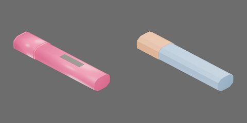

# 粉红色短扁身荧光笔



粉红色短扁身、凿形笔尖与同色空心笔帽，闭合110×22×15mm。

两个独立完整刚体组件：笔身 `body` 与空心笔帽 `cap`；无永久关节。−X朝笔尖及拔帽方向。

## 资产树

从当前 `object.blend` 实际父子关系导出，省略视觉/碰撞网格。部件随所属刚体运动。

```text
body [rigid]
  barrel
  label
  neck
  tip
cap [rigid]
  end
  lip
  shell
```
