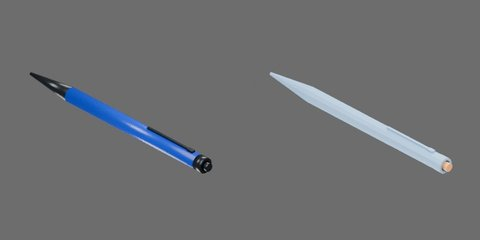

# 蓝黑色按动笔



蓝色笔杆、黑色握部/笔夹/按钮，收回时约148×10×11mm。

两个刚体组件：笔壳 `pen.shell`；按钮、笔芯与笔尖构成的活动组件 `pen.refill`。滑动关节 `button_press` 为 SLIDER，沿约束局部 X，限位[−0.003, 0]m，负值沿−X伸出笔尖。

## 资产树

从当前 `object.blend` 实际父子关系导出，省略视觉/碰撞网格。部件随所属刚体运动。

```text
pen
  refill [rigid]
    button
    shaft
    tip
  shell [rigid]
    barrel
    clip
    collar
    grip
```
