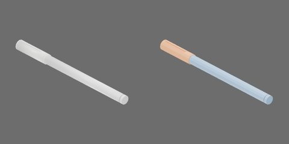

# 白色细带盖笔



白色细笔杆与白色带笔夹空心帽，闭合150×11×12mm。

两个独立完整刚体组件：笔身 `body` 与空心笔帽 `cap`；无永久关节。−X朝笔尖及拔帽方向。

## 资产树

从当前 `object.blend` 实际父子关系导出，省略视觉/碰撞网格。部件随所属刚体运动。

```text
body [rigid]
  barrel
  neck
  rear_plug
  steel_point
  tip
cap [rigid]
  clip
  end
  lip
  shell
```
