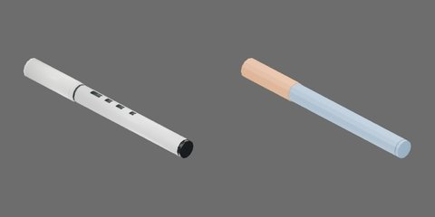

# 白身黑尾带盖笔



白色笔杆、黑色尾端/肩环与深色印记，白色空心帽，闭合150×14×14mm。

笔身 `body`、空心笔帽 `cap` 和3个内部球形卡扣从动件，共5个刚体。笔身与笔帽可完全分离；每个从动件以原生径向 SLIDER 连到笔帽。−X朝笔尖及拔帽方向。

## 资产树

从当前 `object.blend` 实际父子关系导出，省略视觉/碰撞网格。部件随所属刚体运动。

```text
body [rigid]
  detent_ridge
  barrel
  neck
  print
  rear_plug
  shoulder_band
  tip
cap [rigid]
  end
  lip
  shell
cap_ball1..3 [rigid]
  ball
```

## 第二章物理能力

内部卡扣采用原生球形接触、颈部环形凸棱、有限径向行程和弹簧 Drive。保持、脱开与再次盖合均由接触求解，不需要行为脚本或测试夹具维持连接。保留外形与空腔，仅扩大隐藏帽口内部净空并添加内部机构。帽沿−X拔出；从动件沿各自关节局部+X向外，限位[0, 0.00045]m。

|参数|工程取值|
|---|---:|
|笔身 / 帽壳质量|11 / 2 g|
|从动件数量 / 半径|3 / 0.45 mm|
|每个从动件有效质量|0.177979 g|
|径向弹簧刚度 / 阻尼|984.375 N/m / 0.16875 N·s/m|
|向内驱动目标（预压）|−0.16875 mm|
|凸棱或斜坡高度|0.253125 mm|

从动件质量是约同尺寸实钢球60倍的有效惯量代理，按半径立方缩放；不是实钢密度。质量、弹簧和摩擦均未实物标定，质心/惯量由碰撞体积估算。塑料静/动摩擦0.35/0.30，球为金属接触0.20/0.15；平均组合、零恢复，contact offset 0.1mm/rest offset 0；无额外刚体线性/角阻尼。小接触采用1ms、TGS位置/速度迭代32/8、每体CCD开，稳定阈值0、最大去穿透速度1m/s；应单列于4ms、16/4标准条件之外。加载本新盖时应将仿真世界物理步长设为1ms；导入USDZ本身不会修改世界步长，不能把4ms视为已验收的等价条件。

凸体在USD中将局部顶点放大100倍并以原生形状缩放0.01补偿，世界尺寸不变，避免PhysX固定烘焙容差删除亚毫米凸棱。该设置随资产分发，不依赖全局烘焙参数；Blender仍为米单位原网格。

`physics_test.py` 提供六项独立实验：`pull_comparison`（紧/松渐拉、完全分离后接住放稳）、`close`（轻推停位、加力座合、撤去帽夹具）、`gravity_rotation`（只夹笔身翻转）、`cycles`（连续三次拔插，无状态复位）、`free_reaction`（自由帽受力、笔身反作用及闲置实例）、`low_drop`（最低点20mm落放与稳定）。正式候选已逐项完成三轮无渲染与独立视频测量及完整媒体审查；正式目录重建后的等价核对另行留证。

当前渐拉协议下紧/松帽完全分离末次外力约1.276/0.034N；0.15N弱拉保持。轻推0.04N停在凸棱前，座合末次施力约0.8043N，撤去帽载荷和夹具后开口约0.04407mm。动态末次施力不是准静态实测拔力或接触反力。拉拔导向期间轴向刚度/阻尼为0，完全分离后才接住；盖合导向轴向阻尼10N·s/m，座合后释放。

能力限于正确朝向、低速引导装配、紧松保持差异和宏观低落。不能预测真实塑料变形、精确冲击载荷或真实脱帽高度；错向不自动吸正，跨ID换帽与机器人整理任务另行验收。正式RTF采用实际RTX RT2采样设置，非严格1spp；视频Actions栏只列计划动作，自定义加载回调以applied_force_x和曲线为准。

按[第二章教程](../../../../docs/tutorials/02-physics-assets.md)显式选择本ID构建，加载产物目录的 `object.usdz`。`object.py` / `physics.py` / `physics_test.py` 分别保留逐款几何、质量和实验协议参数，共享实现来自同版本 `table_1000.modeling.pen_detents`、`table_1000.physics.pen_assets`、`table_1000.physics.pen_tests`；源码快照重建依赖同版本包。身份字段不扩展。

历史CPU候选RTF（旧框架，仅供追溯；无渲染三轮 / 独立含视频；960×480、25FPS）：

|实验|无渲染RTF|含视频RTF|
|---|---:|---:|
|pull_comparison|0.130489|0.111459|
|close|0.229248|0.177528|
|gravity_rotation|0.124635|0.106286|
|cycles|0.227546|0.179267|
|free_reaction|0.131979|0.109632|
|low_drop|0.227523|0.176346|

循环动态拔力随三次状态变化（1.23/0.931/0.753N）；低落最大瞬时几何穿地1.503mm，不外推真实冲击。白色轮廓在浅背景对比度有限，完整媒体和关键帧均已实际审查。

### 2026-10-23 定向修复与当前结果

六项正式合同CPU1/GPU4均completed，全部视频与曲线本组审查通过，待总控独立验收。GPU自由反作用及翻转采用已批准PGS例外、关闭每迭代重复外力；保留1ms、scene64/16、rigid32/8及全部断言。GPU低落沿用原PGS，拔盖/合盖/循环仍TGS；GPU scene CCD关，CPU TGS、scene1/0、CCD开。此前“32/8、CCD开”简写不代表GPU场景条件。

free_reaction从座合帽开始，0.2s后才施加载荷；PGS四环境动量相对误差最大1.13e-6、闲置末速最大6.49e-6m/s。翻转中四环境松帽最终开口约218.186mm，紧帽全程最大开口0.2294mm，原>30mm分离及<0.5mm保持条件不变。PGS是数值workaround，尚未定位PhysX内部故障。

拔盖夹具在原1.2s下降段按帽碰撞凸包与COM选择约15°稳定支撑面，使用原生夹具转动/下降；按原时刻释放，保留2.4s稳定段、0.5s尾窗及0.01m/s/1mm门槛，没有瞬移或改变帽/卡扣物性。GPU最大尾速0.003416m/s、最大跨度0.003832mm。CPU拔盖已重测；free/gravity也在当前初始化路径复验，其他三项新版输入/调用路径不受本轮修正影响。全部机构、质量、材料、Drive、载荷与UUID保持，工程参数未经实物标定。

当前完整原始结果：`assets/objects/pen/000011/physics_test/`。媒体/逐环境检查入口：`outputs/asset-physics/pen/framework-gpu-2026-10-22/media-review/000011-complete-review.json`。两次长命令以143中断的日志已单独归档，之后按单后端/单项补测正常完成；未将中断当物理通过，也未认定为运行器死锁。正式性能通过统一队列单次提交；功能录像RTF不替代无渲染基准。

本轮关键实测（Isaac Sim 5.1，未经实物标定）：

| 物理量 | CPU1 | GPU4（聚合口径见指标） | 来源 |
|---|---:|---:|---|
| 紧帽分离末施加载荷 (N) | 0.87825 | 1.1925 | pull_comparison / tight_pull |
| 松帽分离末施加载荷 (N) | 0.034 | 0.03425 | pull_comparison / loose_pull |
| 撤力后开口 (mm) | 0.04191548 | 0.04240162 | close / released_opening |
| 紧帽全程最大开口 (mm) | 0.1715839 | 0.2239686 | gravity_rotation / held_opening |
| 完整拔插次数 (1) | 3 | 3 | cycles / cycles |
| 动量相对误差（env0） (1) | 4.208211e-05 | 1.294805e-07 | free_reaction / momentum_error |
| 最大几何穿地 (mm) | 1.503309 | 1.143086 | low_drop / penetration |

历史GPU失败及中断原始证据保留在本轮结果索引的`before/`与`runs/`，不计为当前通过。旧接触查询只覆盖env0；以初始化后四环境接触库存为准。逆环境位置诊断没有实际改变view初态，不能作为排除位置因素的依据。

当前正式性能任务`6f7db69cecc0561f`已单次进入统一队列；尚待本次测量及新媒体审核。前述历史候选CPU性能仅供旧版本参考，不代表当前框架正式性能。功能和媒体本组审核通过，总控独立验收尚未完成。
