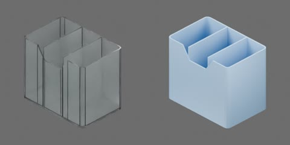

# 透明三格笔筒



透明塑料笔筒，120 × 80 × 100 mm。三列直通空腔，两块隔板到筒口，前沿中段有取物缺口。底板、外壁和隔板组成一个完整刚体，无关节；原点为底面中心，+X 宽度、+Y 背面、+Z 向上。

```text
pen_holder
  container [rigid]
    divider1..2
    floor
    walls
```

## 物理配置与验证范围

`physics.py` 为完整空筒设置一个 0.155 kg 刚体，无关节或行为脚本；质心与惯量由现有薄壁、底板和隔板的碰撞体估算。碰撞总体积约 130.45 cm³，按透明塑料约 1180 kg/m³ 得 0.154 kg，取整为工程质量，未经实物称重。静/动摩擦为 0.65/0.50、恢复系数为 0，使用平均材料组合；这是粗糙桌面实验的工程估计，未经材料标定。接触裕量为 0.1 mm、静止偏移为 0，启用 CCD 和 speculative CCD，求解迭代为 16/4。

按第二章教程构建后，以同目录 `object.usdz` 加载；无需 `behavior.py`。`physics_test.py` 定义正立/侧倒落放、低位/高位推移、三格球探针和自由冲量实验。已在 Isaac Sim 5.1、CPU PhysX/TGS、4 ms、16/4 迭代、960×480/25 FPS 下完成四项正式实验、全程媒体/曲线审查、三实例隔离、停止/重建复位及刚体整体性检查。2 ms 对照同样通过，但 50 mm 落放的最大瞬时穿地从约 1.01 mm 降至 0.031 mm，故不将冲击结果用于精确实物预测。内腔不填实，探针为测试专用夹具；真实笔装入后的组合重心、承载及倾倒需要另行验证。模型不表示塑料弹性、冲击损伤或真实材料的精确接触参数。


正式测量采用 AMD EPYC 7542、RTX 4090、Kit/PhysX 4 线程、数学库实效 1 线程。每项无渲染基准三轮，每轮至少 10 s 有效实验，短实验独立复位重复；含视频实验独立运行，均含 1 s 物理预热后复位，准备成本另计。RTF 为仿真秒/墙钟秒：

| 实验 | 无渲染中位 RTF | 含视频端到端 RTF |
|---|---:|---:|
| 正立/侧倒落放 | 1.366 | 0.536 |
| 低位/高位推力 | 1.305 | 0.526 |
| 三格内壁球探针 | 1.456 | 0.564 |
| 自由冲量与实例隔离 | 1.120 | 0.430 |

低位 10 mm 推力的 0.5 mm 起滑点约为 0.885 N，高位 90 mm 推力的 5°/45°倾倒点约为 0.825/0.980 N；这些是该工程模型、该地面和加载速率下的施加外力，不是接触反力或实物静态临界力。探针为半径 4 mm、质量 5 g 的理想球，采用 2 mm 接触生成裕量、零静止偏移；只验证内腔接触，不表示真实笔的装入与承载。
