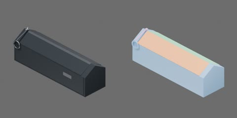

# 黑色单腔拉链笔袋



袋身闭合外形240×70×75mm，拉链行程216mm，圆环内径18mm/外径22mm（16边近似的内切直径17.65mm）。原点为底面中心，+X沿长度及开链方向，前面为−Y。包含圆环、拉头和白绳的实际闭合视觉包络约240×74×83.47mm。

第一章使用固定空腔袋身＋两片完整刚性袋唇近似，5刚体、4关节。先退完拉头再撑口，先合口再回拉；顺序由几何关键帧协调，无机械互锁，不模拟布料变形、解链力或保持力。

关节：`pencil_case.unzip`为沿+X的SLIDER，[0,0.216]m；前/后袋唇HINGE绕+X，[0,π/4]/[−π/4,0]rad；`pencil_case.ring_swing`为绕+Y的HINGE，[−π/2,π/2]rad。圆环绕上侧连接点在前面摆动。无禁碰对，装饰与链带随各自刚体，碰撞空腔和圆环孔保持开放。

全开碰撞净口约210×44.51mm，下半净腔230×64×51mm。22.5°部分撑口净宽约18.68mm，20mm粗笔不能从该姿态通过。整件放置选中组织根`pencil_case`，各刚体及约束锚点共同随动；各刚体内的语义部件不单独运动。第一章离散几何检查覆盖三笔、两橡皮、白短刀的指定入袋路径和装载合口，未验证夹爪空间、布料受力、Isaac拖拽/Play/Stop或机器人任务。

实际资产树（从object.blend导出，省略网格层）：

```text
pencil_case
  back_lip [rigid]
    cloth
    lining
    rim
    zipper_tape
  front_lip [rigid]
    cloth
    lining
    rim
    zipper_tape
  housing [rigid]
    binding
    label
    lining
    outer_cloth
  pull_ring [rigid]
    ring
  slider [rigid]
    attachment
    carriage
    white_cord
```

## 第二章物理与PC-01互锁

物理层由physics.py配置，behavior.py通过官方Python Scripting组件实现已批准的PC-01近似。加载入口为生成目录object.usda；它相对引用object.usdz和behavior.py，须保留整个目录并使用同版本table_1000。直接加载USDZ只有原生几何/关节/阻力，不具备完整拉链互锁。

拉头行程s为0–216mm。闭链及半退链时，两片完整刚性袋唇保持合口（各0.5°数值游隙）；s≥215.8mm才解锁袋唇。任一唇张开超过1°时，拉头限于215.6–216mm停车区；两唇均合到0.5°以内才可反拉，s≤215.4mm重新保持合口。状态来自实际受力位置，通过原生限位承担约束；行为不写入动态位姿、速度或运动目标。每实例独立，停止恢复原限位，重启按实际初态判定，非法初态报错。

**能力边界：** 半退链不能局部张口；必须全退后整体撑开。闭链是理想不破坏约束，不模拟拉链齿、布料、爆链或磨损；回拉前需先合口，不自动缝合。袋唇无回位弹簧，但重力可使其合拢；未验证任意高速或同时相冲突的操作。

工程参数均未经实物标定：总质量80g（壳50g、唇各10g、拉头7g、环3g），按240mm空袋的设计质量预算分配；质心和惯量按各刚体碰撞估计。布面静/动摩擦0.55/0.40、金属0.30/0.22，恢复系数0；接触裕量0.05mm、rest offset=0。拉头原生轴静/动阻力0.35/0.25N、阻尼2N·s/m；唇和环仅粘性阻尼0.001/0.00002N·m·s/rad，写入USD时转换为每度系数。CPU PhysX/TGS、16/4迭代、CCD、dt=0.004s。

实验采用TESTS/TestContext：闭/半/全退撑口对照、只对圆环施低/高及反向拉力、开口保持下反拉、合口闭链、三次循环、20mm底向/侧向低落放、零重力自由运动与双实例。固定壳仅为有说明的测试夹具；机构属于资产。施加外力不是测得的约束反力。

预先判据：闭/半退时唇角≤1°、口缝增量≤1mm；全退1N撑口各唇≥30°且≤46°；0.2N拉环位移≤1mm，0.8N可到两端，滑轨越界≤0.5mm、撤力末速度<0.01m/s；开口持续反拉时s≥215.1mm；低落放末0.5s每体速度<0.02m/s、地面几何穿透≤0.5mm；自由整体动量与外力冲量误差≤5%。关键曲线包括实际行程、两唇角、两内缘点距离、环角、外力和互锁状态。

当前验证：九项正式实验均完成数值检查和完整1299帧/关键曲线审查；三轮无渲染与独立视频RTF、官方GUI/无界面加载、停止/复位、暂停继续、卸载/重载及双实例独立性均有记录。单资产PC-01工程近似达到本组验收，仍待总控复核与用户Git/PR操作。夹爪装载、真实跨类别收纳、鼠标拖动和机器人任务未验收。

落放夹具地面采用3mm contact offset、0 rest offset：20mm自由落体约0.63m/s，在4ms内可能走2.52mm，以提前建立接触避免首次接触采样穿地。袋体接触裕量保持0.05mm，外形和静止接触面不变；该夹具裕量不能隐去，也不推断高速碰撞精度。官方运行时实测articulation会忽略逐关节collisionEnabled，使用整体self-collision配置；未声称相邻链接每对碰撞均启用。

本次实测环境为Isaac Sim5.1.0 rc.19、AMD EPYC7542、RTX4090；CPU TGS、4ms、16/4、CCD，Kit/TBB/PhysX各4线程、BLAS1。单实例无渲染RTF中位数约0.480–0.500、视频0.293–0.318；双实例约0.273/0.198。视频960×480/25FPS、RealTimePathTracing实际sampledLighting=2spp，偏离规范1spp目标，不能直接当完全同条件渲染基准。共享主机无其他仿真竞争，但有短时CPU负载峰值，性能只代表报告条件。九项独立无渲染与视频末状态差均为0；关节锚点误差最大约0.000049mm；底/侧落放穿透0.000634/0.001196mm。2ms关键互锁对照通过，非实物校准。
