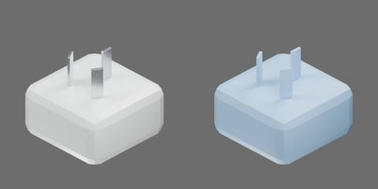

# 白色插头／转换头



白色圆角方壳，三片固定扁插脚；面向针脚看，上方一片竖直，下方两片分别倾斜为“\ /”；不可见背面为素面。

主体55 × 55 × 30 mm，插脚外露18 mm，总高48 mm。 尺寸为工程估计。一个完整刚体，视觉与碰撞随整体移动；无关节。

```text
power_plug
  body [rigid]
    left_pin
    right_pin
    shell
    top_pin
```
