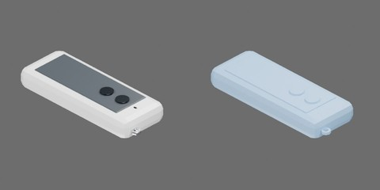

# 白色遥控器



白色圆角壳、深色面区、两个圆按钮、指示点和固定金属挂环；遮挡处为素面。

整体95 × 35 × 15 mm，包含末端挂环。 尺寸为工程估计。一个完整刚体，视觉与碰撞随整体移动；无关节。

```text
remote_control
  body [rigid]
    button1..2
    end_loop
    face_panel
    indicator
    shell
```
