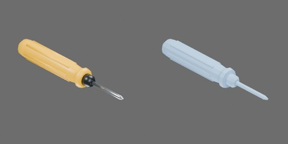

# 黄柄螺丝刀



黄柄、黑色颈圈、银色杆，刀头保留收窄轮廓。

总长150 mm，柄最大直径22 mm。 尺寸为工程估计。一个完整刚体，视觉与碰撞随整体移动；无关节。

```text
screwdriver
  body [rigid]
    grip
    neck
    shaft
```

## 物理能力与参数

入口为构建后的 `object.usdz`，原生自由刚体，无行为脚本。支持整理用抓取、推移、滚动和低高度落放；不包含拧螺丝、刀杆弯曲、损伤或柄与杆分离。

总质量估计38 g：塑料柄26 g、颈圈2 g、外露钢杆5.5 g、柄内钢芯4.5 g。使用同轴圆柱复合模型显式配置刚体局部质心 `(-9.105, 0, 11) mm`、主惯量约 `(1.11945e-6, 5.40140e-5, 5.40140e-5) kg·m²`，主轴与本地XYZ一致。钢芯只计入质量模型，不增加几何或独立刚体。外露钢杆的尺寸与钢密度支持约5.5 g估计；塑料等效尺寸和柄内钢芯长度尚未实测。该模型不精确积分筋条、锥端或实际内部结构，需后续称重与质心/惯量标定。

柄、颈圈、钢杆的静/动摩擦分别为0.55/0.40、0.45/0.32、0.30/0.22；恢复系数、线/角阻尼均为0。碰撞接触裕量0.1 mm、rest offset为0；质量与摩擦均为工程估计。整体支撑可同时接触多个部件，不能把推移起动载荷直接解释为单一材料摩擦系数。筋条及十二边形柄碰撞影响滚动，不表示实测滚阻。

`physics_test.py` 提供轴向/侧向推移撤力、柄端/杆端/水平30 mm落放、质心/柄/杆偏心脉冲和初始旋转后的自由滚动对照。力列为施加外力，不含接触反力。标准测试为CPU PhysX/TGS、4 ms、16/4迭代、CCD；杆端落放在4/2 ms下超过2 mm几何穿地判据，使用1 ms单列验证，不宣称标准4 ms冲击精度。测试脚本执行完成仍需查看完整视频、曲线及独立性能报告后验收。

受力及媒体验证覆盖上述四项，另完成独立目录加载、多实例隔离、停止复位与卸载重载。4/2 ms对照中轴向停止位移约75.5/78.2 mm、侧向滚移约428.5/463.0 mm；初始自旋后最终滚角约75°/45°，表明筋条/多面碰撞的最终支撑姿态对步长敏感。1/0.5 ms落放最大瞬时几何穿地约1.12/0.57 mm。以上为当前模型的数值实验，不代替实物标定；重新构建或改变求解条件后应重跑对应验证。无行为脚本，GUI交互未测试。
