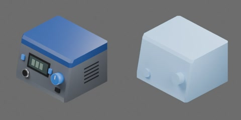

# 恒温焊台



深灰色机壳配深蓝色顶盖的焊台主机：前面板后倾，带深色数显窗、蓝色温度旋钮、两个蓝色按键、电源开关和烙铁线插座，两侧有散热槽；顶面平整，可放焊锡卷或助焊膏盒。外形约 140 × 120 × 90 mm（含旋钮深 129 mm），质量 1.4 kg，尺寸为工程估计。一个完整刚体，无关节。

```text
soldering_station
  body [rigid]
    case
    controls
    cord_socket
    cover
    display
```
