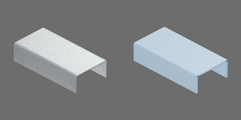

# 24/6（12#）订书针条候选



银灰色 U 形订书针，50 枚组成一条，外形 25.5 × 12.7 × 6 mm。原点位于脚尖平面中心，+X 为条长、+Y 为钉冠宽度、+Z 指向冠部。

外宽 12.7 mm、钉脚 6 mm、线径 0.51 mm 来自用户输入，未经实测或厂商规格核验；用户已明确截面为圆线。当前候选将 6 mm 定义为冠部顶面至脚尖的外部总高，6 mm 测量基准仍待核实。节距暂取 0.51 mm，中心线弯曲半径取 0.51 mm，均为建模假设。

一个完整刚体 `staple.strip`，无关节。冠部（含圆角）及两排钉脚为三个随动部件，保留 U 形内槽与脚尖平面；选择刚体根进行整体移动。50 枚针的视觉表面保持原形，碰撞以原七段截面的外包络沿条长聚合为 7 个盒体，省略相邻针之间的细小沟槽，并填充肩部角落（相对原截面并集最多约 0.207 mm）。每枚针不可独立切离，未实现粘接、变形、送钉、穿纸或弯脚。

从生成模型实际导出的资产树（省略网格）：

```text
staple
  strip [rigid]
    crown
    leg_left
    leg_right
```

## 第二章物理说明

使用统一建模、物理构建和测试入口；加载生成目录中的 `object.usdz`，无需行为脚本。
`object.py` 定义七段 BOX 的几何边界，`physics.py` 将它们表示为同名原生 USD Cube
并配置物理参数。原生盒体避免了细长网格的凸包烹制膨胀；视觉表面、外形尺寸、U 槽
和脚尖平面保留。肩部角落的 0.207 mm 包络增加是整条搬运近似，不适用于精密装订。

整条质量为工程估计 0.0020 kg：按 50 枚、0.51 mm 圆线、每枚约 24.7 mm 线长及钢材
密度 7850 kg/m³ 估算并取整，尚未实测。质心与惯量由七个碰撞盒体按均匀密度估计；
肩部盒体有重叠、针间沟槽被填平，故不是逐针密度模型。候选静/动摩擦系数为
0.35/0.25，恢复系数 0.05，均未标定。接触裕量 0.25 mm、静置偏移 0；CPU PhysX/TGS、
16/4 迭代、CCD 开启、Speculative CCD 关闭。接触裕量接近半个线径，不能承诺亚毫米
精密配合。

`physics_test.py` 登记五项物理实验及一项停止/复位诊断：脚朝下/冠朝下/侧放静置，最低点距地 30 mm 落放，
8 mN 水平脉冲后撤力，U 槽量规接触，以及零重力质心/偏心脉冲和未加载实例对照。
量规为 10 × 6 × 2 mm 理想固定夹具，接触裕量 0.05 mm；原生 D6 导向只允许针条沿 Y
移动。该实验检查 U 槽和脚排接触，未验证装入路径或真实订书机装填。记录的力为施加
外力，未采集地面接触力或导向夹具反力。

当前 CPU1 全部使用 4 ms；GPU4 的低落放使用 0.5 ms，其余使用 4 ms。地面接触裕量
0.25 mm，几何穿地上限仍为 0.255 mm（半线径）。历史 CPU 30 mm 落放步长对照中，
4/1/0.5 ms 满足该上限，2 ms 出现约 0.607 mm 穿透；当前框架 GPU4 的 4 ms
低落放出现约 1.417 mm 穿透，已保留失败证据，0.5 ms 复验通过。
不得把更小步长当作自动可靠，也不得外推到任意高度、速度、地面或仿真条件。替换
接触条件后应重验。数值稳定不等于实物材料或冲击标定。

当前能力始终限于 50 枚整条刚体：不能分离单针、弯脚、穿纸或送钉；6 mm 外部总高
仍是未实测候选。不同资产与真实订书机的组合装填不属于这些单资产测试。

## 当前框架实测（2026-10-21）

Isaac Sim 5.1.0；CPU PhysX 为 1 环境、TGS 16/4、CCD 开启；GPU PhysX 为 4 环境、
TGS 至少 64/16、CCD 关闭、每迭代外力开启。不同后端的条件不同，不能将 RTF
直接解释为相同工作量下的纯后端加速比。每个环境独立施力、读取张量并执行判据；
场景内含运动/未加载对照实例。U 槽夹具和原生 D6 导向在初始化前声明并复制到各环境。

五项物理实验与停止/复位诊断均已通过 CPU1/GPU4 功能测试；12 段完整视频及 12 张
曲线图完成本组审查。复位诊断在 0.4 s 显式停止/复位并恢复张量，重复运动末态一致；
最大复位状态分量误差 CPU 为 0、GPU 约 2.664e-7。普通刚体无行为脚本，不涉及
行为加载/卸载；未声称 GUI 热卸载测试。

| 功能指标 | CPU1 | GPU4 |
| --- | ---: | ---: |
| 三姿态静置最大尾段速度 (m/s) | 0.0005607 | 0.0005518 |
| 低落放最大几何穿透 (m) | 1.371e-8 | 5.992e-8 |
| 撤力后相对对照滑移 (m) | 0.008908 | 0.008904 |
| U 槽量规接触位移 (m) | 0.002840 | 0.002840 |
| 自由受力最大相对动量误差 | 1.732e-7 | 5.110e-6 |
| 偏心加载末态角速度 (rad/s) | 1.921 | 1.920 |

上述数值来自功能结果；以下性能来自独立正式三轮 benchmark，停止/复位诊断不纳入
稳态计时。完整性能、新媒体审查及输入哈希见本组本地交付清单。

本轮未修改几何、质量、摩擦、碰撞或已批准机构；原 USDZ 与 10 月 18 日交付相同。
本组自审与总控独立验收分开，当前尚未代表第二章整体验收。

## 正式三轮性能与新媒体（2026-10-21）

队列 605dbc7439fc1fe1 已完成；CPU1/GPU4 各五项物理实验三轮均≥10 s，完整独立实验预热累计≥1 s。每个独立重复和录像末态最大标量差均为 0。新 10 段完整视频（310 帧）与 10 张曲线已实际审查，本组自审通过，仍待总控独立验收。

| 实验 | CPU1 三轮 RTF / 含视频 | GPU4 三轮 RTF / 含视频 |
| --- | --- | --- |
| orientation_settle | 1.3581 / 1.3675 / 1.3771 ; video 0.2783 | 0.4830 / 0.4791 / 0.4930 ; video 0.2016 |
| low_drop | 1.3568 / 1.3662 / 1.3944 ; video 0.2757 | 0.0629 / 0.0630 / 0.0631 ; video 0.0515 |
| push_release | 1.6871 / 1.6890 / 1.7006 ; video 0.3009 | 0.6886 / 0.6926 / 0.6901 ; video 0.2360 |
| u_probe | 2.3410 / 2.3515 / 2.3349 ; video 0.2925 | 0.8943 / 0.8944 / 0.8879 ; video 0.2434 |
| free_impulse | 1.5043 / 1.4963 / 1.4985 ; video 0.2734 | 0.6123 / 0.6116 / 0.6131 ; video 0.2134 |

RTF 为仿真时间/墙钟时间；GPU 四环境总吞吐为 RTF 的四倍。无渲染计时包括物理步、施力、状态读取及内存采样；启动、构建、初始化/渲染预热/复位成本单列。含视频计时包含捕获、标注和编码。

测量采用共享主机、分配的 GPU 与 CPU 亲和性，非整机独占或严格空闲等价参考。实际 Kit/TBB/PhysX 为32/32/4、原生数学线程池各1（OPENBLAS环境变量读回32但实际线程池1）。RT2为960×480/25 FPS、每捕获2遍、直接照明2 spp、Dome2/TAA8、bounce12、无运动模糊；非严格1 spp。GPU利用率/显存为设备级读数；机器与资源分配详情仅保留本地报告。

进程CPU、主机负载、两类GPU利用率、准备成本、冻结版本和来源哈希详见本组本地 outputs/asset-physics/staple/adaptation-2026-10-21/benchmark-report.md 与 benchmark-audit.json。交付入口 outputs/asset-physics/staple/delivery-current.json；原始结果在 outputs/asset-physics/coordinator-benchmarks/605dbc7439fc1fe1/snapshot/assets/objects/staple/000000/physics_test/。冻结结果只读，审查写本组目录。
