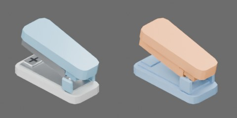

# 白蓝迷你订书机



白色浅底座、浅蓝上盖和金属钉槽，约 70 × 30 × 43 mm（初始打开姿态）。

包括两个刚体组件：基座；上盖、金属钉槽和压针件构成的活动上部。铰链 `upper_press` 沿 +Y 轴，限位约 [−0.299254, 0] rad。零位为最大打开姿态，负值下压至金属钉槽接触底座。

## 物理能力

加载生成目录中的 `object.usdz`，无需行为脚本；同目录保留 `model.json` 与测试源码快照供统一测试入口使用。底座和活动上部质量分别为35g、25g，质心和惯量由碰撞形状估算；这是工程估计，未称重或实物标定。塑料静/动摩擦为0.40/0.30，钢为0.25/0.18，恢复系数0，采用平均组合；接触/静止偏移为0.05mm/0。

`upper_press` 使用原生角向力驱动作为等效回位弹簧：目标角+0.05rad、刚度0.40N·m/rad、阻尼0.006N·m·s/rad、最大力矩0.25N·m。目标在打开限位外，提供0.020N·m预紧。上盖、钉槽和压针件始终共刚体。

使用普通刚体加原生铰链，保留相连部件间碰撞。CPU PhysX/TGS使用64/4次迭代、CCD开，且消费者场景必须启用原生PhysxSceneAPI的enableExternalForcesEveryIteration。该设置控制外力积分，不增加机构、保持力或自由度；回位力仍来自USD中的Drive。测试脚本显式设置该选项。普通16/4未达到原定末段角速<0.05rad/s；16/8虽满足尾速，但默认场景下加载角速度与姿态差分方向不一致，因此不交付该配置。64/4配合逐迭代外力通过原门槛及新增角速一致性检查。articulation原型因缺少相邻端部接触而弃用，几何和批准弹簧参数未变。

测试包含固定底座三次0–3N下压/撤力、自由底座桌面三次按压、零重力双实例自由反作用、张开/压下双初态从最低点20mm落放。按压记录实际外力、关节角/角速、底座运动、锚点误差与钉槽/砧座接触冲量；接触冲量不等于铰链或夹具反力。前三项步长4ms，落放2ms；4ms初轮落放穿透超过2mm门槛。

64/4配置完成四项正式实验、每项三轮无渲染RTF及独立含视频测量，完整帧序列和关键曲线已审查。固定/桌面按压末段角速分别不超过0.0346/0.0405rad/s（门槛0.05），20mm落放最大穿地约0.489mm（门槛2mm）；自由反作用动量相对误差约1.19e-6。旧16/8证据不代表当前配置，结果须与输入哈希对应。细步长复核中，固定/桌面/自由实验在2ms通过；落放在1ms的上部末速约13.04mm/s，超过原10mm/s门槛，尽管穿透约0.479mm。该1ms落放配置不在已验收范围内；不得从更小步长推断自动更稳定，当前落放支持条件限定为2ms。数值响应不代表真实装订力或冲击损坏。没有送料、单钉分离、穿纸、弯脚、独立开盖或装钉路径能力；真实订书针/纸张组合另列验收。


## 场景设置与复现

在初始化物理前，对消费者自己的PhysicsScene设置原生外力积分选项（stage为已创建的USD场景）：

```python
from pxr import PhysxSchema, UsdPhysics

scene = next(p for p in stage.Traverse() if p.IsA(UsdPhysics.Scene))
PhysxSchema.PhysxSceneAPI.Apply(scene).CreateEnableExternalForcesEveryIterationAttr(True)
```

该选项作用于整个场景；组合场景应记录并重新验证其数值条件。资产不创建或覆写消费者PhysicsScene。统一测试入口自动完成此设置：

```bash
python scripts/assets/physics_test.py assets/objects/stapler/000000 --tests press_release table_press free_reaction drop_states --output outputs/stapler-physics
```

使用已配置Isaac Sim 5.1的Python环境。结果包含CSV、曲线、MP4和result.json；RTF受实际硬件、共享负载、实例数、步长及渲染采样影响。测试环境实际直接光照2spp/TAA8，与规范1spp有偏差，不标为同条件基准。

```text
stapler
  base [rigid]
    anvil
    axle
    clinch_groove1..2
    hinge_cheek1..2
    plate
    shell
  upper [rigid]
    bracket1..2
    channel
    cover
    driver
    rear_bridge
```
