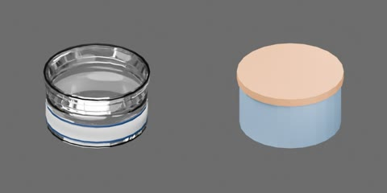

# 中号透明圆筒盒及放置盖



无色全透明盒体及浅盖，仅白纸标签和蓝边不透明，盒身外径90 mm、高50 mm；浅盖外径94.4 mm，装配总高52.25 mm。盒体和盖为两个独立完整刚体，无永久关节或卡扣；盖沿可竖直取下、翻转放置后再盖回。盒体原点为底面中心，盖原点在盖板内面中心，+Z 向上。

```text
storage_box.container [rigid]
  floor
  label_border
  mouth_rim
  paper_label
  walls
storage_box.lid [rigid]
  plate
  skirt
```
