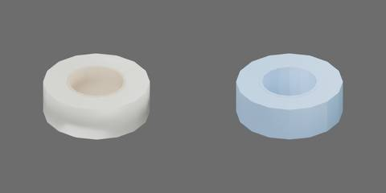

# 半透明胶带卷



乳白胶带卷和纸芯，约 61 × 61 × 20 mm，中孔内径约 32 mm。

整体为一个刚体，2个语义部件、32个凸碰撞扇区，无关节。

第二章物理采用完整胶带卷的工程近似：质量 0.050 kg；绕带接触材料静/动摩擦
0.38/0.28，纸芯为 0.45/0.32，恢复系数为 0。质量分布、摩擦和接触裕量尚未实物标定，
质量按绕带约39.7 cm³×1.2 g/cm³与纸芯约3.18 cm³×0.7 g/cm³估计并取整；
质心与惯量由均匀碰撞体积估计。圆周为16边形，立放初态宜使一个平面着地；
滚动衰减含多边形接触损失，并非已标定的滚动阻力。当前诊断中同载荷的
4 ms/2 ms滚动行程为166.6/226.4 mm（相差35.8%），仅支持固定步长下的定性整理运动，
不用于实物停止距离预测。`physics.py` 提供 USD 物理层，`physics_test.py` 覆盖滚动衰减、
侧向倾倒、内孔理想圆柱接触和两种姿态落放及自由冲量。能力边界是整体卷：不模拟放卷、撕胶、粘附或
胶带端头互锁。无行为脚本，构建后的加载入口为 `object.usdz`。
新版CPU/GPU验证与性能状态见下方；历史诊断不计作新版验收。

```text
tape
  roll [rigid]
    core
    winding
```


## 物理测试

在仓库根目录构建物理资产后运行：

    uv run python scripts/assets/physics_test.py --assets tape/000000 --physics isaac-cpu isaac-gpu --gpus 0 --scripts asset_sources/objects

功能及媒体检查通过后，按项目统一测量队列提交对应后端与测试项；CPU内孔媒体未通过部分不入队。
结果入口为构建目录的 physics_test/summary.json，两后端分别在 isaac-cpu/、isaac-gpu/。
内孔夹具在环境内初始化前声明，通过PhysX张量运动；GPU四环境逐一验证穿孔、侧推、稳定性与穿地阈值。
不在运行中修改USD位姿或物理结构；不夹持或写入动态卷体位姿。

## 物理实测

2026-10-20，Isaac Sim 5.1.0 rc.19；通过Isaac Lab 2.3.2源码环境运行（发行元数据0.54.3，尚未证明等同锁定wheel）。以下均为未实物标定的仿真值，取自本轮 physics_test/summary.json。
CPU1环境/GPU4环境核心各5项执行完成；另有停止/复位测试通过，逐环境功能断言保持。媒体审查中CPU内孔夹具画面未随物理目标同步，因此该项媒体验收未通过，不能将completed视为完整交付。

| 测量量 | CPU | GPU | 来源与方法 |
|---|---:|---:|---|
| 立滚行程（mm） | 166.6 | 190.6 | roll_decay；末态相对初态X位移 |
| 立滚峰值角速度（rad/s） | 9.353 | 9.157 | roll_decay；采样角速度模长峰值 |
| 平放最大横漂（mm） | 2.31e-05 | 6.602e-05 | roll_decay；平躺X最大偏移 |
| 各环境最大瞬时穿地（mm） | 0.2658 | 0.8465 | tip_over；所有环境碰撞顶点对地面最小净空 |
| 中央插入最大横漂（mm） | 0.0002242 | 6.358e-05 | bore_contact；中央进入阶段X最大偏移 |
| 孔壁侧推末段最小位移（mm） | 28.72 | 28.84 | bore_contact；2.2–2.4s卷体X最小值 |
| 各环境最大瞬时穿地（mm） | 1.012 | 1.047 | drop_orientations；所有环境瞬时几何穿地峰值 |
| 各环境线动量最大相对误差（%） | 6.144e-05 | 0.002258 | free_impulse；施力积分冲量与末线动量比较 |

GPU四环境落放在4 ms下瞬时穿地3.085 mm，未满足原1.5 mm阈值；保留该失败，改为2 ms复测后为1.047 mm。
该项CPU4 ms/GPU2 ms，其余两后端均4 ms；释放高度50 mm、材料、环境数和验收阈值保持。
CPU TGS16/4、CCD开启；GPU TGS最小64/16、CCD关闭。滚动行程GPU比CPU大约14.3%，
且历史CPU2 ms对照与4 ms相差35.8%；多边形接触衰减不用于实物停止距离预测。

### 性能状态

独立 --benchmark 尚无测量结果。2026-10-21起由统一队列自动安排已通过功能与媒体的部分，
CPU内孔仍待公共同步修复、定向复验后再补；不再等待人工测量窗口。summary中的RTF来自共享负载下的功能视频运行，
其中physics只是排除相机采集的推进估计，不是标准独立无渲染性能；当前不据此给出正式性能范围。
本机复用指定环境，无安装升级；严格锁定环境重建与CPU内孔夹具渲染同步复验仍待完成；新版停止/复位证据见下一节。
当前功能报告实际Kit tasking/TBB均为32、PhysX为4；数学线程池读回为1，尽管OPENBLAS_NUM_THREADS环境字符串为32。
渲染实际direct lighting/dome采样为2、TAA为8，CPU部分首帧需3次render，GPU为2次；未证明严格1 spp或标准4线程性能条件。


### 生命周期复验

新版统一入口的 lifecycle_reset 显式在0.4 s停止、复位恢复初始化状态后继续自由运动；
这段复位置换属于生命周期检查，不作为受力响应。CPU1/GPU4的最大状态恢复误差均为0，
闲置实例状态误差均为0，GPU环境间复位位置最大差0.00007451 mm（4 ms）。
两后端各31帧和4个曲线面板已审查，复位处位置重置与测试说明一致。没有行为脚本，未新增GUI能力声明。
