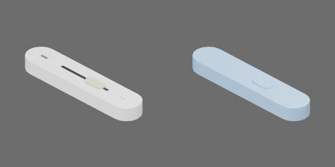

# 白色短壳美工刀



白色圆端短壳、浅绿色滑钮及细长深色滑槽，约 95 × 20 × 10 mm（工程估计）。

整体为一个搬运刚体，无关节；滑钮固定，刀片按收回状态表示，不提供伸出或切割功能。原点为底面中心，+X 指向后端、+Y 为宽度、+Z 向上。

从实际模型导出的资产树（省略视觉/碰撞网格）：

```text
utility_knife
  body [rigid]
    blade_guide
    housing
    retracted_blade
    slider
    slider_track
```

刀壳、浅绿滑钮、深色滑槽、金属导向标记及壳内收回刀片为固定语义部件；刀片网格完全位于壳内，不增加内部碰撞或运动机构。
