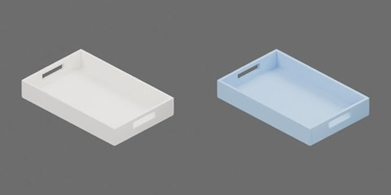

# 白色木质化妆托盘



白色漆面木托盘，外形 360 × 230 × 55 mm，壁厚 8 mm、底厚 6 mm，两端短壁各有一个提手孔，空腔在碰撞中保持敞开。尺寸为工程估计。一个完整刚体，无关节；原点为底面中心，+X 最长边、+Z 向上。

```text
vanity_tray
  body [rigid]
    floor
    handle_walls
    long_walls
```
