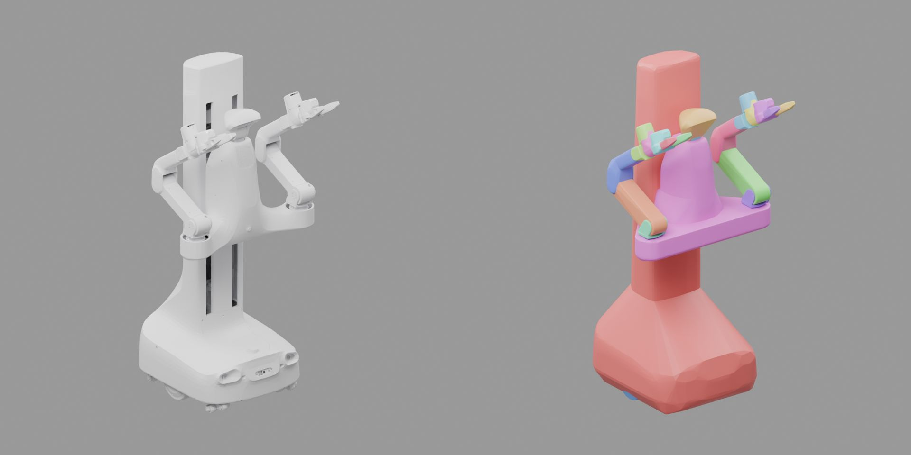

# X1Pro 双臂移动机器人（RM001 转动夹爪）



与 [x1pro](../x1pro/) 共用底盘、躯干、双臂和相机，换装 `rm001_g1_dvt1` 转动夹爪。原始资产来自 `ex001_render` 包的 `urdf/ex001_robot_rm001_g1_dvt1.urdf`；厂商数据的处理约定见 x1pro。

本目录保存夹爪座、两指、腕部相机座的 4 个外观网格及其碰撞体，其余网格引用 `../x1pro/meshes/`。生成和配置入口复用 x1pro，仅定义差异。模型共 22 个刚体、128 个碰撞体。

## 夹爪与控制

| 关节 | 类型 | 限位 | 张开方向 |
| --- | --- | --- | --- |
| `{left,right}_arm_gripper_left_joint` | 转动 | [−0.073, 0.872] rad | 正向 |
| `{left,right}_arm_gripper_right_joint` | 转动 | [−0.872, 0.073] rad | 负向 |

手指长 0.14 m，两指转轴位于 `*_arm_link6` 前方 0.077 m、中线两侧各 0.025 m。仿真固定厂商电机关节，由左指驱动、右指通过 PhysX mimic 反向跟随。

动作和观测使用两指尖间距，范围 0–0.245 m；换算见 `robot.py` 与 `ArmSpec.finger_pivot`。TCP 位于 `*_arm_link6` 前方 0.198 m、轴线下方 0.01 m。`ready` 姿态的躯干高度为 0.45 m。

## 碰撞与物理

每指沿长度分为 8 段凸包以贴合内凹弧面，内侧与外观间隙约 0.75 mm（局部台阶另计）。x≈38–140 mm 的内侧表层划分为 5 块约 2 mm 厚的独立指垫；指垫与金属共同组成手指碰撞轮廓，外观、质量和惯量取厂商模型。

| 参数 | 取值 |
| --- | --- |
| 主动指刚度 / 阻尼 | 50 N·m/rad / 20 N·m·s/rad |
| 手指关节力矩上限 | 20 N·m，取 URDF `effort` |
| 金属静 / 动摩擦 | 0.4 / 0.3 |
| 指垫静 / 动摩擦 | 2.0 / 1.6 |
| 指垫扭转摩擦半径 | 6 mm |

求解器配置与 x1pro 共用。指垫为刚性接触的材料分区近似，不模拟橡胶变形；驱动与接触参数未经真机标定，关节力矩上限不等于指尖夹持力。

两指张开呈 V 形，宽物体可能在顶棱处接触并翻滚。直径 60 mm、高 120 mm、0.5 kg 圆柱尚不能稳定夹持；直径 8 mm 的贴桌细杆尚不能可靠夹起，抓取时需考虑实际指面位置与桌面间隙。

## 使用与生成

依赖本目录和 `../x1pro/`，在仓库根目录运行：

```bash
uv run python scripts/robots/build_robot.py x1pro_rm001 --gpu 0
uv run python scripts/robots/check_robot.py x1pro_rm001 --output outputs/robots/x1pro_rm001-check --gpu 0
```

从厂商包重新生成源码：

```bash
uv run python scripts/assets/remote.py pull robots/x1pro/raw/ex001_render
uv run python scripts/robots/prepare_robot.py x1pro_rm001
```

x1pro 的共享网格变更后，需要重新生成本资产。缩略图左侧为外观，右侧为碰撞体，每个刚体一种颜色。
