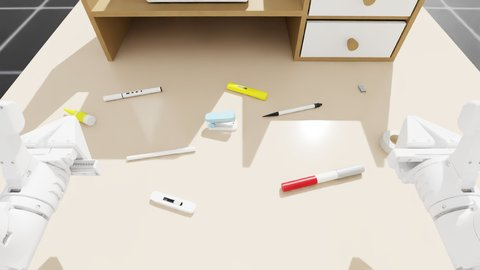

# 场景 000001：桌面文具与收纳架



本交付包含场景与随机初态，专家程序由后续任务实现。高层指令沿用 `tidy up the table`；不在场景内添加整理动作或成功判据。

## 场景

桌面、X1Pro 位置及起始关节与场景 000000 相同：桌面 1.36 × 1.02 m，高 0.755 m；机器人底盘位于 (-0.03, -0.80, 0) m，朝向 +Y，升降关节 0.40 m、头部俯仰 0.30 rad，其余关节为零。

木架位于桌面后侧 (0, 0.25) m，抽屉朝向机器人。三抽屉塑料盒位于木架左侧层板中央；高度从 `cabinet.housing.raised_shelf` 的碰撞几何求得，支撑关系记录为 `organizer`。

| 场景名称 | 资产 | 初态 |
| --- | --- | --- |
| organizer | cabinet/000001 | 固定初始摆放，两个抽屉关闭 |
| cabinet | cabinet/000000 | 木架左侧层板上，三个抽屉关闭 |
| highlighter | pen/000007 | 黄色带盖荧光笔，盖好 |
| red_marker | pen/000003 | 红色粗笔，盖好 |
| fine_pen | pen/000010 | 白色细笔，盖好 |
| white_marker | pen/000011 | 白身黑尾笔，盖好 |
| ballpoint | pen/000001 | 白黑按动笔，沿用资产静止构型 |
| tape | tape/000000 | 胶带卷平放 |
| stapler | stapler/000000 | 沿用资产静止构型 |
| glue_stick | glue/000001 | 黄色固体胶，侧放 |
| glue_bottle | glue/000000 | 尖嘴胶水，侧放 |
| staples | staple/000000 | 裸订书针条，代替照片中的纸盒装订书针 |
| knife | utility_knife/000000 | 白色长条美工刀，代替照片中的蓝色椭圆款 |

照片中的深青笔按场景要求替换为带盖荧光笔；粉红色 pen/000008 是允许的替代资产，目前源码选用黄色款。

## 随机初始化

11 件小物的完整碰撞包围盒位于 X ∈ [-0.50, 0.50]、Y ∈ [-0.45, -0.015] m 的前侧区域，物品间的水平包围盒至少留 12 mm 间隔。位置及偏航由 `layout.rng` 采样；相同 seed/attempt 重现相同布局。先放较大的物品；每件最多 200 次候选，无解交给公共构建流程换子 seed。

稳定朝向及底部高度来自资产碰撞几何。两个胶水资产从侧卧方向求最近的稳定面。抽屉、笔帽及工具机构保留资产初态；场景不缩放资产、不覆盖质量和驱动。间隔检查只保证初态几何空隙，不承诺所有姿态都可抓取。

## 构建与审核

先按资产和机器人教程准备表中各项的标准构建产物（`model.json`、`object.usdz`/`object.usda` 及其依赖、`robots/x1pro/robot.usda`）。物理配置读取 `msb/asset-physics` 分支，其中木架和两种胶水的配置由提交 `8533847` 补齐。带盖笔按资产要求使用 0.001 s 物理步长，控制频率仍为 25 Hz。本次不运行第二章 CPU/GPU 单资产测试；新配置及尚未完成的资产测试仅记录状态。

在仓库根目录，按本机资源分配设置 `GPU_ID`：

```bash
uv run python scripts/scenes/build_scene.py 000001 --seeds 0:9 --gpus "$GPU_ID" --grid 3x3 --images
```

此命令按公共流程检查几何穿透、静置稳定及机器人接触，写出 `assets/scenes/000001/initial_states.hdf5`、`initial.json`、初态拼图和单张图，并更新 `thumbnail.jpg`。默认机器人头部相机；`wide` 和 `overhead` 为另两个审核视角。自定义 `--output` 可以保留另一视角的结果，不覆盖正式初态。

## 专家策略交接

读取本目录 `scene.py` 和已验收的 `initial_states.hdf5`，按上表场景名称查询对象。专家 `solve(ctx)` 在后续新增 `expert.py`；本场景构建不依赖专家文件，不提供占位成功策略。整理顺序、各件物品的收纳目标及抓取可达性由专家阶段确定并验证。

本阶段通过初态检查不等于抓取、开关抽屉或完整任务成功。后续如更换物理资产，须重建初态并重新审核。场景规范见 [场景与专家轨迹](../../../docs/designs/asset-pipeline/scenes.md)。

## 本次场景初态验证

在提交 `7330807` 的固定检出上使用 CPU PhysX、1 ms 步长完成 seed 0–3：4/4 有效，均为 attempt 0，机器人接触数为 0。所有资产刚体的最大静置位移 0.134 mm、最大转动 0.561°（阈值 3 mm、2°）；通过公共几何穿透检查。生成机器人头部相机图、2×2 初态拼图与可恢复的 HDF5 状态。场景和控制相关测试 35 项通过。

这是场景搭建阶段的小批量验收，尚未做 100 seed 批量验证、抓取可达性、专家轨迹或任务成功验证。木架与两种胶水仍未运行第二章单资产 CPU/GPU 测试。笔类沿用物理分支的配置与历史实测说明，当前机器未提供对应新版批次汇总；不能把本次静置通过等同于单资产双后端验收。
