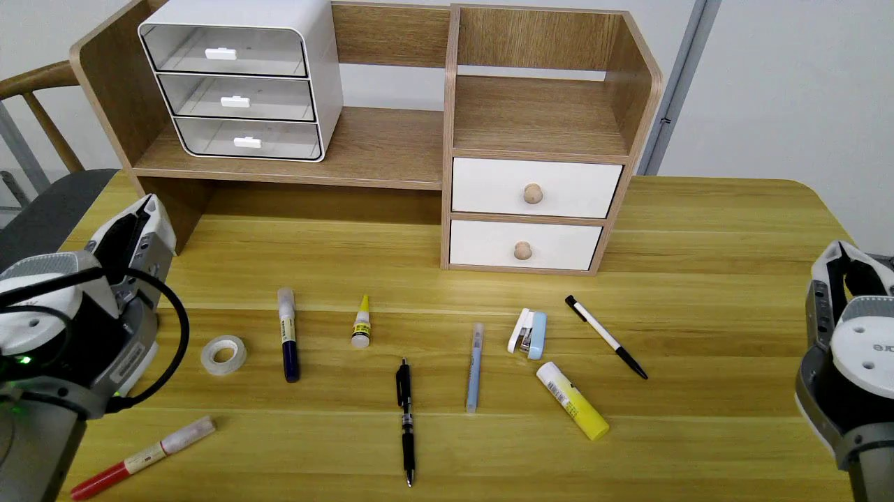
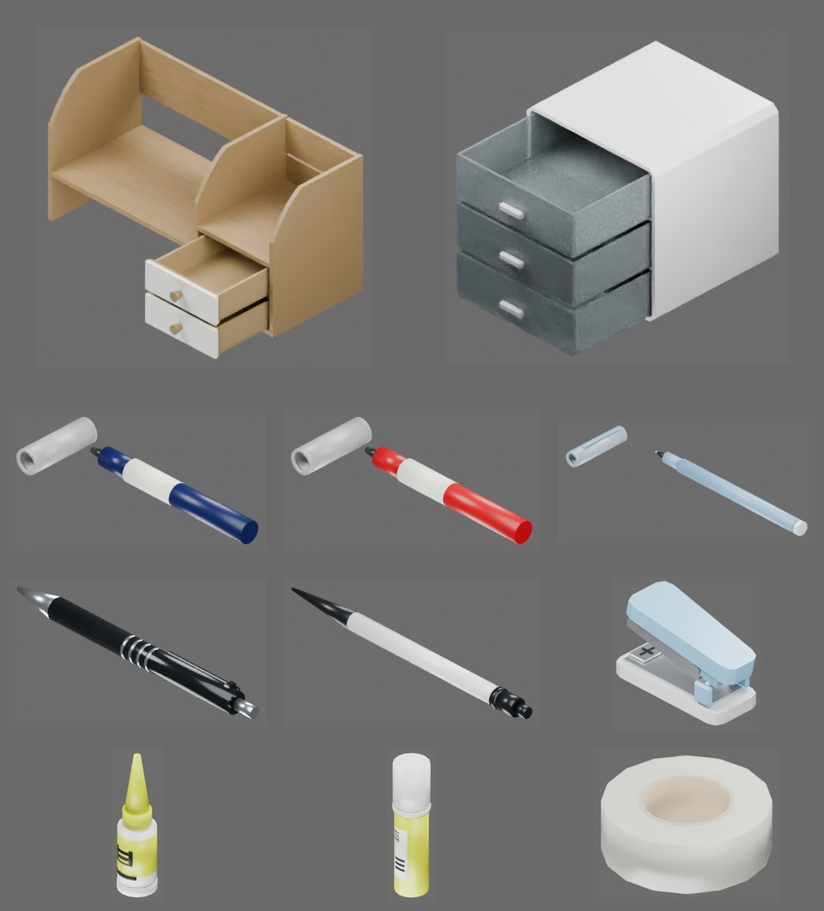

# 01 单图资产建模

从一张参考照片，为照片中的每件物品生成独立的三维资产：视觉外观、碰撞形状、刚体划分和关节。质量、摩擦和物理测试在[第 2 章](02-physics-assets.md)处理。

**输入：** 单张参考照片。尺寸和看不见的结构由 AI 根据图片和常识推断。



**输出：** 照片中各物品的资产。下图展示开放的抽屉和分离的笔帽，布局只为对比外观，未按实际尺寸摆放。



三抽屉盒子的开合预览：

<video controls preload="none" poster="images/cabinet-open.jpg" src="images/cabinet-open.mp4"></video>

[打开视频](images/cabinet-open.mp4) · [查看静态展开图](images/cabinet-open.jpg)

本章以[三抽屉盒子](../../asset_sources/objects/cabinet/000000/)（外壳和三个抽屉，共 4 个刚体）和[黑色圆珠笔](../../asset_sources/objects/pen/000000/)（笔壳与按动组件，2 个刚体、1 个滑动关节）为例。照片中其他文具也都有资产，见 `asset_sources/objects/`。

## 交付物

每个资产一个源码目录 `asset_sources/objects/<类别>/<编号>/`，提交到 Git：

| 文件 | 作用 |
| --- | --- |
| `object.py` | 建模源码：视觉和碰撞几何、刚体划分、关节，由 AI 按[建模规范](../designs/asset-pipeline/modeling.md)编写 |
| `preview.json` | 预览配置：拍摄视角和关节运动 |
| `metadata.json` | 类别、名称等元数据 |
| `README.md` | 外观、尺寸、资产树、刚体数和关节说明 |
| `three_quarter.jpg` | 缩略图，左为外观、右为碰撞 |

构建结果写到 `assets/objects/<类别>/<编号>/`（不进 Git）：`object.blend` 模型，以及 `preview/` 下的自动检查报告、图片和视频。

## 命令

构建模型：

```bash
blender -b --python-exit-code 1 -P scripts/assets/build_assets.py -- --assets cabinet/000000 pen/000000
```

自动检查并渲染预览（省略 `--assets` 时处理全部资产）：

```bash
uv run python scripts/assets/validate_and_preview.py --source assets/objects --assets cabinet/000000 pen/000000
```

导出资产树，核对后写进 README：

```bash
blender -b --python-exit-code 1 -P scripts/assets/export_asset_tree.py -- \
  assets/objects/cabinet/000000/object.blend --output outputs/cabinet-tree.txt
```

从预览生成缩略图：

```bash
ffmpeg -hide_banner -loglevel error -y -i assets/objects/pen/000000/preview/three_quarter.jpg \
  -vf scale=480:240 -q:v 2 -frames:v 1 asset_sources/objects/pen/000000/three_quarter.jpg
```

## 验收

自动检查失败时，脚本以非零退出码结束。每个资产的 `preview/` 下有一份 `summary.json`，按它验收：

1. **`summary.json`**：

   | 字段 | 看什么 | 盒子 | 笔 |
   | --- | --- | --- | --- |
   | `status` | 应为 `passed` | `passed` | `passed` |
   | `rigid_bodies` | 刚体数，应与 README 一致 | 4 | 2 |
   | `joints` | 关节数，应与 README 一致 | 3 | 1 |
   | `penetrations` | 穿透的姿态，应为空；不为空时列出所在图片或视频帧、刚体和深度 | 空 | 空 |
   | `complexity` | 视觉三角面数和碰撞形状数，用来判断模型是否过细或过粗 | 588 面，21 个盒、12 个凸网格 | 1036 面，2 个盒、35 个凸网格 |
   
   完整的检查记录在同目录的 `acceptance.json`，一般不需要看。

2. **`preview/` 中的图片和视频**（左为外观，右为碰撞，碰撞按刚体着色）：外观与照片相符；碰撞完整覆盖外观，刚体划分合理；运动视频中抽屉、按钮等活动部件能走完行程，没有穿透。盒子的视频是 `open.mp4`，笔的是 `press_and_extend.mp4`。

不通过时，记下问题所在的图片或视频帧：形状和结构问题改 `object.py`，视角和运动问题改 `preview.json`，然后重新构建和预览。
