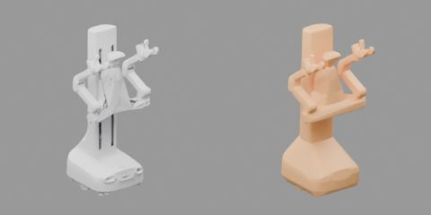

# 03 机器人导入与验收

以双臂移动机器人 [X1Pro](../../asset_sources/robots/x1pro/) 为例，把厂商的 URDF 包变成仿真可用的机器人：可以导入 Isaac Sim 的模型、运动学与规划、关节和末端位姿控制接口，并在仿真中验证行为和性能。

**输入：** 真机导出的 URDF 包 `ex001_render`（193 MB）。

**输出：** 不超过 10 MB 的机器人源码 `asset_sources/robots/x1pro/`，以及构建产物 `assets/robots/x1pro/robot.usda`。



## 交付物

源码目录 `asset_sources/robots/x1pro/`，提交到 Git，各文件的要求见[机器人资产规范](../designs/asset-pipeline/robots.md)：

| 文件 | 作用 |
| --- | --- |
| `robot.urdf`、`meshes/` | 由厂商包生成的外观网格和碰撞凸块 |
| `prepare.py` | 生成源码的选择与对厂商数据的修改 |
| `physics.py` | 驱动、自碰撞过滤、材料、夹爪耦合、底盘 |
| `robot.py` | 机器人描述 `SPEC` |
| `robot_test.py` | 验收设置 |
| `README.md`、`three_quarter.jpg` | 说明和缩略图 |

厂商原始包不进 Git，存档在 Hugging Face 私有数据集，版本记录在 [assets.lock.json](../../assets.lock.json)。

## 命令

构建（约 40 s，场景按 `robots/x1pro` 引用；失败时退出码为 1，错误写在 `assets/robots/build-error.txt`）：

```bash
uv run python scripts/robots/build_robot.py x1pro --gpu 0
```

代码中用 `table_1000.robots.load_spec('x1pro')` 取机器人描述，`RobotModel` 做运动学与规划，`RobotEnv` 在仿真中控制机器人（25 Hz 一个动作），见[规范](../designs/asset-pipeline/robots.md#机器人层运动学规划与控制)。

修改 `prepare.py` 或更新厂商数据时，下载原始包并重新生成源码（约 10 分钟，结束时自动做资产检查）：

```bash
uv run hf auth login
uv run python scripts/assets/remote.py pull robots/x1pro/raw/ex001_render
uv run python scripts/robots/prepare_robot.py x1pro
```

上传新的原始包用 `remote.py push <assets 下的目录> -m "说明"`，然后提交更新后的清单。

资产检查（约 10 s，不需要原始包）：

```bash
uv run python scripts/robots/prepare_robot.py x1pro --check
```

物理验收：

```bash
uv run python scripts/robots/check_robot.py x1pro --physics isaac-cpu isaac-gpu --gpus 0 1 2
```

- 可以列出多台机器人；`--physics` 必填，列出物理后端 `isaac-cpu`、`isaac-gpu`。
- 全部用例按预估耗时打包成 `--jobs` 个进程，同时运行。本机运行时分到 `--gpus` 列出的卡上，`--jobs` 默认每张卡一个。本例两台机器人、两个后端共 106 个用例和试验，在 16 个进程上约 45 分钟，其中 GPU 物理最慢。
- `--launcher PREFIX` 把每个进程交给作业调度器，以 `PREFIX bash -c '<命令>'` 提交，由调度器选卡，例如 `--launcher "srun --gres=gpu:1"`；这时不给 `--gpus`，`--jobs` 默认 16。
- 进程中途退出（如显存不足、被调度器终止）而没有写出结果的用例自动重跑，次数由 `--retries` 设置（默认 1）；运行完但未通过的用例不重跑。
- `--cases`、`--trials` 只运行指定用例和夹持与推力的试验，其余用例的已有结果保留。调参时只跑相关的用例，例如 `--cases grasp_and_push --trials 0 3`；比较参数时用同一组试验编号。
- `--metrics` 另外测量对比指标。
- 结果写到 `assets/robots/x1pro/check/`；`--output DIR` 改写到 `DIR/x1pro/`，比较不同参数时每组用一个目录。

验收只记录每个用例每一步的状态（`trajectory.hdf5`），不渲染。需要看视频时，把选中用例的轨迹渲染成视频（逐帧恢复状态，不重新仿真）：

```bash
uv run python scripts/robots/render_check.py x1pro --physics isaac-cpu --cases grasp_and_push --trials 3 --gpus 0
```

`--views` 选外部视角 `wide`（默认）和机器人的 RGB 相机，如 `--views wide face_view`；视频写在用例目录，名为 `<视角>.mp4`。用例选择、`--jobs`、`--gpus`、`--launcher`、`--retries` 和 `--output` 与 `check_robot.py` 相同。

遥控：在浏览器中用键盘操作机器人，人工检查行为：

```bash
uv run python scripts/robots/teleop.py x1pro --output outputs/robots/x1pro-teleop --gpu 0 --port 8765
```

打开 `http://<服务器>:8765/`（或 `ssh -L 8765:localhost:8765 <服务器>` 后打开本机地址），点击页面后操作。会话动作写入 `actions.jsonl`，可用 `teleop.replay` 回放。

| 按键 | 动作 |
| --- | --- |
| W/S、A/D | 底盘前进后退、转向 |
| R/F | 升降 |
| 方向键 | 转头 |
| Tab | 切换手臂 |
| I/K、J/L、U/O | 沿基座坐标系移动 TCP |
| Z/X、C/V、B/N | 转动 TCP |
| 空格 | 开合夹爪 |
| Backspace | 复位 |
| Shift | 按住加速 |

## 测试项与关键指标

各用例的条件和通过门槛见[规范的验收一节](../designs/asset-pipeline/robots.md#验收)。

**资产检查**

| 项目 | 本例 |
| --- | --- |
| `check.json` | 外观越出碰撞最多 0.19 mm，目录 8.5 MB |
| `prepare.json` | 网格最大误差 0.91 mm，22 个刚体 |

**物理用例**：本例在 CPU 和 GPU 上全部通过；下表为 CPU 结果。

| 用例 | 本例 |
| --- | --- |
| 关键姿态 | 零位与 `ready` 无自碰撞；静置 1 s 关节漂移为 0 |
| 传感器 | 四路图像中标记物位置与镜头模型预测相差最多 0.7 px，深度误差最多 0.8 mm |
| 手臂撞固定块 | 最大穿透 0.1 mm |
| 手臂推自由物 | 最大穿透 0.2 mm |
| 物体落到机身上 | 停在底盘和头上；撞击穿透 3.0–4.7 mm |
| 躯干升入隔板 | 穿透 0.5 mm |
| 夹持与晃动 | 方块、圆柱和细棒漂移不超过 0.2 mm |
| 夹持与推力 | 0–12 号试验全部夹住，漂移不超过 1.0 mm，穿透不超过 0.17 mm |
| 手指压桌闭合 | 闭合前压桌力 9.2 N、15.5 N，方块最大速度 0.15 m/s |
| 底盘连续转向 | 转角误差 0.002 rad |
| 持物行驶 | 手中方块漂移 0.01 mm |

**对比指标**（`--metrics`）：

| 指标 | 本例 |
| --- | --- |
| 模型与仿真 TCP 一致性（30 个随机姿态） | 位置差 < 0.001 mm，角度差 < 2 µrad |
| IK（每臂 100 个随机可达位姿） | 成功率 99–100%，中位耗时约 0.05 s |
| 自碰撞规划（每臂 20 组随机起止） | 成功率 95–100%，中位耗时 5–6.5 s |
| 关节轨迹跟踪 | 最大误差 0.5 mrad |
| 底盘 | 0.4 m/s 指令实测 0.400 m/s，停车误差 < 0.01 mm |
| 每物理步耗时 | 静止 2.6–2.7 ms，手臂运动 4.8–5.0 ms |

## 验收

资产检查看 `check.json`、`prepare.json` 和缩略图：缩略图中外观无破面、塌陷，碰撞覆盖完整，刚体划分合理。

物理验收有用例未通过或进程出错时，`check_robot.py` 以非零退出码结束。先看 `assets/robots/x1pro/check/summary.json`：

| 字段 | 看什么 |
| --- | --- |
| `backends.<后端>` | `passed` / `cases` 为通过数和用例数，`failed` 应为空 |
| `cases.<用例>.<后端>` | `status` 应为 `PASS`；未通过时 `failed_checks` 列出未通过的检查项 |
| `metrics` | 对比指标（`--metrics`），与上表或其他方案比较 |

然后看 `<后端>/<用例>/`（夹持与推力为 `<后端>/grasp_and_push/t<试验>/`）：

1. `report.json`：每项检查和测量值；出错时 `error` 写明原因，进程日志在 `<后端>/logs/<进程>/run.log`；
2. 未通过或有疑问的用例，渲染出 `wide.mp4` 查看：过程是否符合用例意图，有没有穿透、抖动、飞出；
3. 传感器用例中每路相机的标记物图 `<相机>_<姿态>.jpg`：十字应落在标记物中心。

不通过时：外观或碰撞问题改 `prepare.py` 后重新生成；驱动、过滤、材料或夹爪问题改 `physics.py` 后重新构建，再重跑受影响的用例。

## 同一台机器人换夹爪

真机现用的转动夹爪 rm001 是另一台机器人 [`x1pro_rm001`](../../asset_sources/robots/x1pro_rm001/)：目录中只有夹爪的 4 个网格（0.9 MB），其余网格和 `.py` 文件引用 x1pro。命令相同，把 `x1pro` 换成 `x1pro_rm001`；两台一起验收：

```bash
uv run python scripts/robots/build_robot.py x1pro_rm001 --gpu 0
uv run python scripts/robots/check_robot.py x1pro x1pro_rm001 --physics isaac-cpu isaac-gpu --gpus 0 1 2
```

`prepare.py` 设 `BASE = 'x1pro'`，原始包中 x1pro 也用到的网格不再生成，所以修改 x1pro 的网格后要重新生成 x1pro_rm001。转动手指同样按指尖间距控制，换算与验收结果见其 README。
