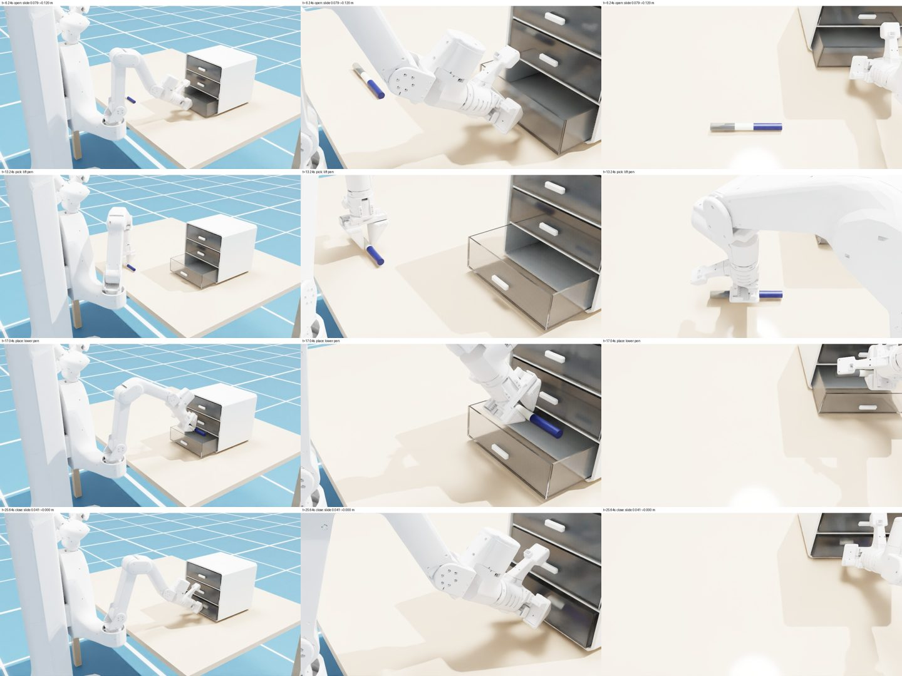

# 04 场景搭建、专家轨迹与批量验收

以 [scene-000000](../../asset_sources/scenes/scene-000000/) 为例：X1Pro 站在桌前，打开 [三抽屉盒 cabinet/000000](../../asset_sources/objects/cabinet/000000/) 的最下层抽屉，把 [带盖笔 pen/000002](../../asset_sources/objects/pen/000002/) 放进去，再关上抽屉。流程为 **编写场景源码 → 按可达范围选区域 → 编写专家脚本 → 单次运行与视频 → 批量验收 → 留存**。各文件的要求见[场景与专家任务规范](../designs/scenes-and-tasks.md)。

**输入：** 第二章的两件物理资产，第三章的机器人资产。

**输出：** 场景源码 `scene.py`；对每个随机初始摆放都适用的固定专家脚本；每次运行的 `result.json`、`trace.csv`、`contacts.json` 与视频；批量的 `summary.json/csv`。



## 1. 准备环境

环境同第二、三章。该 Python 环境另需 MPlib 0.2.1、toppra、trimesh，并已按第二、三章构建 `assets/objects/cabinet/000000`、`assets/objects/pen/000002` 与 `assets/robots/x1pro`。

## 2. 编写场景源码

场景是一个 Python 模块，不另设配置格式。[scene.py](../../asset_sources/scenes/scene-000000/scene.py) 写明：

- **世界系**：原点在桌面中心正下方的地面，+Z 向上；
- **桌子**：1.36 × 1.02 m，高 0.755 m，摩擦；
- **机器人**：资产路径、base_link 位姿（(−0.03, −0.80, 0)，偏航 90°）和全部初始关节值（升降 0.40 m、头俯仰 0.30 rad、双臂初始姿态）；
- **物体**：资产路径、区域中心、高度、朝向和 ±0.05 m 的随机范围；
- `placement(seed=None, offsets=None)`：用 `numpy.random.default_rng(seed)` 依次为抽屉盒、笔各抽一个 XY 偏移，返回各自的 4×4 位姿；
- `check(layout)`：返回违反的布局约束，空表示有效。

运行时由 [stage.py](../../table_1000/scenes/stage.py) 把场景组装进 Isaac Sim 舞台：桌子用基本体创建，机器人和物体原样引用构建产物，只在引用 prim 上设置位姿。布局、尺寸与选址依据见[场景 README](../../asset_sources/scenes/scene-000000/README.md)。

## 3. 按可达范围选区域

区域位置由机器人能否到达每个关键姿态决定，不靠试跑。离线检查只用 MPlib，不启动 Isaac Sim，约 2 分钟：

```bash
"$ISAAC_PYTHON" -m pytest -q tests/scenes
"$ISAAC_PYTHON" scripts/tasks/drawer_pen_reach.py --output outputs/drawer-pen/reach
```

- **布局检查**（[test_scene_000000.py](../../tests/scenes/test_scene_000000.py)）：同一 seed 结果相同；两件物体偏移独立且在区域内、朝向不变；两个区域 3 × 3 代表点（中心、边中点、角）的 81 种组合全部满足约束：物体在桌面内，笔不进入抽屉完全拉出时扫过的范围，离机器人一侧桌边至少 0.05 m。
- **可达性**（[reach.py](../../table_1000/tasks/reach.py)）：对同样 81 种组合，用与专家脚本相同的坐标计算把手预抓与抓取、拉开后的把手及其后撤点、笔的预抓/抓取/抬起、抽屉上方的松手位，逐一做带碰撞检查的 IK。`reach.json` 列出每个组合每个位姿是否可达；本例 81 种全部可达。

本例由此得到的选址约束：

1. 桌子前沿离躯干约 4 cm，躯干下沿低于桌面，机器人不能再靠前。
2. 抽屉盒太近时，拉开后的把手离肩太近，手臂折叠，上臂和前臂相碰；盒子区域中心放在 base_link 前方约 0.86 m。
3. 竖直向下的夹爪在 0.86 m 以上只能到 base_link 前方约 0.6 m；放笔时手向抽屉里侧倾斜 40°。
4. 笔区放在双臂之间偏右，并在 X 方向与抽屉拉出的范围错开。

调整区域或机器人碰撞后先跑这一步，再跑后面的仿真。

## 4. 编写专家脚本

[drawer_pen.py](../../table_1000/tasks/drawer_pen.py) 的 `Solver.solve()` 参照 ManiSkill3 motionplanning solutions 的写法，一个阶段一行：

| 阶段 | 动作 |
| --- | --- |
| open | 预抓把手 → 沿接近方向靠近 → 合爪 → 分三段沿抽屉轴拉开 0.12 m → 松爪后撤 |
| pick | 手先竖直升高、离开抽屉侧壁 → 在笔质心处俯抓 → 合爪 → 竖直抬起 |
| place | 直线移到抽屉开口上方 → 下降到松手位 → 张爪让笔落下 → 撤手 |
| close | 再抓把手 → 分三段推回 → 松爪后撤 |

**抓取与放置坐标。** 每一步的目标位姿都由**当下**的物体真实位姿和资产自身的碰撞几何算出，写成 `T_world_tcp = T_world_frame · T_frame_tcp`，见 [drawer_pen_geometry.py](../../table_1000/tasks/drawer_pen_geometry.py)，没有按 seed 或世界坐标写的特例：

- **把手**：原点取把手碰撞体中心，轴取抽屉刚体的轴（−Y 为拉出方向）。手指沿把手长度方向夹住两端，接近方向下倾 30°，指尖停在抽屉面板前 6 mm。
- **笔**：竖直向下，开合方向垂直笔轴，抓在物理引擎读出的笔质心处。抓在质心外时笔会在两指间转动，规划用的持笔几何随之失准。
- **松手位**：抽屉内腔露出部分的中心、侧壁上方 12 mm；手部姿态由合爪后实测的手-笔相对位姿反算，使笔轴沿抽屉宽度方向。
- **拉与推**：沿实时抽屉轴移动 TCP；每段后检查抽屉是否跟上（偏差 1.5 cm 以内），没跟上就松手、重读把手位姿、重新抓取，全程最多 2 次。

**规划与执行。** [motion.py](../../table_1000/tasks/motion.py) 是 MPlib 与 Isaac Sim 之间的薄层：

- **空程**用 IK 加 RRTConnect，**接触动作**用[闭环直线螺旋路径](../../table_1000/planning/screw.py)，两者都用 TOPP 按 4 ms 采样时间参数化。
- **规划世界**：桌子、抽屉盒各刚体（把手单独成一个对象）、笔和机器人全身（另一臂冻结在初始姿态）。物体几何取自资产的 `model.json`，每次规划前按物理引擎中的实时位姿更新。MPlib 0.2.1 摆放挂接物体时不计 articulation 的基座位姿，所以规划在机器人 base_link 坐标系中进行。
- **接触许可**：只在相应阶段给手指与把手、手指与笔开放；拉推抽屉时把抽屉作为被手带动的物体挂在 TCP 上一起规划。
- **余量**：机器人凸块（手指除外）加厚 2 mm；空程规划时桌子和抽屉盒再加厚 3 mm；RRTConnect 的路径另按 0.01 rad 关节步长逐点复查，有碰撞就重规划。
- **执行**：逐个物理步下发关节位置和速度目标，到终点后等待关节误差小于 0.01 rad。
- **失败传播**：IK、碰撞、关节限位、TOPP、跟踪任一失败都抛出带阶段名和原因的异常。只在列明的几处换用较短动作再试：把手后撤距离、开抽屉后的升高高度、笔抬起高度、撤手方向。

## 5. 单次运行与视频

```bash
"$ISAAC_PYTHON" scripts/tasks/drawer_pen.py --offsets 0 0 0 0 --output outputs/drawer-pen/center --gpu 0 --video
"$ISAAC_PYTHON" scripts/tasks/drawer_pen.py --seed 3 --output outputs/drawer-pen/seed-3 --gpu 0
```

`--offsets CX CY PX PY` 直接给出两件物体的偏移，`--seed` 按 `placement()` 抽样。运行在受监督的子进程中：结果落盘后写 `shutdown.json`；`app.close()` 超过期限，或子进程心跳 300 s 未更新（例如渲染器启动失败后挂起）时，父进程依次发 TERM、KILL，真实退出码与原因写入 `parent-lifecycle.json`。

| 文件 | 内容 |
| --- | --- |
| `result.json` | `status`；布局与初始位姿；`failure`（阶段、原因、碰撞对或 IK 状态）；各阶段起始时刻；每次规划的类型、耗时、时长、最大跟踪误差；`evaluation`；`timings` |
| `trace.csv` | 每 0.04 s 一行：阶段、关节实际值与目标、手指间距、抽屉开度、笔位姿 |
| `contacts.json` | 按时间段记录的接触，分为预期与意外 |
| `wide.mp4`、`close.mp4`、`head.mp4` | `--video` 时的远景、近景与头部相机视频 |

**判定。** PASS 需同时满足：流程无失败、抽屉合上（开度 ≤ 5 mm）、笔在抽屉内腔、手离把手 5 cm 以上、无意外接触。PhysX 接触点间距小于 0.5 mm 计为接触；预期接触只有手指与把手、手指与笔、轮子与地面、夹爪两指之间，其余都计为意外。笔从抬起到松手之间拿在手里，这段时间笔与手指以外的任何物体接触也计为意外。接触报告挂在机器人和抽屉盒刚体上，不挂在笔上，否则笔帽卡扣每步的内部接触会大量回调，物理步进慢约 4 倍。

**视频。** [cameras.py](../../table_1000/runtime/cameras.py) 为每个视角建一个相机、一个渲染产品和一个 RGB annotator，每 10 个物理步（0.04 s）同步渲染一次全部视角，25 fps 播放即 1 倍速；渲染不推进物理，有无 `--video` 走同一条物理轨迹。每帧左上角标注仿真时间和当前阶段。

- **相机不在视角之间移动**：渲染器的时间累积随相机保留；移动同一个相机轮流拍各视角会在每帧清空累积，视频出现高频闪烁（静止场景下帧间变化约为固定相机的 7 倍）。
- **残影**：RT2 在时间上降噪，并用辐射缓存和光照缓存跨帧复用间接光。每帧只渲染一次时，松手后下落的笔在原位置留下深色拖影；即使多渲染几次，笔的蓝色反弹光仍会在盒面上停留约 1 s。现在两个缓存都关闭，每帧对同一物理状态渲染 `--subframes` 次（默认 4）。在笔瞬移 12 cm 的测试中，这样设置后残留降到渲染噪声水平，2–8 个子帧结果相近，1 个子帧时仍明显；关缓存还让每次渲染快了约一半。关掉 DLSS 或半透明运动矢量都没有改善。
- **渲染设置与资产物理测试一致**，统一定义在 [render.py](../../table_1000/runtime/render.py)：RTX Real-Time 2.0，总反弹与镜面/透射反弹上限 12，`DomeLight` 900 加 `DistantLight` 2500。抽屉盒和笔的塑料是透射材质；用旧的 RTX 实时模式渲染时盒体显示成深色镜面，倒影容易被误看成穿模。RT2 只在 `--video` 时启用，因为它在启动时编译光线追踪管线，不录像的运行用不到。

## 6. 批量验收

```bash
"$ISAAC_PYTHON" scripts/tasks/drawer_pen_batch.py corners --output outputs/drawer-pen/corners --gpus 0 1 --jobs 8
"$ISAAC_PYTHON" scripts/tasks/drawer_pen_batch.py seeds --first 0 --count 40 --output outputs/drawer-pen/seeds --gpus 0 1 --jobs 8
```

- **corners**：两个区域各取中心、四个边中点和四个角，两两组合共 81 例，两件物体独立变化。
- **seeds**：连续 seed 的独立随机摆放。

每例是一次独立运行，已有结果的例子不重跑；验收批次运行期间不改代码、场景和资产。同一张 GPU 上的启动间隔 20 s。8 路同时启动时，Isaac 偶尔在启动阶段建不成光线追踪管线并挂起，由监督进程在心跳 300 s 未更新时停止；这种没有 `result.json` 的运行属于任务之外的故障，原目录改名为 `<例子>.no-result-<n>` 留作记录后重跑一次。有结果的运行，不论 PASS 还是 FAIL，都不重跑。汇总表的 `attempts`、`no_result_attempts` 两列记录启动次数。全部例子（含失败）汇总到 `summary.json` 与 `summary.csv`：seed、偏移、结果、失败阶段与原因、重抓次数、意外接触数和耗时。

**通过条件**：两批全部 PASS，所有进程正常退出。之后录中心和至少一个角点组合的视频，逐视角检查：

1. 远景看完整流程：抽屉拉开、笔被抓起、放进抽屉并留在里面、手撤出、抽屉合上；
2. 近景看接触：手指与把手、笔的接触，手和手臂有无穿过桌子或盒体，笔在手中有无滑移或跳动；
3. 画面本身：无闪烁、无错帧、材质与资产物理测试一致。

结果以 `result.json` 与 `contacts.json` 为准，画面用来核对接触记录。

**本例结果**（8 路并行，两张 GPU）：corners 81/81、seeds 0–39 共 40/40 PASS；重抓 0 次，意外接触 0 次，退出码全为 0。seeds 中 2 例首次启动时光线追踪管线创建失败、没有结果，重跑后 PASS。每例墙钟时间中位数约 140 s：启动约 50 s、加载 5 s、规划 21 s、物理步进约 49 s。

**耗时**（单次 28 s 仿真时间）：

| 运行方式 | 一条轨迹耗时 | 构成 |
| --- | --- | --- |
| 单跑，不录像 | 约 2 分钟 | Isaac 启动约 40 s，场景加载 11 s，规划约 19 s，物理步进约 38 s |
| 单跑，录 3 路视频 | 约 5 分钟 | 另加渲染约 145–170 s（每帧 4 个子帧）、编码约 7 s；加载时还要编译 RT2 管线 |
| 8 路并行批量 | 每条 2.5–3 分钟，摊下来约 20 s | 并行时启动和步进都变慢 |

约一半时间是每条轨迹都要付的启动和加载开销；纯物理步进的实时因子单跑约 0.75。

资产、机器人碰撞或运行时参数变化后，两批全部重跑。

## 7. 留存成果

| 位置 | 内容 | 留存方式 |
| --- | --- | --- |
| `asset_sources/scenes/scene-000000/` | `scene.py`、`README.md` | Git |
| `table_1000/scenes/`、`table_1000/planning/`、`table_1000/tasks/`、`table_1000/runtime/` | 舞台组装、规划、专家脚本、运行与批量入口、相机 | Git |
| `scripts/tasks/` | 单次、批量与可达性入口 | Git |
| `tests/scenes/`、`tests/tasks/`、`tests/planning/` | 布局、几何与规划模型的静态检查 | Git |
| `outputs/drawer-pen/` | 单次运行、批量结果与视频 | 本地；验收结论与数字写入任务报告 |

需要长期保留的视频或批量结果，复制到 `assets/` 下的对应目录后用 `scripts/assets/remote.py push` 存入数据集。
