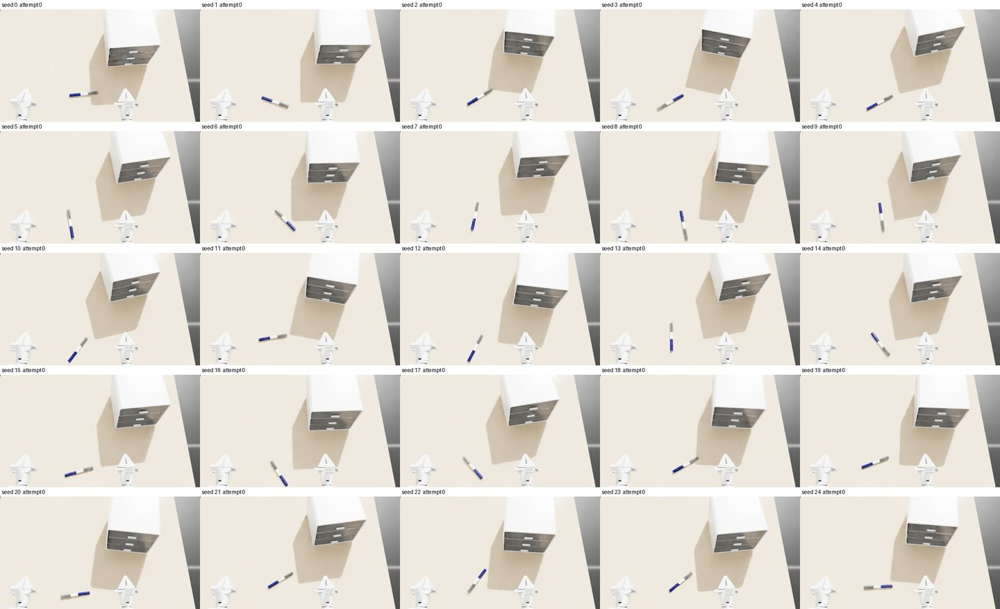

# 04 场景、专家轨迹与渲染

以场景 [scenes/000000](../../asset_sources/scenes/000000/) 为例：X1Pro 站在桌前，桌上一个三抽屉柜和一支笔；机器人打开最下层抽屉，把笔放进去，再关上。流程为 **场景源码 → 检查初态 → 专家程序 → 批量生成轨迹 → 渲染与评审 → 导出 LeRobot**。场景和专家都是 Python 代码（专家即 code as policy，可由大模型编写）；框架负责检查初态、把场景放进 Isaac Lab、录制与重放。规范见[场景与专家轨迹规范](../designs/scenes.md)。

**输入：** 已构建的资产 `assets/objects/cabinet/000000`、`assets/objects/pen/000002`（第二章）与机器人 `assets/robots/x1pro`（第三章）。

**输出：**

- 场景目录 `asset_sources/scenes/000000/`：`scene.py`、`expert.py`、25 个初态的拼图 `initial_states.jpg`；
- 场景预览目录 `assets/scenes/000000/preview/`（不进 Git）：初态检查结果 `initial.json` 与拼图 `initial_states.jpg`，渲染轨迹的视频、评审图与机器人相机图像；
- 轨迹文件 `trajectories.hdf5`（成功）、`trajectories_failed.hdf5`（失败），每个 seed 的报告与汇总；
- 每条渲染轨迹的视频、评审图、机器人相机图像；LeRobot v3.0 数据集。

环境同第三章，另需 `data` 依赖组（LeRobot）；命令都用 `uv run python` 运行：

```bash
uv sync --locked --all-extras
```

## 1. 场景源码

[scene.py](../../asset_sources/scenes/000000/scene.py) 的内容：

| 名称 | 本例 |
| --- | --- |
| `TABLE` | 1.36 × 1.02 m，高 0.755 m |
| `ROBOT` | `robots/x1pro`，底盘在桌子 −Y 边外 (−0.03, −0.80)，朝 +Y；躯干升 0.40 m，头低 0.30 rad，双臂零位（折叠） |
| `OBJECTS` | `cabinet`：`objects/cabinet/000000`；`pen`：`objects/pen/000002` |
| `VIEWS` | 录像用的 `wide`、`close` 与看摆放用的俯视 `top` 三个固定视角 |
| `initialize(layout)` | 抽屉柜原点在 (0.30, 0.06) ± 5 cm，抽屉朝向机器人，偏航 ±15°；笔原点在 (−0.04, −0.36) ± 5 cm，朝向任意，在机器人右手前方、抽屉拉出范围之外 |

```python
def initialize(layout):
    layout.place('cabinet', region=((.25, .01), (.35, .11)), yaw=(-CABINET_YAW, CABINET_YAW))  # 15°
    layout.place('pen', region=((-.09, -.41), (.01, -.31)), yaw=(-math.pi, math.pi))
```

`place` 在区域内均匀采样原点，按资产碰撞几何算出稳定朝向与贴住桌面的高度，与已放物体穿透就重采。需要更细的控制时，直接用 `set_pose`、`set_joint` 和几何查询（`resting_pose`、`penetration`、`geometry`）自己写，例如先放一个碗，再把另一个碗放进去。

## 2. 检查初态

```bash
uv run python scripts/scenes/check_scene.py 000000 --gpu 0
```

对 seed 0–24 各做一次与生成轨迹时相同的初始化：

1. 运行 `initialize`；
2. 检查物体之间、物体与桌面之间无穿透（允许接触）；
3. 复位后静置 1 s，物体相对支撑的移动不超过 3 mm、2°，抽屉不滑动，机器人不碰任何东西。

不通过就换子 seed 重来。

本例结果：25 个 seed 全部第一次通过；静置时笔最多移动 0.38 mm、转动 0.18°，抽屉柜不动。每个 seed 约 2.3 s，含启动共约 3 分钟。结果写入 `assets/scenes/000000/preview/`（`--output` 可换）。拼图 `initial_states.jpg` 用场景的 `top` 视角（`--view` 可换），用于人工查看摆放是否合理、是否有足够变化：



最初笔按资产原始朝向平放，有一条棱朝下，静置时会滚 7.5° 到相邻的面上，检查因此不通过。现在 `place` 先取离给定朝向最近的稳定朝向（由碰撞凸包算出），静置移动降到 0.4 mm、0.2°。

`initial.json` 记录每个 seed 的每次尝试：问题、静置时各物体的移动量、机器人接触。

## 3. 专家程序

[expert.py](../../asset_sources/scenes/000000/expert.py) 定义 `solve(ctx)`，按四个英文子任务组织：

```python
def solve(ctx):
    expert = Expert(ctx)
    with ctx.subtask('open the bottom drawer of the cabinet'):
        ...
    with ctx.subtask('pick up the pen'):
        ...
    with ctx.subtask('put the pen into the drawer'):
        ...
    with ctx.subtask('close the drawer'):
        ...
```

用到的几层接口：

| 层 | 本例用法 |
| --- | --- |
| 规划世界 | `add_table()`；`add_object('cabinet', ...)`：每个刚体一个规划物体，把手单独分出（手指可以碰）；`add_object('pen', ...)`：整支笔合成一个凸体 |
| 运动原语 | 到把手前方用 `move_to_pose_with_RRTConnect`，贴近、拉动、后撤用 `move_to_pose_with_screw`；`open_gripper`、`close_gripper` |
| 接触许可 | 抓把手前 `allow(['cabinet:cabinet.drawer3.handle'])`，松开后撤销；拉抽屉时 `carry` 把抽屉当作随手移动的物体；笔夹起后 `attach` |
| 几何查询 | 把手、抽屉前板、内腔、底板的包围盒（`ctx.geometry['cabinet'].bounds(部件, 刚体)`），笔的质心（`ctx.center_of_mass`），抽屉开度（`ctx.joint('cabinet', 'cabinet_drawer3_slide')`） |
| 抓取几何 | `build_grasp_pose(接近方向, 闭合方向, 中心)`：把手从前方斜向下 30° 接近，两指夹住把手两端；笔在质心处横夹，从上方接近 |

所有目标都由物体当下的位姿和资产几何算出，不按 seed 写特例。重试只有列明的几种：

- 后撤距离与抬起高度按候选依次尝试（`first_reachable`）；
- 抓笔：笔可能朝任意方向，候选依次是两种对称的手腕转向（先试闭合方向更接近机器人后方的一种），每种先竖直接近，再绕笔轴侧倾 ±20°（笔身是圆柱，侧倾仍是横夹）；
- 放笔：笔在抽屉里朝哪头都行，也可以相对抽屉转 ±20°（笔长 0.18 m，抽屉内宽 0.25 m、露出约 0.11 m），手倾斜 40° 或 20°；先试手腕转动最少的方向；
- 拉抽屉分 3 段，每段检查抽屉是否跟上，跟不上就松手重抓，最多 2 次。

候选是物理上等价的几种做法，不是针对某个 seed 的特例。最初只有一种抓法和一种放法，笔大致顺着机器人前后方向时够不着，柜子转离右手时放不进去，100 个 seed 只成功 63 个。

失败用 `ctx.fail(原因)` 结束，记录子任务。

## 4. 生成轨迹

```bash
uv run python scripts/scenes/generate.py 000000 --seeds 0:100 --output outputs/scenes/000000/gen --gpu 0
```

每个 seed 依次：

1. 按第 2 节生成初态并静置；
2. 开始录制；
3. 运行 `solve`；
4. 把轨迹写进 HDF5，成功和失败分开存放。

一个进程连续跑多个 seed，每个从复位开始。需要更快时，按 seed 区间在多个进程或 GPU 上分别运行，各自输出到不同目录，再汇总：

```bash
uv run python scripts/scenes/summarize.py outputs/scenes/000000/gen/part* --output outputs/scenes/000000/gen/summary.json
```

本例结果：在提交 3e2c8a0 上，seed 0–99 分 4 个进程并行生成。

- 初态全部第一次通过。
- 成功 98 条，平均 27.7 s（692 步）。各子任务平均用时：开抽屉 9.4 s，拿笔 5.0 s，放笔 5.1 s，关抽屉 8.2 s。
- 用到候选：14 条换了抓笔方式，20 条换了放笔方式。
- 没有意外接触。手指碰过的只有把手和笔，另有 3 条碰到了抽屉前板。
- 每条墙钟平均 63 s，最长 152 s：
  - 规划 32 s：每条平均 5.6 次 RRTConnect，每次约 5.4 s，其中一部分是失败候选的尝试；另有约 18 次直线规划，每次约 0.1 s；
  - 执行 23 s；
  - 初态 1.7 s。
- 失败 2 条（seed 24、40），都在 `close the drawer`：40 关抽屉时卡住，柜子移动 2.4 cm 时停止；24 重新抓把手时抓空。

关抽屉的失败在改随机化之前就有，比例相近：笔放进抽屉后一端翘起几度，之前抽屉又被推进一些，关抽屉时被卡住。开发中专家曾在卡住后松手重抓、继续推，把整个柜子推动 10–15 cm；现在柜子移动超过 1 cm 就停止。

| 输出 | 内容 |
| --- | --- |
| `trajectories.hdf5` | Isaac Lab 录制器的格式，每条 `data/demo_<seed>`：`initial_state`、`actions`、`states`、`obs/*`；属性有场景、seed、指令、子任务起止步。可用 `env.reset_to(initial_state)` 加动作在物理中重放，或用 `states` 逐步恢复 |
| `trajectories_failed.hdf5` | 失败的轨迹，格式相同，属性里有失败的子任务与原因 |
| `episodes/<seed>.json` | 初态各次尝试、子任务、失败、每次规划（类型、耗时、结果）、机器人接触、物体终态（位置与关节）、耗时 |
| `summary.json`、`summary.csv` | 成功率、失败按子任务与原因分布、平均初态尝试次数、有意外接触的轨迹数、平均时长与墙钟耗时 |

报告里的机器人接触分两类，都只作为指标记录，不作为失败条件：

- `fingers`：手指碰到的物体部件，用来核对是否只碰了该碰的部件。
- `unexpected`：除此之外、也不是两指之间的接触。

第一版专家在自由空间移动到把手之前就允许了手指碰把手。RRTConnect 的路径因此可以穿过把手，把抽屉推进去约 3 cm，随后抓空。现在只在最后的直线接近时允许。

## 5. 可重复性

初态由 seed 完全确定。专家的规划用 MPlib，每条轨迹开始前用 seed 设置它的随机数（`mplib.pymp.set_global_seed`）：

- 实测同一 seed（0、30）两次运行的动作逐位相同。
- 设置之前，同一 seed 重跑的步数会差 1–2 步。

RRTConnect 有规划时限，机器负载不同时仍可能走出不同的路径。例如在改随机化之前，seed 35、90 单独运行成功，4 个进程并行时失败。所以复现轨迹以录制的文件为准。

## 6. 渲染与评审

把录制的轨迹渲染成视频、机器人相机图像和评审图。渲染按录制的状态逐步恢复场景，不重新仿真，画面与录制的轨迹一致。

```bash
uv run python scripts/scenes/render.py outputs/scenes/000000/gen/trajectories.hdf5 --count 5 --gpu 0
```

`--count 5` 随机选 5 条（`--seed` 固定选择），`--demos demo_3 demo_7` 指定，默认全部。

每一步渲染前：

1. 用 `scene.reset_to(states[t])` 恢复状态；
2. 调用 PhysX 的 `update_transformations` 把位姿写进 USD（不推进物理时渲染器读不到新位姿）；
3. 渲染两次，保留第二次（RT2 在时间上降噪，第一次会混入上一个状态）。

每条轨迹写入 `assets/scenes/000000/preview/<demo>/`（`--output` 可换）：

| 文件 | 内容 |
| --- | --- |
| `wide.mp4`、`close.mp4`、`top.mp4` | 场景的固定视角，25 fps 即 1 倍速，标注时间与子任务 |
| `sheet.jpg` | 第一个视角在整条轨迹上均匀取的 12 帧，标注子任务，供大模型逐条评审、人工抽查 |
| `frames/<相机>/%05d.jpg` | 机器人相机每一步之前的图像（该步动作对应的观测），不加标注 |

本例每条轨迹约 700 步，渲染 3 个视角与 3 路机器人相机约 2.5 分钟。

批量评审用 `--sheets`：只渲染每条轨迹评审图的 12 帧，不出视频和机器人相机图像，每条约 1 s（每次运行另有约 1 分钟启动）；只替换 `sheet.jpg`，已渲染的视频和图像保留。

## 7. 导出 LeRobot

```bash
uv run python scripts/scenes/to_lerobot.py outputs/scenes/000000/gen/part*/trajectories.hdf5 --output outputs/scenes/000000/lerobot
```

可以一次给多个轨迹文件（分段生成的各部分）；只转换在场景预览目录（`--frames` 可换）下渲染过的轨迹。本例 5 条轨迹（3478 帧，3 路相机）转换约 7.5 分钟，主要耗在 AV1 视频编码，数据集 71 MB。

已渲染的每条轨迹成为一个 LeRobot 回合（25 fps）：

| 字段 | 内容 |
| --- | --- |
| `observation.state` | 关节位置（机器人关节，再加底盘虚拟关节；名字写在 `meta/info.json`） |
| `action` | 每步的动作，名字为 `<动作组>.<序号>`，动作组见轨迹文件的 `action_layout` |
| `observation.images.<相机>` | 每路机器人相机，存成视频 |
| `task` | 该步所属子任务的英文指令；`--task instruction` 改用高层指令 `tidy up the table` |

读取：

```python
from lerobot.datasets.lerobot_dataset import LeRobotDataset
dataset = LeRobotDataset('table-1000/000000', root='outputs/scenes/000000/lerobot', video_backend='pyav')
```

LeRobot 默认用 torchcodec 解码视频，它需要系统里有 FFmpeg 4–7 的共享库；没有时用 `video_backend='pyav'`。
